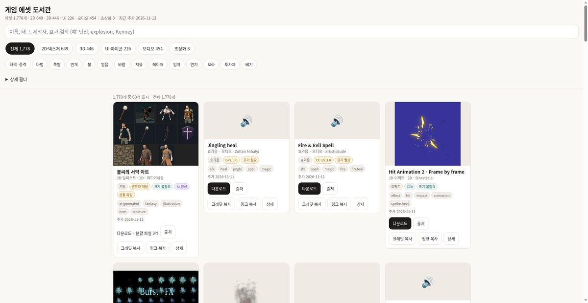

# game-asset-catalog

재사용 가능한 게임 에셋 라이브러리의 중앙 카탈로그입니다.
실제 파일은 유형별 저장소에 두고, 여기에 모든 에셋의 출처·라이선스·작가·장르 태그를 기록합니다.

## 📸 실제 실행 화면

## 2026-11-13 A80 추가 (3팩, 총 1852팩)

A80 라운드에서 OpenGameArt 3D 최신순의 3D 2팩 City Kit (Roads)·Ghost lady model (UNTEXTURED)와 효과음 1팩 Packsmithy SFX sampler: 30 synthesised sound effects(모두 opengameart.org)를 수집했습니다. 중복은 저장소 raw 경로와 카탈로그 코드 검색으로 팩 슬러그를 확인했습니다.

| 팩 | 라이선스 |
| --- | --- |
| City Kit (Roads) | CC0 |
| Ghost lady model (UNTEXTURED) | CC-BY 4.0 |
| Packsmithy SFX sampler: 30 synthesised sound effects | CC-BY 4.0 |

종류: 3D 2팩(assets-3d-lowpoly; 환경/모듈 1·캐릭터 1), 효과음 1팩(assets-audio). 라이선스: CC0 1팩, CC-BY 4.0 2팩. AI 생성 명시 팩 없음. 팩당 1커밋(에셋: <팩 이름> 추가, 임시 워크플로 batch-ingest.yml 수동 실행). 용량: assets-3d-lowpoly 약 612MB, assets-audio 약 385MB(700MB 미만, 새 저장소 생성 없음). 색인(assets-index*.json)·위키·llms.txt는 직접 손대지 않고 Actions 자동 갱신에 맡김. '천하삼분 게임 에셋 56'은 수집 대상이 아님.

## 2026-11-13 A79 추가 (4팩, 총 1849팩)

A79 라운드에서 OpenGameArt 3D 최신순의 3D 3팩 Cremation Urn·Sumo Arena·Character Guy (Rigged)와 효과음 1팩 Cozy Space SFX: 46 Retro Sound Effects(모두 opengameart.org)를 수집했습니다. 중복은 카탈로그 저장소 코드 검색으로 제목을 확인했습니다(모두 0건, 신규).

| 팩 | 라이선스 |
| --- | --- |
| Cremation Urn | CC0 |
| Sumo Arena | CC0 |
| Character Guy (Rigged) | CC0 |
| Cozy Space SFX: 46 Retro Sound Effects | CC-BY 4.0 |

종류: 3D 3팩(assets-3d-lowpoly; 소품 1·환경 1·캐릭터 1), 효과음 1팩(assets-audio). 라이선스: CC0 3팩, CC-BY 4.0 1팩. AI 생성 명시 팩 없음. 팩당 1커밋(에셋: <팩 이름> 추가, 임시 워크플로 ingest-pack.yml 수동 실행). 용량: GitHub API size 기준 assets-3d-lowpoly 약 610MB(700MB 미만), assets-audio 약 383MB, 새 저장소 생성 없음. 색인(assets-index*.json)·위키·llms.txt는 손대지 않고 Actions 자동 갱신에 맡김. '천하삼분 게임 에셋 56'은 수집 대상이 아님.
## 2026-11-13 A78 추가 (4팩, 총 1845팩)

A78 라운드에서 OpenGameArt 3D 최신순의 3D 3팩 Lock·Stylized Coin·Dice와 효과음 1팩 Pocket Bleeps – 31 Retro 8-Bit SFX(모두 opengameart.org)를 수집했습니다. 중복은 라이브러리 검색(https://sigco3111.github.io/game-asset-catalog/)에서 제목으로 확인했습니다(모두 신규; low poly iron ore·Mini Dungeon·flash bang sound·Pixel art sword slash effect·Spark effect는 이미 수록되어 제외; Cartoon Character(s)는 zip 30.9MB로 제외). 4팩 모두 5MB 이하라 저장소 트리에 올렸습니다.

| 팩 | 라이선스 |
| --- | --- |
| Lock | CC0 |
| Stylized Coin | CC0 |
| Dice | CC0 |
| Pocket Bleeps – 31 Retro 8-Bit SFX | CC-BY 4.0 |

종류: 3D 3팩(assets-3d-lowpoly; 소품 3), 효과음 1팩(assets-audio). 라이선스: CC0 3팩, CC-BY 4.0 1팩. AI 생성 명시 팩 없음. 팩당 1커밋(에셋: <팩 이름> 추가, 임시 워크플로 ingest-pack.yml 수동 실행). 용량(GitHub API size): assets-3d-lowpoly 약 608MB(700MB 미만), assets-audio 약 381MB, 새 저장소 생성 없음. 색인(assets-index*.json)·위키·llms.txt는 손대지 않고 Actions 자동 갱신에 맡김. '천하삼분 게임 에셋 56'은 수집 대상이 아님.
## 2026-11-13 A77 추가 (3팩, 총 1841팩)

A77 라운드에서 OpenGameArt 3D 최신순의 3D 3팩 Rail Post·Humanoid SoulsLike Animations·B-chan(모두 opengameart.org)을 수집했습니다. 중복은 라이브러리 검색(https://sigco3111.github.io/game-asset-catalog/)에서 제목으로 확인했습니다(모두 신규; Swinging blade trap·Wooden crate·Germanic style castle·desert castle/tower·Chibi Neko·Bird Bath·Asian Girl·Bald Man·Basic Female·Pine Tree·Mushroom Enemy·Mini Shop는 이미 수록되어 제외; A5 Carbine·P50 Heavy Pistol·R90 Bullpup SMG는 CC-BY 4.0이지만 AI 협업 아트워크 표기 또는 파일 미제공으로 제외; Low Poly Medieval Models 163 CC0는 파일 미제공으로 제외; 효과음 IgnisForge Free SFX Sampler는 원본 파일 내려받기가 실패해 이번 라운드에서 제외). 3팩 모두 CC0이며 zip 또는 25MB 이하 파일이라 저장소 트리에 올렸습니다.

| 팩 | 라이선스 |
| --- | --- |
| [Rail Post](https://opengameart.org/content/rail-post) | CC0 |
| [Humanoid SoulsLike Animations](https://opengameart.org/content/humanoid-soulslike-animations) | CC0 |
| [B-chan](https://opengameart.org/content/b-chan) | CC0 |

종류: 3D 3팩(assets-3d-lowpoly; 소품 1·애니메이션 1·캐릭터 1). 라이선스: CC0 3팩. AI 생성 명시 팩 없음. 팩당 1커밋(에셋: <팩 이름> 추가, 임시 워크플로 ingest-pack.yml 수동 실행). 용량(GitHub API size): assets-3d-lowpoly 약 590MB(700MB 미만), 새 저장소 생성 없음. 색인(assets-index*.json)·위키·llms.txt는 손대지 않고 Actions 자동 갱신에 맡김. '천하삼분 게임 에셋 56'은 수집 대상이 아님.
## 2026-11-13 A76 추가 (3팩, 총 1838팩)

A76 라운드에서 OpenGameArt 3D 최신순의 3D 2팩 Mini Rocket·3D Sara - Wizard와 2D 마법 이펙트 최신순의 Animated Charged Bolt(모두 opengameart.org)를 수집했습니다. 중복은 라이브러리 검색(https://sigco3111.github.io/game-asset-catalog/)에서 제목으로 확인했고(모두 신규; Mini Shop·Mini Forest·Modular Cave Kit·Pine Tree·Mushroom Enemy·Weapon Slash - Effect·Earth Impact - Magic Effect·Tiny Magic Glyphs·Pure Projectile·150 Combat Sound Effects는 이미 수록되어 제외, Dungeon Building Kit은 tar.gz 31.4MB라 이번 라운드에서 제외), 각 페이지의 라이선스 표기·파일·AI 언급 여부를 확인했습니다(AI 생성 언급 없음). 3팩 모두 zip 5MB 이하라 저장소 트리에 올렸습니다.

| 팩 | 라이선스 |
| --- | --- |
| [Mini Rocket](https://opengameart.org/content/mini-rocket) | CC0 |
| [3D Sara - Wizard](https://opengameart.org/content/3d-sara-wizard) | CC-BY 3.0 |
| [Animated Charged Bolt](https://opengameart.org/content/animated-charged-bolt) | CC-BY 4.0 |

종류: 3D 2팩(assets-3d-lowpoly; 무기 소품 1·캐릭터 1), 2D 이펙트 1팩(assets-2d-pixel). 라이선스: CC0 1팩, CC-BY 3.0 1팩, CC-BY 4.0 1팩. AI 생성 명시 팩 없음. 팩당 1커밋(에셋: <팩 이름> 추가, 임시 워크플로 ingest-pack.yml 수동 실행). 용량(GitHub API size): assets-3d-lowpoly 약 566MB, assets-2d-pixel 약 379MB(모두 700MB 미만), 새 저장소 생성 없음. 색인(assets-index*.json)·위키·llms.txt는 손대지 않고 Actions 자동 갱신에 맡김. '천하삼분 게임 에셋 56'은 수집 대상이 아님.
## 2026-11-13 A75 추가 (3팩, 총 1835팩)

A75 라운드에서 OpenGameArt 3D 최신순 목록의 3D 2팩 Asian Girl·Space port kit와 2D 최신순의 폭발 이펙트 1팩 512x512 explosion(모두 opengameart.org)을 수집했습니다. 중복은 라이브러리 검색(https://sigco3111.github.io/game-asset-catalog/)에서 제목으로 확인했고(모두 신규), 각 페이지의 라이선스 표기·파일·AI 언급 여부를 읽어 확인했습니다(AI 생성 언급 없음). 512x512 explosion의 zip은 7.2MB라 Releases v4.0 첨부로 올렸고, 나머지 2팩은 저장소 트리에 올렸습니다.

| 팩 | 라이선스 |
| --- | --- |
| [Asian Girl](https://opengameart.org/content/asian-girl) | CC-BY 4.0 |
| [Space port kit](https://opengameart.org/content/space-port-kit) | CC-BY 4.0 |
| [512x512 explosion](https://opengameart.org/content/512x512-explosion) | CC0 |

종류: 3D 2팩(assets-3d-lowpoly; 캐릭터 1·환경 1), 2D 이펙트 1팩(assets-2d-pixel). 라이선스: CC-BY 4.0 2팩, CC0 1팩. AI 생성 명시 팩 없음. 팩당 1커밋(에셋: <팩 이름> 추가, 임시 워크플로 ingest-pack.yml 수동 실행). 색인(assets-index*.json)·위키·llms.txt는 손대지 않고 Actions 자동 갱신에 맡김. '천하삼분 게임 에셋 56'은 수집 대상이 아님.
## 2026-11-13 A74 추가 (3팩, 총 1832팩)

소유자의 짧은 수집 라운드(3~4팩) 지시로 3D 2팩 Bird Bath·Medieval Castle Manor와 마법·불 이펙트 1팩 Lava Waves(모두 opengameart.org)를 수집했습니다. 중복은 라이브러리 검색(https://sigco3111.github.io/game-asset-catalog/)에서 제목으로 확인했고(후보 Vehicles Assets pt1·Modular Village·5x Special Effects - 2D·PSX Style Cars·Germanic style castle·Chibi Neko 등은 이미 수록되어 제외), 각 페이지의 라이선스 표기·파일·AI 언급 여부를 읽어 확인했습니다(AI 생성 언급 없음). 3팩 모두 zip 5MB 이하라 저장소 트리에 올렸습니다.

| 팩 | 라이선스 |
| --- | --- |
| [Bird Bath](https://opengameart.org/content/bird-bath) | CC0 |
| [Medieval Castle Manor](https://opengameart.org/content/medieval-castlemanor) | CC0 |
| [Lava Waves](https://opengameart.org/content/lava-waves) | CC0 |

종류: 3D 2팩(assets-3d-lowpoly; 소품 1·건물 1), 2D 이펙트 1팩(assets-2d-pixel). 라이선스: CC0 3팩. AI 생성 명시 팩 없음. 팩당 1커밋(에셋: <팩 이름> 추가, 임시 워크플로 ingest-pack.yml 수동 실행). 용량(GitHub API size): assets-3d-lowpoly 약 560MB, assets-2d-pixel 약 330MB(모두 700MB 미만), 새 저장소 생성 없음. 색인(assets-index*.json)·위키·llms.txt는 손대지 않고 Actions 자동 갱신에 맡김. '천하삼분 게임 에셋 56'은 수집 대상이 아님.

## 2026-11-13 A73 추가 (3팩, 총 1829팩)

소유자의 짧은 수집 라운드(3~4팩, 약 15분) 지시로 3D 3팩 Oozey the Slime·Elemental Golem·Armadillo Foe(모두 opengameart.org)를 수집했습니다. 시작 전 library index와 catalog.csv에서 제목·source_url로 중복이 없음을 확인했고(모두 신규), 각 페이지의 라이선스 표기·파일·AI 언급 여부를 읽어 확인했습니다(AI 생성 언급 없음). 3팩 모두 zip 5MB 이하라 저장소 트리에 올렸습니다.

| 팩 | 라이선스 |
| --- | --- |
| [Oozey the Slime](https://opengameart.org/content/oozey-the-slime) | CC-BY 3.0 |
| [Elemental Golem](https://opengameart.org/content/elemental-golem) | CC-BY 3.0 |
| [Armadillo Foe](https://opengameart.org/content/armadillo-foe) | CC0 |

종류: 3D 3팩(assets-3d-lowpoly; 몬스터 3). 라이선스: CC-BY 3.0 2팩, CC0 1팩. AI 생성 명시 팩 없음. 팩당 1커밋(에셋: <팩 이름> 추가, 임시 워크플로 ingest-pack.yml 수동 실행). 용량(GitHub API size): assets-3d-lowpoly 약 560MB(700MB 미만), 새 저장소 생성 없음. 색인(assets-index*.json)·위키·llms.txt는 손대지 않고 Actions 자동 갱신에 맡김. 미수집: Rock Golem(페이지 파일이 .blend 단일이라 zip 아님), 80 CC0 RPG SFX·20 Sword Sound Effects·Gothicvania Magic Pack 9(모두 이미 카탈로그에 있음). '천하삼분 게임 에셋 56'은 수집 대상이 아님.

## 2026-11-13 A72 추가 (3팩, 총 1826팩)

3D 2팩(Modular Dungeon 2 - 3D Models, Base Human Models (Low Poly) — 모두 opengameart.org)과 타격 이펙트 1팩(Weapon Slash - Effect, assets-2d-pixel)을 수집했습니다. 라이선스는 CC0 2팩, CC-BY 3.0 1팩이며 CC-BY 팩에는 CREDITS.txt를 동봉했습니다. 중복은 assets-index.min.json·catalog.csv에서 제목과 source_url로 확인했습니다(모두 신규).

## 2026-11-12 A71 추가 (3팩, 총 1823팩)

소유자의 짧은 수집 라운드(3~4팩, 약 14분) 지시로 A70에서 보류한 2D 이펙트 후보 Pixel Art Explosion Animation과, OpenGameArt 3D Art 인기순에서 새로 찾은 3D 2팩 Destroyed Walls - 3D models·Bone Golem(모두 opengameart.org)을 수집했습니다. 시작 전 library index(assets-index.min.json 1820팩)와 catalog.csv(1820행)에서 제목과 source_url로 3개 모두 없음을 확인했고, 각 페이지의 라이선스 표기·파일 크기·AI 언급 여부를 읽어 확인했습니다(AI 생성 언급 없음). 3팩 모두 zip 5MB 이하라 저장소 트리에 올렸습니다. Pixel Art Explosion Animation은 페이지에 zip이 없어 PNG 2개를 바이트 그대로 무압축 zip으로 묶었고, 나머지 2팩은 페이지 zip을 수정 없이 보관했습니다.

| 팩 | 저장소 | 제작 | 라이선스 | 비고 |
| --- | --- | --- | --- | --- |
| [Destroyed Walls - 3D models](https://github.com/sigco3111/assets-3d-lowpoly/tree/main/destroyed-walls-3d-models) | assets-3d-lowpoly | LFA | CC-BY 3.0 | 파괴된 벽 3D 모델(텍스처·UV 포함) FBX 1 + Maya MA 1 + OBJ 2 + 텍스처 BMP 2, zip 1개 3.21MB(페이지 zip 그대로); 페이지 CC-BY 3.0 단독; 귀속 필수(CREDITS.txt); AI 생성 아님 |
| [Bone Golem](https://github.com/sigco3111/assets-3d-lowpoly/tree/main/bone-golem) | assets-3d-lowpoly | Mophs | CC-BY 3.0 | 핸드페인트 뼈 골렘 몬스터(약 4k 삼각형) OBJ 1 + 디퓨즈 텍스처 PNG 1, zip 1개 0.48MB(페이지 OBJ zip 그대로); 페이지 CC-BY 3.0 / GPL 3.0 병기 → CC-BY 3.0 선택; 귀속 필수(CREDITS.txt); AI 생성 아님 |
| [Pixel Art Explosion Animation](https://github.com/sigco3111/assets-2d-pixel/tree/main/pixel-art-explosion-animation) | assets-2d-pixel | 9KeyStudio | CC0 | 픽셀 폭발 애니메이션 스프라이트시트 2종(Large 128x128·Medium 64x64, 6프레임) PNG 2, zip 1개 0.04MB(무압축 zip); 페이지 CC0 단독; 귀속 불필요(페이지에 크레딧 요청 있음); AI 생성 아님 |

종류: 3D 2팩(assets-3d-lowpoly; 환경 1·몬스터 1), 2D 이펙트 1팩(assets-2d-pixel). 라이선스: CC0 1팩, CC-BY 3.0 2팩. AI 생성 명시 팩 없음. 팩당 1커밋(에셋: <팩 이름> 추가; 새 폴더 주소(/upload/main/<폴더>)에서 대소문자를 유지하는 File 객체로 첨부), 업로드 후 저장소 파일 14개를 로컬과 git blob 해시로 대조해 모두 일치. 용량(GitHub API size): assets-3d-lowpoly 약 558MB, assets-2d-pixel 약 370MB(모두 700MB 미만), 새 저장소 생성 없음. 색인(assets-index*.json)·위키·llms.txt는 손대지 않고 Actions 자동 갱신에 맡김. 미수집: Fantasy Sound Effects Library(CC-BY 3.0, 31MB, assets-audio 릴리스 필요해 보류), 3rd person blender sci-fi pack(CC0이나 zip 33.2MB로 파일 한도 25MB 초과), Sheep (rigged, textured and animated)·Sci-Fi light tank·Magic Sword·Spell Book Pack(CC-BY-SA 3.0 단독이라 제외), 시간상 보류한 후보: Oozey the Slime·Rock Golem·Elemental Golem·Scifi plane·Turret(CC-BY 3.0)과 3d old jeep(GPL 병기). '천하삼분 게임 에셋 56'은 수집 대상이 아님.

실제 팩 수(catalog.csv 기준): 2D 654 · 3D 476 · UI/아이콘 226 · 오디오 462 · 기타 5 (합계 1826).

## 2026-11-12 A70 추가 (4팩, 총 1820팩)

소유자의 짧은 수집 라운드(3~4팩, 약 14분) 지시로 A69에서 보류한 3D 후보 Wizard·Crate와 효과음 Short impact, OpenGameArt 2D Art 이펙트 검색에서 새로 찾은 Basic Pixel Animated Spells(모두 opengameart.org)를 수집했습니다. 시작 전 library index(assets-index.min.json 1816팩)와 catalog.csv(1816행)에서 제목과 source_url로 4개 모두 없음을 확인했고, 각 페이지의 라이선스 표기·파일 크기·AI 언급 여부를 읽어 확인했습니다(전부 페이지 단독 표기, AI 생성 언급 없음). Wizard(zip 25.64MB)는 5MB를 넘어 docs/capacity.md 규칙 1에 따라 assets-3d-lowpoly 릴리스 v9.1의 첨부로 추가했고(업로드 후 크기 26,881,599바이트가 로컬과 일치, 릴리스 설명에 한 줄 추가), 폴더에는 pack.md·preview.gif·LICENSE-SOURCE.txt·CREDITS.txt만 둡니다. 나머지 3팩은 저장소 트리에 올렸습니다. Crate는 페이지 파일이 7z라 해제한 뒤 내용 파일을 수정 없이 zip으로 다시 묶었습니다.

| 팩 | 저장소 | 제작 | 라이선스 | 비고 |
| --- | --- | --- | --- | --- |
| [Wizard](https://github.com/sigco3111/assets-3d-lowpoly/tree/main/wizard) | assets-3d-lowpoly | AnthonyMyers | CC-BY 3.0 | 리깅·애니메이션된 마법사 캐릭터(지팡이·검 포함) Blend 1 + OBJ 2 + 3DS 1 + MTL 2 + 텍스처 PNG 4·BMP 5, zip 1개 25.64MB(페이지 zip 그대로, 릴리스 v9.1 첨부); 페이지 CC-BY 3.0 단독; 귀속 필수(CREDITS.txt); AI 생성 아님 |
| [Crate](https://github.com/sigco3111/assets-3d-lowpoly/tree/main/crate) | assets-3d-lowpoly | Kutejnikov | CC0 | 손그림 텍스처 나무 상자(12 삼각형) Blend 1 + FBX 1 + OBJ 1 + MTL 1 + 텍스처 PNG 4 + 2D용 아이소메트릭 렌더 PNG 4, zip 1개 2.54MB(페이지 7z를 해제해 zip으로 재압축, 저장소 트리); 페이지 CC0 단독; 귀속 불필요; AI 생성 아님 |
| [Short impact](https://github.com/sigco3111/assets-audio/tree/main/short-impact) | assets-audio | Soundsnap | GPL 3.0 | 짧은 금속 타격 효과음 WAV 1종(모노 96kHz 24bit, 0.94초), zip 1개 0.27MB(무압축 zip) + sample.wav; 페이지 GPL 3.0 단독; 귀속 필수·카피레프트(LICENSE-GPL-3.0.txt 전문·CREDITS.txt 동봉); AI 생성 아님 |
| [Basic Pixel Animated Spells](https://github.com/sigco3111/assets-2d-pixel/tree/main/basic-pixel-animated-spells) | assets-2d-pixel | beddedOtaku | CC0 | 픽셀 마법 이펙트 4종(불 2·땅·물/얼음, 140x90) GIF 8 + 스프라이트시트 PNG 1 + 원본 PSD 5, zip 1개 76.9KB(페이지 zip 그대로, 저장소 트리); 페이지 CC0 단독; 귀속 불필요; AI 생성 아님 |

종류: 3D 2팩(assets-3d-lowpoly; 캐릭터 1·소품 1), 효과음 1팩(assets-audio), 2D 이펙트 1팩(assets-2d-pixel). 라이선스: CC0 2팩, CC-BY 3.0 1팩, GPL 3.0 1팩. AI 생성 명시 팩 없음. 팩당 1커밋(에셋: <팩 이름> 추가; Wizard의 zip은 먼저 v9.1 릴리스에 올림; 새 폴더 주소(/upload/main/<폴더>)에서 대소문자를 유지하는 File 객체로 첨부), 업로드 후 저장소 파일 19개를 로컬과 git blob 해시로 대조해 모두 일치. assets-audio README 첫 줄의 팩 수(459)를 실제 수(462)로 고쳤고 assets-2d-pixel README의 팩 수도 655로 갱신했습니다(assets-3d-lowpoly README에는 팩 수 줄이 없음). 용량(GitHub API size): assets-3d-lowpoly 약 554MB, assets-2d-pixel 약 370MB, assets-audio 약 381MB(모두 700MB 미만), 새 저장소 생성 없음. 색인(assets-index*.json)·위키·llms.txt는 손대지 않고 Actions 자동 갱신에 맡김. 미수집: Pixel Art Explosion Animation(CC0, PNG 2개 단일 시트라 보류), Fantasy Sound Effects Library(CC-BY 3.0, 31MB, assets-audio 릴리스 필요해 보류). '천하삼분 게임 에셋 56'은 수집 대상이 아님.

실제 팩 수(catalog.csv 기준): 2D 653 · 3D 474 · UI/아이콘 226 · 오디오 462 · 기타 5 (합계 1820).

## 2026-11-12 A69 추가 (4팩, 총 1816팩)

소유자의 짧은 수집 라운드(3~4팩, 약 14분) 지시로 A68에서 보류한 3D 후보 Wooden crate·Undead male과, 최근 두 라운드에 없던 효과음 2팩 Spell 4 (fire)·Shimmer glitter magic(모두 opengameart.org)을 수집했습니다. 시작 전 library index(assets-index.min.json 1812팩)와 catalog.csv(1812행)에서 제목과 source_url로 4개 모두 없음을 확인했고, 각 페이지의 라이선스 표기·파일 크기·AI 언급 여부를 읽어 확인했습니다(AI 생성 언급 없음). Wooden crate(zip 23.97MB)는 5MB를 넘어 docs/capacity.md 규칙 1에 따라 assets-3d-lowpoly 릴리스 v9.1의 첨부로 추가했고(릴리스 설명에 한 줄 추가), 폴더에는 pack.md·preview.png·LICENSE-SOURCE.txt만 둡니다. 나머지 3팩은 저장소 트리에 올렸습니다.

| 팩 | 저장소 | 제작 | 라이선스 | 비고 |
| --- | --- | --- | --- | --- |
| [Wooden crate](https://github.com/sigco3111/assets-3d-lowpoly/tree/main/wooden-crate) | assets-3d-lowpoly | EmoPreben | CC0 | 뚜껑이 느슨한 로우폴리 나무 상자 FBX 1 + 2048 텍스처 PNG 6, zip 1개 23.97MB(페이지 zip 그대로, 릴리스 v9.1 첨부); 페이지 CC0 단독; 귀속 불필요; AI 생성 아님 |
| [Undead male](https://github.com/sigco3111/assets-3d-lowpoly/tree/main/undead-male) | assets-3d-lowpoly | TiZiana | CC-BY 3.0 | 리깅된 언데드 남성 캐릭터(2000+ 삼각형) Blend 1 + 텍스처 PNG 4 + 메모 TXT, zip 1개 0.89MB(페이지 zip 그대로); 페이지 CC-BY 3.0 단독(zip 안 메모는 CC-BY 2.0 표기); 귀속 필수(CREDITS.txt); AI 생성 아님 |
| [Spell 4 (fire)](https://github.com/sigco3111/assets-audio/tree/main/spell-4-fire) | assets-audio | Bart K. | CC-BY 3.0 | 불 주문 효과음 WAV 1종, zip 1개 0.29MB(무압축 zip) + sample.wav; 페이지 CC-BY 3.0 / CC-BY-SA 3.0 / GPL 3.0 / GPL 2.0 / OGA-BY 3.0 병기 → CC-BY 3.0 선택; 귀속 필수(CREDITS.txt); AI 생성 아님 |
| [Shimmer glitter magic](https://github.com/sigco3111/assets-audio/tree/main/shimmer-glitter-magic) | assets-audio | The Berklee College of Music | CC-BY 3.0 | 반짝이는 마법 효과음 FLAC 1종, zip 1개 0.04MB(무압축 zip) + sample.flac; 페이지 CC-BY 3.0 단독; 귀속 필수(CREDITS.txt); AI 생성 아님 |

종류: 3D 2팩(assets-3d-lowpoly; 소품 1·캐릭터 1), 효과음 2팩(assets-audio). 라이선스: CC0 1팩, CC-BY 3.0 3팩. AI 생성 명시 팩 없음. 팩당 1커밋(에셋: <팩 이름> 추가; Wooden crate의 zip은 먼저 v9.1 릴리스에 올림; 새 폴더 주소(/upload/main/<폴더>)에서 대소문자를 유지하는 File 객체로 첨부). 용량(GitHub API size): assets-3d-lowpoly 약 554MB, assets-audio 약 381MB(모두 700MB 미만), 새 저장소 생성 없음. 색인(assets-index*.json)·위키·llms.txt는 손대지 않고 Actions 자동 갱신에 맡김. 미수집: Wizard(AnthonyMyers, CC-BY 3.0, zip 26.9MB, 시간상 보류), Crate(Kutejnikov, CC0, 7z, 보류), Fantasy Sound Effects Library(Little Robot Sound Factory, CC-BY 3.0, zip 31MB, assets-audio 릴리스 필요해 보류), Short impact(GPL 3.0 단독 단일 WAV, 보류). '천하삼분 게임 에셋 56'은 수집 대상이 아님.

실제 팩 수(catalog.csv 기준): 2D 652 · 3D 472 · UI/아이콘 226 · 오디오 461 · 기타 5 (합계 1816).

## 2026-11-12 A68 추가 (3팩, 총 1812팩)

소유자의 짧은 수집 라운드(3~4팩, 약 14분) 지시로 A67에서 보류한 Cc0 crates + wooden pallet과 OpenGameArt 3D Art 상자 검색에서 새로 찾은 Sci-Fi Shipping Crate, 인기 3D 환경 소품 Low-Poly Mushrooms 3팩(모두 opengameart.org, 3D)을 수집했습니다. 시작 전 library index(assets-index.min.json 1809팩)와 catalog.csv(1809행)에서 제목과 source_url로 3개 모두 없음을 확인했고, 각 페이지의 라이선스 표기·파일 크기·AI 언급 여부를 읽어 확인했습니다(전부 페이지 단독 표기, AI 생성 언급 없음). Cc0 crates + wooden pallet(zip 16.07MB)은 5MB를 넘어 docs/capacity.md 규칙 1에 따라 assets-3d-lowpoly 릴리스 v9.1의 첨부로 추가했고(내려받은 파일의 sha256이 로컬과 일치, 릴리스 설명에 한 줄 추가), 폴더에는 pack.md·preview.png·LICENSE-SOURCE.txt만 둡니다. 나머지 2팩은 저장소 트리에 올렸습니다.

| 팩 | 저장소 | 제작 | 라이선스 | 비고 |
| --- | --- | --- | --- | --- |
| [Cc0 crates + wooden pallet](https://github.com/sigco3111/assets-3d-lowpoly/tree/main/cc0-crates-wooden-pallet) | assets-3d-lowpoly | Lucian Pavel | CC0 | 나무 상자 4종 + 나무 팔레트 1종 로우폴리 모델(각 100~200 폴리곤) OBJ·MTL·Blend + 1024 텍스처 PNG, zip 1개 16.07MB(페이지 zip 그대로, 릴리스 v9.1 첨부); 페이지 CC0 단독(Copyright/Attribution Notice: Public Domain); 귀속 불필요; AI 생성 아님 |
| [Sci-Fi Shipping Crate](https://github.com/sigco3111/assets-3d-lowpoly/tree/main/sci-fi-shipping-crate) | assets-3d-lowpoly | David W CG | CC-BY 4.0 | PBR 공상과학 화물 상자 Blend 1 + GLB 1 + 텍스처 PNG 5, zip 1개 2.06MB(페이지 zip 그대로, 저장소 트리); 페이지 CC-BY 4.0 단독; 귀속 필수(CREDITS.txt 동봉); AI 생성 아님 |
| [Low-Poly Mushrooms](https://github.com/sigco3111/assets-3d-lowpoly/tree/main/low-poly-mushrooms) | assets-3d-lowpoly | Clint Bellanger | CC-BY 3.0 | 로우폴리 버섯(각 184 삼각형) 3종 Blend 1 + 텍스처 PNG 2, zip 1개 0.20MB(페이지 zip 그대로, 저장소 트리); 페이지 CC-BY 3.0 단독; 귀속 필수(CREDITS.txt 동봉); AI 생성 아님 |

종류: 3D 3팩(assets-3d-lowpoly; 소품 2·환경 1). 라이선스: CC0 1팩, CC-BY 4.0 1팩, CC-BY 3.0 1팩. AI 생성 명시 팩 없음. 팩당 1커밋(에셋: <팩 이름> 추가; 릴리스 첨부 1개는 먼저 v9.1에 올림; 새 폴더 주소(/upload/main/<폴더>)에서 대소문자를 유지하는 File 객체로 CREDITS.txt·LICENSE-SOURCE.txt 첨부), 업로드 후 저장소 파일 13개와 릴리스 첨부 1개를 로컬과 sha256으로 대조해 모두 일치(첫 팩은 버튼 클릭이 반영되지 않아 커밋 목록·폴더 조회로 미커밋 확인 후 폼 제출로 커밋, 중복 커밋 없음). 용량(GitHub API size): assets-3d-lowpoly 약 549MB(700MB 미만), 새 저장소 생성 없음. 색인(assets-index*.json)·위키·llms.txt는 손대지 않고 Actions 자동 갱신에 맡김. 미수집: Wooden crate(EmoPreben, CC0이나 zip 25.1MB라 시간상 보류), Crate(Kutejnikov, CC0, 7z)는 시간상 보류, Spell Book Pack·Kingdom Weapon Set·Elven Weapon Set(CC-BY-SA 3.0 단독이라 제외), Castle Kit·Fantasy Town Kit(OGA 사본이나 같은 Kenney 팩이 이미 라이브러리에 있음), Wizard·Undead male(CC-BY 3.0, 시간상 보류). '천하삼분 게임 에셋 56'은 수집 대상이 아님.

실제 팩 수(catalog.csv 기준): 2D 652 · 3D 470 · UI/아이콘 226 · 오디오 459 · 기타 5 (합계 1812).

## 2026-11-12 A67 추가 (3팩, 총 1809팩)

소유자의 짧은 수집 라운드(3~4팩, 약 14분) 지시로 A66에서 보류한 3D 후보 Bald Man - Rigged·Basic Female(이상 릴리스)과 새로 찾은 Crate 3(모두 opengameart.org, CC0 단독) 3팩을 수집했습니다. 시작 전 library index와 catalog.csv(1806행)에서 제목과 source_url로 3개 모두 없음을 확인했고, 각 페이지의 라이선스 표기·파일 크기·AI 언급 여부를 읽어 확인했습니다(전부 CC0 단독, AI 생성 언급 없음). Bald Man - Rigged(zip 7.09MB)와 Basic Female(zip 24.76MB)은 5MB를 넘어 docs/capacity.md 규칙 1에 따라 assets-3d-lowpoly 릴리스 v9.1의 첨부로 추가했고(내려받은 파일의 sha256이 로컬과 일치, 릴리스 설명에 두 줄 추가), 폴더에는 pack.md·preview.png·LICENSE-SOURCE.txt만 둡니다. Crate 3(zip 0.46MB)은 저장소 트리에 올렸습니다.

| 팩 | 저장소 | 제작 | 라이선스 | 비고 |
| --- | --- | --- | --- | --- |
| [Bald Man - Rigged](https://github.com/sigco3111/assets-3d-lowpoly/tree/main/bald-man-rigged) | assets-3d-lowpoly | EmoPreben | CC0 | 대머리 남성 캐릭터 FBX 1(Mixamo 리깅, 8.8k 폴리) + 2048 텍스처 PNG 3, zip 1개 7.09MB(페이지 zip 그대로, 릴리스 v9.1 첨부); 페이지 CC0 단독; 귀속 불필요; AI 생성 아님 |
| [Basic Female](https://github.com/sigco3111/assets-3d-lowpoly/tree/main/basic-female) | assets-3d-lowpoly | EmoPreben | CC0 | 기본 여성 캐릭터 FBX 1(Mixamo 리깅, 8.5k 폴리) + 텍스처 PNG 3, zip 1개 24.76MB(페이지 zip 그대로, 릴리스 v9.1 첨부); 페이지 CC0 단독; 귀속 불필요(원하면 "EmoPreben" 크레딧 가능); AI 생성 아님 |
| [Crate 3](https://github.com/sigco3111/assets-3d-lowpoly/tree/main/crate-3) | assets-3d-lowpoly | plaggy | CC0 | 나무 상자 로우폴리 모델 OBJ 1 + DAE 1 + 텍스처 JPG 3 + 미리보기 JPG 1, zip 1개 0.46MB(페이지 zip 그대로, 저장소 트리); 페이지 CC0 단독; 귀속 불필요; AI 생성 아님 |

종류: 3D 3팩(assets-3d-lowpoly; 캐릭터 2·소품 1). 라이선스: CC0 3팩. AI 생성 명시 팩 없음. 팩당 1커밋(에셋: <팩 이름> 추가; 릴리스 첨부 2개는 먼저 v9.1에 올림; 새 폴더 주소(/upload/main/<폴더>)에서 파일 이름 대소문자를 유지하는 File 객체로 LICENSE-SOURCE.txt 첨부), 업로드 후 저장소 파일 10개를 로컬과 sha256으로 대조해 모두 일치. 용량(GitHub API size): assets-3d-lowpoly 약 543MB(700MB 미만), 새 저장소 생성 없음. 색인(assets-index*.json)·위키·llms.txt는 손대지 않고 Actions 자동 갱신에 맡김. 미수집: Cartoon Character(s)(CC-BY 3.0이나 페이지 zip fatman_toon_fbx.zip 30.9MB 안에 FBX 모델이 없고 텍스처 PNG 10개뿐이라 3D 모델 팩으로 부적합), Wooden crate는 같은 이름의 페이지를 찾지 못해 대신 Crate 3 수집(다른 Crate 후보: Crate(Kutejnikov, 7z)·Cc0 crates + wooden pallet(16.1MB)은 시간상 보류). '천하삼분 게임 에셋 56'은 수집 대상이 아님.

실제 팩 수(catalog.csv 기준): 2D 652 · 3D 467 · UI/아이콘 226 · 오디오 459 · 기타 5 (합계 1809).

## 2026-11-12 A66 추가 (4팩, 총 1806팩)

소유자의 짧은 수집 라운드(3~4팩, 약 14분) 지시로 보류 후보 Elemental Charge Effects(2D 이펙트)와 OpenGameArt 3D Art 최신순에서 새로 찾은 3D 3팩(모두 opengameart.org)을 수집했습니다. 시작 전 library index(assets-index.min.json 1802팩)와 catalog.csv(1802행)에서 제목과 source_url로 4개 모두 없음을 확인했고, 각 페이지의 라이선스 표기·파일 크기·AI 언급 여부를 읽어 확인했습니다. 4팩 모두 zip 5MB 이하라 저장소 트리에 올렸습니다.

| 팩 | 저장소 | 제작 | 라이선스 | 비고 |
| --- | --- | --- | --- | --- |
| [Germanic style castle](https://github.com/sigco3111/assets-3d-lowpoly/tree/main/germanic-style-castle) | assets-3d-lowpoly | _Creature_ | CC0 | 독일풍 중세 성 로우폴리 모델(158 삼각형) OBJ 1 + 512x512 텍스처 PNG 1, zip 1개 307.9KB(페이지 zip 그대로); 페이지 CC0 단독; 귀속 불필요(텍스처 일부는 CC0 텍스처 팩 사용, 페이지 명기); AI 생성 아님 |
| [Chibi Neko by cosmix](https://github.com/sigco3111/assets-3d-lowpoly/tree/main/chibi-neko-by-cosmix) | assets-3d-lowpoly | zodiepupper (모델 cosmix) | CC0 | 치비 고양이 소녀 로우폴리 캐릭터 GLB 1 + VRM 아바타 1, zip 1개 111.3KB(페이지 zip 그대로); 페이지 CC0 단독(VRM 메타데이터도 CC0·크레딧 불필요); AI 생성 아님 |
| [desert castle/tower](https://github.com/sigco3111/assets-3d-lowpoly/tree/main/desert-castle-tower) | assets-3d-lowpoly | unForastero | CC0 | 사막 성/탑 로우폴리 모델 FBX 1, zip 1개 399.4KB(페이지 zip 그대로); 페이지 CC0 단독; 귀속 불필요(페이지 Copyright 표기 "credits, Guiliard TB."를 기록); AI 생성 아님 |
| [Elemental Charge Effects](https://github.com/sigco3111/assets-2d-pixel/tree/main/elemental-charge-effects) | assets-2d-pixel | Kelvin Shadewing | GPL 3.0 | 원소 차지 이펙트 픽셀아트 스프라이트시트 PNG 9개(32x32 프레임 가로 배열), zip 1개 14.4KB(페이지 zip 그대로); 페이지 GPL 3.0 / CC-BY-SA 4.0 병기 → GPL 3.0 선택; 귀속 필수·카피레프트(LICENSE-GPL-3.0.txt 전문·CREDITS.txt 동봉); AI 생성 아님 |

종류: 3D 3팩(assets-3d-lowpoly; 건물 2·캐릭터 1), 2D 이펙트 1팩(assets-2d-pixel). 라이선스: CC0 3팩, GPL 3.0 1팩. AI 생성 명시 팩 없음. 4커밋(팩당 1커밋: 에셋: <팩 이름> 추가; 새 폴더 주소(/upload/main/<폴더>)에서 파일 이름 대소문자를 유지하는 File 객체로 첨부), 업로드 후 저장소 파일 18개를 로컬과 바이트 단위로 대조해 모두 일치. 용량(GitHub API size): assets-3d-lowpoly 약 543MB, assets-2d-pixel 약 370MB(모두 700MB 미만), 새 저장소 생성 없음. 색인(assets-index*.json)·위키·llms.txt는 손대지 않고 Actions 자동 갱신에 맡김. 미수집: Cloud spark action VFX(OGA에서 해당 주소를 찾지 못함), Lightning Strike(CC0, 벡터 튜토리얼 원본 SVG/PDF/CDR 팩이라 스프라이트가 아님), Bald Man - Rigged·Basic Female·Wooden crate·Cartoon Character(s)(zip 5MB 초과 또는 시간상), P50 Heavy Pistol·A5 Carbine·R90 Bullpup SMG(AI 보조 제작 명시), Low Poly Medieval Models - 163 CC0(AI 코딩 보조 사용 명시, 시간상 미수집). '천하삼분 게임 에셋 56'은 수집 대상이 아님.

실제 팩 수(catalog.csv 기준): 2D 652 · 3D 464 · UI/아이콘 226 · 오디오 459 · 기타 5 (합계 1806).

## 2026-11-12 A65 추가 (4팩, 총 1802팩)

소유자의 짧은 수집 라운드(3~4팩, 약 14분) 지시로 A64 이전에 보류한 후보 중 Swinging blade trap(3D)과 3rd version of Sparkle·Shape Particles(2D 이펙트), 새로 찾은 PSX Style Cars(3D)까지 4팩(모두 opengameart.org)을 수집했습니다. 시작 전 library index(assets-index.min.json 1798팩)와 catalog.csv(1798행)에서 제목과 source_url로 4개 모두 없음을 확인했고, 각 페이지의 라이선스 표기·파일 크기·AI 언급 여부를 읽어 확인했습니다(전부 단독 표기, AI 생성 언급 없음). 4팩 모두 zip 5MB 이하라 저장소 트리에 올렸습니다.

| 팩 | 저장소 | 제작 | 라이선스 | 비고 |
| --- | --- | --- | --- | --- |
| [Swinging blade trap](https://github.com/sigco3111/assets-3d-lowpoly/tree/main/swinging-blade-trap) | assets-3d-lowpoly | Q2DENJINDREW | CC0 | 흔들리는 칼날 함정 로우폴리 모델 glTF 1 + README, zip 1개 24.0KB(페이지 zip 그대로); 페이지 CC0 단독; 귀속 불필요(크레딧 환영); AI 생성 아님 |
| [PSX Style Cars](https://github.com/sigco3111/assets-3d-lowpoly/tree/main/psx-style-cars) | assets-3d-lowpoly | GGBotNet | CC0 | PS1풍 로우폴리 자동차 8종(색상 변형 다수) OBJ·MTL·Blend + 그림자·바퀴 + 효과음 OGG 16, zip 1개 2.49MB(페이지 zip 그대로); 페이지 CC0 단독; 귀속 불필요; AI 생성 아님 |
| [3rd version of Sparkle](https://github.com/sigco3111/assets-2d-pixel/tree/main/3rd-version-of-sparkle) | assets-2d-pixel | davididev | CC-BY 3.0 | 스파클 파티클 스프라이트시트 PNG 1개(768x768), zip 1개 98.3KB(페이지 PNG를 바이트 그대로 무압축 zip으로 묶음); 페이지 CC-BY 3.0 단독; 귀속 필수(페이지 문구 "Sparkle particle by DavidiDev.com", CREDITS.txt); AI 생성 아님 |
| [Shape Particles](https://github.com/sigco3111/assets-2d-pixel/tree/main/shape-particles) | assets-2d-pixel | iyol | CC0 | 8x8 도형 파티클 PNG 1개(사각형·원·별·삼각형·X), zip 1개 1.0KB(페이지 PNG를 바이트 그대로 무압축 zip으로 묶음); 페이지 CC0 단독; 귀속 불필요; AI 생성 아님 |

종류: 3D 2팩(assets-3d-lowpoly; 소품 1·탈것 1), 2D 이펙트 2팩(assets-2d-pixel). 라이선스: CC0 3팩, CC-BY 3.0 1팩. AI 생성 명시 팩 없음. 4커밋(팩당 1커밋: 에셋: <팩 이름> 추가; 새 폴더 주소(/upload/main/<폴더>)에서 파일 이름 대소문자를 유지하는 File 객체로 첨부), 업로드 후 저장소 파일 18개를 로컬과 git blob 해시로 대조해 모두 일치. 용량(GitHub API size): assets-3d-lowpoly 약 543MB, assets-2d-pixel 약 370MB(모두 700MB 미만), 새 저장소 생성 없음. 색인(assets-index*.json)·위키·llms.txt는 손대지 않고 Actions 자동 갱신에 맡김. 미수집: Short impact(검색에서 찾지 못함), Elemental Charge Effects(GPL 3.0 / CC-BY-SA 4.0 병기; GPL 전문 첨부 필요해 보류), Cloud spark action VFX(CC-BY 3.0 등 병기; 팩 수 한도), Lightning Strike(CC0, 벡터 튜토리얼 팩; 팩 수 한도). '천하삼분 게임 에셋 56'은 수집 대상이 아님.

실제 팩 수(catalog.csv 기준): 2D 651 · 3D 461 · UI/아이콘 226 · 오디오 459 · 기타 5 (합계 1802).

## 2026-11-12 A64 추가 (4팩, 총 1798팩)

소유자의 짧은 수집 라운드(3~4팩, 약 14분) 지시로 A63 이전에 보류한 후보 중 low poly iron ore·Pine Tree·Low-poly Swords(이상 3D)와 효과음 Weoh-Weoh-Weoh...(모두 opengameart.org) 4팩을 수집했습니다. 시작 전 library index(assets-index.min.json 1794팩)에서 제목과 source_url로 4개 모두 없음을 확인했고, 각 페이지의 라이선스 표기를 읽어 확인했습니다(전부 단독 표기, AI 생성 언급 없음).

| 팩 | 저장소 | 제작 | 라이선스 | 비고 |
| --- | --- | --- | --- | --- |
| [low poly iron ore](https://github.com/sigco3111/assets-3d-lowpoly/tree/main/low-poly-iron-ore) | assets-3d-lowpoly | musher3004 | CC0 | 로우폴리 철광석 OBJ + MTL + Blend, zip 1개 0.29MB(페이지 zip 그대로); 페이지 CC0 단독; 귀속 불필요 |
| [Pine Tree](https://github.com/sigco3111/assets-3d-lowpoly/tree/main/pine-tree) | assets-3d-lowpoly | trent_taray | CC0 | 로우폴리 소나무(129 삼각형) Blend 1 + 텍스처 PNG 1, zip 1개 0.95MB(페이지 파일을 바이트 그대로 zip으로 묶음); 페이지 CC0 단독; 귀속 불필요 |
| [Low-poly Swords](https://github.com/sigco3111/assets-3d-lowpoly/tree/main/low-poly-swords) | assets-3d-lowpoly | Lamoot | CC-BY 3.0 | 로우폴리 검 6종(각 약 350 삼각형, 텍스처 없음) Blend 1, zip 1개 0.25MB; 페이지 CC-BY 3.0 단독; 귀속 필수(CREDITS.txt) |
| [Weoh-Weoh-Weoh...](https://github.com/sigco3111/assets-audio/tree/main/weoh-weoh-weoh) | assets-audio | viwooh | CC0 | SF·마법용 초현실 효과음 FLAC 1종, zip 1개 0.13MB(무압축 zip) + sample.flac; 페이지 CC0 단독; 귀속 불필요 |

종류: 3D 3팩(assets-3d-lowpoly; 소품 1·환경 1·무기 1), 효과음 1팩(assets-audio). 라이선스: CC0 3팩, CC-BY 3.0 1팩. AI 생성 명시 팩 없음. 4커밋(팩당 1커밋: 에셋: <팩 이름> 추가), 업로드 후 저장소 파일 18개를 로컬과 sha256으로 대조해 모두 일치. 용량: assets-3d-lowpoly 약 538MB, assets-audio 약 380MB(700MB 미만), 새 저장소 생성 없음. 색인(assets-index*.json)·위키·llms.txt는 손대지 않고 Actions 자동 갱신에 맡김. 미수집(시간상): Swinging blade trap, Lightning Strike, Shape Particles, Short impact, 3rd version of Sparkle, Elemental Charge Effects, Cloud spark action VFX (low_poly_swords 슬러그는 404, 실제 slug low-poly-swords).

실제 팩 수(catalog.csv 기준): 2D 649 · 3D 459 · UI/아이콘 226 · 오디오 459 · 기타 5 (합계 1798).

## 2026-11-12 A63 추가 (4팩, 총 1794팩)

소유자의 짧은 수집 라운드(3~4팩, 약 15분) 지시로 A62에서 보류한 3D 후보 Medieval Dungeon – Modular Base Kit (Free)·Sci-Fi Rotary Turret, 새로 찾은 Mushroom Enemy(이상 3D, opengameart.org)와 효과음 Punch SFX(opengameart.org) 4팩을 수집했습니다. 시작 전 library index(assets-index.min.json 1790팩)와 catalog.csv(1790행)에서 제목과 source_url로 4개 모두 없음을 확인했고(던전 키트는 같은 제목의 다른 팩 없음, 기존 Kenney Mini Dungeon·Modular Dungeon Kit·KayKit Dungeon Remastered 등은 별개 팩), 각 팩 페이지의 라이선스 표기·파일 크기·AI 언급 여부를 읽어 확인했습니다. Medieval Dungeon – Modular Base Kit(zip 31.54MB)과 Sci-Fi Rotary Turret(zip 5.14MB)은 5MB를 넘어 docs/capacity.md 규칙 1에 따라 assets-3d-lowpoly 릴리스 v9.1의 첨부로 추가했고(GitHub 표시 sha256이 로컬과 일치, 릴리스 설명에 두 줄 추가), 폴더에는 pack.md·preview.png·LICENSE-SOURCE.txt·CREDITS.txt만 둡니다. Mushroom Enemy(42.9KB)와 Punch SFX(1.88MB)는 저장소 트리에 올렸습니다. 이번 라운드에서 다루지 않은 보류 후보(허용 라이선스, 팩 수 한도): Lightning Strike(CC0, 벡터 튜토리얼 팩), Shape Particles(CC0, 8x8 PNG 1개), Swinging blade trap·Pine Tree·low poly iron ore·low_poly_swords(모두 CC0 3D), Prehistoric car(CC-BY 3.0, .blend 단일 파일). 건너뜀(용량): Dungeon Building Kit(CC0이나 tar.gz 31.4MB 단일 파일로 파일당 25MB 한도 초과 및 zip 아님). 이번에 확인하지 못한 이전 보류 후보(Weoh-Weoh-Weoh, Short impact, 3rd version of Sparkle, Elemental Charge Effects, Cloud spark action VFX)는 그대로 보류. '천하삼분 게임 에셋 56'은 수집 대상이 아님.

| 팩 | 저장소 | 제작 | 라이선스 | 비고 |
| --- | --- | --- | --- | --- |
| [Medieval Dungeon – Modular Base Kit (Free)](https://github.com/sigco3111/assets-3d-lowpoly/tree/main/medieval-dungeon-modular-base-kit-free) | assets-3d-lowpoly | Nodex3D | CC-BY 4.0 | 모듈식 중세 던전 키트 GLB 1개(벽·출입구 벽·모서리 벽·나무 문·바닥·계단·천장 볼트·기둥 8종), zip 1개 31.54MB(페이지 zip 그대로, 릴리스 v9.1 첨부); 페이지 CC-BY 4.0 단독; 귀속 필수(페이지 문구 "Medieval Dungeon – Modular Base Kit by Nodex3D (nodex3d.itch.io)", CREDITS.txt); AI 생성 아님 |
| [Sci-Fi Rotary Turret](https://github.com/sigco3111/assets-3d-lowpoly/tree/main/sci-fi-rotary-turret) | assets-3d-lowpoly | David W CG | CC-BY 4.0 | PBR 공상과학 회전 터릿 Blend 1 + GLB 1 + 텍스처 PNG 3, zip 1개 5.14MB(페이지 zip 그대로, 릴리스 v9.1 첨부); 페이지 CC-BY 4.0 단독; 귀속 필수(페이지에 별도 문구 없어 표준 CC-BY 표기, CREDITS.txt); AI 생성 아님 |
| [Mushroom Enemy](https://github.com/sigco3111/assets-3d-lowpoly/tree/main/mushroom-enemy) | assets-3d-lowpoly | Q2DENJINDREW | CC0 | 로우폴리 버섯 적 몬스터(hide·idle·attack 애니메이션) OBJ·FBX·glTF + 텍스처 PNG, zip 1개 42.9KB(페이지 zip 그대로, 저장소 트리); 페이지 CC0 단독; 귀속 불필요(크레딧 환영); AI 생성 아님 |
| [Punch SFX](https://github.com/sigco3111/assets-audio/tree/main/punch-sfx) | assets-audio | DavidW | CC-BY 4.0 | 펀치·타격 효과음 WAV 9종(스테레오 48kHz 16bit, 0.91~1.31초), zip 1개 1.88MB(페이지 WAV를 바이트 그대로 무압축 zip으로 묶음); 페이지 CC-BY 3.0 / OGA-BY 3.0 / OGA-BY 4.0 / CC-BY 4.0 병기 중 CC-BY 4.0 선택; 귀속 필수(표준 CC-BY 표기, CREDITS.txt); AI 생성 아님 |

종류: 3D 3팩(assets-3d-lowpoly; 모듈 키트 1·무기 1·캐릭터(몬스터) 1), 효과음 1팩(assets-audio). 라이선스: CC-BY 4.0 3팩, CC0 1팩. AI 생성 명시 팩 없음. 4커밋(팩당 1커밋: 에셋: Mushroom Enemy 추가 / 에셋: Medieval Dungeon – Modular Base Kit (Free) 추가 / 에셋: Sci-Fi Rotary Turret 추가 / 에셋: Punch SFX 추가; 새 폴더 주소(/upload/main/<폴더>)에서 파일 이름 대소문자를 유지하는 File 객체로 첨부), 업로드 후 저장소 파일 17개를 로컬과 git blob 해시로 대조해 모두 일치(릴리스 첨부 2개는 GitHub 표시 sha256 일치). 용량(GitHub API size): assets-3d-lowpoly 약 538MB, assets-audio 약 380MB(모두 양호, 700MB 미만; 새 저장소 불필요). 색인(assets-index*.json)·위키는 Actions 자동 갱신에 맡김.

실제 팩 수(catalog.csv 기준): 2D 649 · 3D 456 · UI/아이콘 226 · 오디오 458 · 기타 5 (합계 1794).

## 2026-11-12 A62 추가 (4팩, 총 1790팩)

소유자의 짧은 수집 라운드(3~4팩, 약 15분) 지시로 A61에서 보류한 3D 후보 중 Heavy Tank[extra low poly, RTS]·Locomotive·Wolf Mutant 3D·Energy Sword(모두 opengameart.org, CC0 단독) 4팩을 수집했습니다. 시작 전 library index(assets-index.min.json 1786팩)와 catalog.csv(1786행)에서 제목과 source_url로 4개 모두 없음을 확인했고(Locomotive는 같은 제목의 다른 팩 없음, Modular Train Pack은 Quaternius 별개 팩), 각 팩 페이지의 라이선스 표기·파일 크기·AI 언급 여부를 읽어 확인했습니다. Energy Sword(zip 6.2MB)는 5MB를 넘어 docs/capacity.md 규칙 1에 따라 기존 assets-3d-lowpoly 릴리스 v9.1의 첨부로 추가했고(업로드 후 GitHub 표시 sha256이 로컬과 일치), 폴더에는 pack.md·preview.png·LICENSE-SOURCE.txt만 둡니다. 나머지 3팩의 zip은 5MB 이하라 저장소 트리에 올렸습니다. 이번 라운드에서 다루지 않은 보류 후보(허용 라이선스, 팩 수 한도): Medieval Dungeon – Modular Base Kit (Free)(CC-BY 4.0, zip 33.1MB), Sci-fi Rotary Turret(CC-BY 4.0, 5.4MB), 3D Dungeon Tileset(CC-BY-SA 3.0 / GPL 3.0 병기, zip 24.3MB), Dwarf - fixed(GPL 2.0/3.0 등 병기, zip 38.9MB), KayKit: Dungeon Pack 1.0(구버전). '천하삼분 게임 에셋 56'은 수집 대상이 아님.

| 팩 | 저장소 | 제작 | 라이선스 | 비고 |
| --- | --- | --- | --- | --- |
| [Heavy Tank[extra low poly, RTS]](https://github.com/sigco3111/assets-3d-lowpoly/tree/main/heavy-tank-extra-low-poly-rts) | assets-3d-lowpoly | 32kda | CC0 | 중전차 3D 모델(극저폴리 792 정점, 3색 텍스처) Blend 1 + GLB 1 + PNG 1, zip 1개 0.16MB(페이지 zip 그대로, 저장소 트리); 페이지 CC0 단독; 귀속 불필요(선택: 32kda); AI 생성 아님 |
| [Locomotive](https://github.com/sigco3111/assets-3d-lowpoly/tree/main/locomotive-1) | assets-3d-lowpoly | 32kda | CC0 | 기관차 3D 모델(약 10,300 정점, 텍스처 아틀라스) Blend 1 + GLB 1 + TSCN 1 + PNG 3, zip 1개 3.32MB(페이지 zip 그대로, 저장소 트리); 페이지 CC0 단독; 귀속 불필요(선택: 32kda); AI 생성 아님 |
| [Wolf Mutant 3D](https://github.com/sigco3111/assets-3d-lowpoly/tree/main/wolf-mutant-3d) | assets-3d-lowpoly | Prjsj8guge | CC0 | 늑대 돌연변이 몬스터 FBX 모델 1 + 애니메이션 FBX 3(걷기·타격·점프 공격), zip 1개 0.52MB(페이지 zip 그대로, 저장소 트리); 페이지 CC0 단독; 귀속 불필요; AI 생성 아님 |
| [Energy Sword](https://github.com/sigco3111/assets-3d-lowpoly/tree/main/energy-sword) | assets-3d-lowpoly | ova Xen | CC0 | 에너지 소드 GLB 1 + 텍스처 PNG 2, zip 1개 5.93MB(페이지 zip 그대로, 릴리스 v9.1 첨부); 페이지 CC0 단독; 귀속 불필요(작가 언급 환영); AI 생성 아님 |

종류: 3D 4팩(assets-3d-lowpoly; 탈것 2·캐릭터(몬스터) 1·무기 1). 라이선스: CC0 4팩. AI 생성 명시 팩 없음. 4커밋(팩당 1커밋: 에셋: Heavy Tank[extra low poly, RTS] 추가 / 에셋: Locomotive 추가 / 에셋: Wolf Mutant 3D 추가 / 에셋: Energy Sword 추가; 새 폴더 주소(/upload/main/<폴더>)에서 업로드), 업로드 후 저장소 파일을 로컬과 sha256으로 대조해 일치(릴리스 첨부 1개는 GitHub 표시 sha256 일치). 용량: assets-3d-lowpoly 약 530MB(양호, 700MB 미만; 새 저장소 불필요). 색인(assets-index*.json)·위키는 Actions 자동 갱신에 맡김.

실제 팩 수(catalog.csv 기준): 2D 649 · 3D 453 · UI/아이콘 226 · 오디오 457 · 기타 5 (합계 1790).

## 2026-11-12 A61 추가 (4팩, 총 1786팩)

소유자의 짧은 수집 라운드(3~4팩, 약 15분) 지시로 3D 팩 3팩과 효과음 1팩을 수집했습니다. OpenGameArt 3D 아트 목록(최신순·즐겨찾기순 1~5쪽)에서 카탈로그에 없는 CC0·CC-BY 3D 팩을 골라 각 팩 페이지의 라이선스 표기·파일 크기·AI 언급을 읽어 확인했고, 효과음 1팩은 A60에서 보류한 후보 중에서 골랐습니다. 시작 전 library index(assets-index.min.json 1782팩)와 catalog.csv(1782행)에서 제목과 source_url로 4개 모두 없음을 확인했습니다. 5MB를 넘는 3D zip 2개(8.32MB·17.98MB)는 docs/capacity.md 규칙 1에 따라 assets-3d-lowpoly 새 릴리스 v9.1('CC0·CC-BY 3D 배치 v9.1 (OGA)')의 첨부로 올렸고(업로드 후 sha256이 로컬과 일치), 폴더에는 pack.md·preview·LICENSE-SOURCE.txt(·CREDITS.txt)만 둡니다. 건너뜀(이미 카탈로그에 있음): Castle Kit·Fantasy Town Kit·Mini Shop 등 목록 상위 다수(Kenney·KayKit 팩 포함; KayKit 공식 GitHub 저장소 10개 모두 이미 수록). 건너뜀(라이선스): Animated Character Rabbitman(CC-BY-SA 4.0 단독), 3D Gas Mask Dude(GPL 3.0 / CC-BY-SA 4.0 병기이나 .blend 1개뿐이라 보류). 건너뜀(파일 없음): Low Poly Medieval Models - 163 CC0(페이지가 "File(s) currently unavailable due to potential licensing issues"로 파일을 내렸고 Claude·Gemini 보조 코드 사용을 밝힌 AI 보조 작업물). 보류(허용 라이선스, 팩 수 한도): Medieval Dungeon – Modular Base Kit (Free)(CC-BY 4.0, zip 33.1MB → 릴리스 필요), Heavy Tank(extra low poly RTS)(CC0), Locomotive 1(CC0), Wolf Mutant 3D(CC0), Energy Sword(CC0, zip 6.2MB), Sci-fi Rotary Turret(CC-BY 4.0, 5.4MB), 3D Dungeon Tileset(CC-BY-SA 3.0 / GPL 3.0 병기, zip 24.3MB), Dwarf - fixed(GPL 2.0/3.0 등 병기, zip 38.9MB), KayKit: Dungeon Pack 1.0(CC0, 31MB; A13에서 KayKit Dungeon Remastered의 구버전으로 확인해 제외한 itch.io판과 같은 팩). '천하삼분 게임 에셋 56'은 수집 대상이 아님.

| 팩 | 저장소 | 제작 | 라이선스 | 비고 |
| --- | --- | --- | --- | --- |
| [GDQuest 3D Characters Repository](https://github.com/sigco3111/assets-3d-lowpoly/tree/main/gdquest-3d-characters-repository) | assets-3d-lowpoly | GDQuest / Thibaud Goiffon (OGA 게시: hardboileduser) | CC-BY 4.0 | 애니메이션 캐릭터 GLB 6종(Sophia·GDBot·Gobot·Beetle Bot·Bee Bot·Bat), zip 1개 8.32MB(페이지의 전체 모델 zip 그대로, 릴리스 v9.1 첨부); 페이지 CC-BY 4.0 단독; 귀속 필수(페이지 문구를 CREDITS.txt에 기록); AI 생성 아님 |
| [Horror Monster](https://github.com/sigco3111/assets-3d-lowpoly/tree/main/horror-monster) | assets-3d-lowpoly | EmoPreben | CC0 | 공포 몬스터 FBX 1개(Mixamo 리깅) + 텍스처 PNG 3개, zip 1개 17.98MB(페이지 zip 그대로, 릴리스 v9.1 첨부); 페이지 CC0 단독; 귀속 불필요; AI 생성 아님 |
| [Ultimate 3D Car Assets Pack (w Interiors and Animations)](https://github.com/sigco3111/assets-3d-lowpoly/tree/main/ultimate-3d-car-assets-pack) | assets-3d-lowpoly | Lyricsz | CC0 | 자동차 20종(Blend 1 + FBX 20 + GLB 20, 인테리어·애니메이션 1종 포함), zip 1개 1.61MB(페이지 zip 그대로, 저장소 트리); 페이지 CC0 단독; 귀속 불필요; AI 생성 아님 |
| [flash bang sound](https://github.com/sigco3111/assets-audio/tree/main/flash-bang-sound) | assets-audio | teeeece | CC0 | 섬광탄 효과음 WAV 1종(모노 44.1kHz 16bit, 약 6.4초), zip 1개 549.9KB(페이지 WAV를 바이트 그대로 무압축 zip으로 묶음); 페이지 CC0 단독; 귀속 불필요; AI 생성 아님 |

종류: 3D 3팩(assets-3d-lowpoly; 캐릭터 2·탈것 1), 효과음 1팩(assets-audio). 라이선스: CC0 3팩, CC-BY 4.0 1팩. AI 생성 명시 팩 없음. 4커밋(팩당 1커밋: 에셋: GDQuest 3D Characters Repository 추가 / 에셋: Horror Monster 추가 / 에셋: Ultimate 3D Car Assets Pack (w Interiors and Animations) 추가 / 에셋: flash bang sound 추가; 새 폴더 주소(/upload/main/<폴더>)에서 파일 이름 대소문자를 유지하는 File 객체로 첨부), 업로드 후 저장소 파일을 로컬과 sha256으로 대조해 4팩 모든 파일(저장소 15개) 일치. 용량: assets-3d-lowpoly 약 528MB, assets-audio 약 378MB(모두 양호, 700MB 미만; 새 저장소 불필요). 색인(assets-index*.json)·위키는 Actions 자동 갱신에 맡김.

실제 팩 수(catalog.csv 기준): 2D 649 · 3D 449 · UI/아이콘 226 · 오디오 457 · 기타 5 (합계 1786).

## 2026-11-12 A60 추가 (4팩, 총 1782팩)

소유자의 짧은 수집 라운드(3~4팩, 약 14분) 지시로 OpenGameArt 검색(2D 아트·효과음; impact·hit·magic·spell·explosion·laser·lightning·particle·sfx 등, 최신순)에서 카탈로그에 없는 레이저·불꽃 효과음 2팩과 번개·폭발 이펙트 스프라이트 2팩을 수집했습니다. 시작 전 library index(assets-index.min.json 1778팩)와 catalog.csv(1778행)에서 제목과 source_url로 4개 모두 없음을 확인했고, 각 팩 페이지의 라이선스 표기와 파일 크기(모두 파일당 25MB 이하, zip 5MB 이하라 저장소 트리에 직접 올림)를 읽어 확인했습니다. 건너뜀(이미 카탈로그에 있음): 검색 결과 대부분(최근 라운드 팩 포함). 건너뜀(라이선스): Long Deep Impact(CC-BY-SA 4.0 단독), Crystal voices(CC-BY-SA 3.0 단독). 건너뜀(용량): Impacts/Gun/sfx(CC0, zip 12.5MB로 5MB 초과 → 릴리스 업로드가 필요해 짧은 라운드에서 보류), Medieval sound effects - Weapon impacts(파일 25MB 초과). 보류(허용 라이선스, 팩 수 한도): Lightning Strike(CC0, 벡터 튜토리얼 팩), Shape Particles(CC0), Flash bang sound(CC0), Weoh-Weoh-Weoh(CC0, FLAC), Short impact(GPL 3.0), Punch SFX(CC-BY 4.0 등 병기), 3rd version of Sparkle(CC-BY 3.0). '천하삼분 게임 에셋 56'은 수집 대상이 아님.

| 팩 | 저장소 | 제작 | 라이선스 | 비고 |
| --- | --- | --- | --- | --- |
| [Laser Sound Effects](https://github.com/sigco3111/assets-audio/tree/main/laser-sound-effects) | assets-audio | EZduzziteh | CC0 | 레이저 발사 효과음 MP3 6종 + 데모 MP3 1종(스테레오 48kHz 128kbps, 0.14~0.9초), zip 1개 30.4KB(페이지 MP3를 바이트 그대로 무압축 zip으로 묶음); 페이지 CC0 단독; 귀속 불필요; AI 생성 아님 |
| [Synthesized Fire Sound Effect](https://github.com/sigco3111/assets-audio/tree/main/synthesized-fire-sound-effect) | assets-audio | Spring Spring | CC0 | 합성 불꽃·타오르는 소리 효과음 MP3 1종(스테레오 48kHz 128kbps, 약 8초), zip 1개 0.12MB(페이지 MP3를 바이트 그대로 무압축 zip으로 묶음); 페이지 CC0 단독; 귀속 불필요; AI 생성 아님 |
| [Lightning (low quality)](https://github.com/sigco3111/assets-2d-pixel/tree/main/lightning-low-quality) | assets-2d-pixel | cogitollc | CC0 | 번개 이미지 PNG 2개(351x945·543x919 RGBA) + Inkscape 원본 SVG 1개, zip 1개 0.54MB(페이지 파일을 바이트 그대로 무압축 zip으로 묶음); 페이지 CC0 단독; 귀속 불필요; AI 생성 아님 |
| [Explolsion V2](https://github.com/sigco3111/assets-2d-pixel/tree/main/explolsion-v2) | assets-2d-pixel | davididev | CC-BY 3.0 | 폭발 파티클 스프라이트시트 PNG 1개(768x768 RGBA), zip 1개 236.5KB(페이지 PNG를 바이트 그대로 무압축 zip으로 묶음); 페이지 CC-BY 3.0 단독; 귀속 필수(페이지 문구 "Attribute davididev or davididev.com if you use this", CREDITS.txt 동봉); AI 생성 아님 |

종류: 효과음 2팩(assets-audio), 2D 이펙트 2팩(assets-2d-pixel). 라이선스: CC0 3팩, CC-BY 3.0 1팩. AI 생성 명시 팩 없음. 4커밋(팩당 1커밋: 에셋: Laser Sound Effects 추가 / 에셋: Synthesized Fire Sound Effect 추가 / 에셋: Lightning (low quality) 추가 / 에셋: Explolsion V2 추가; 새 폴더 주소(/upload/main/<폴더>)에서 파일 이름 대소문자를 유지하는 File 객체로 첨부), 업로드 후 저장소 파일을 로컬과 git blob 해시로 대조해 4팩 모든 파일(저장소 17개) 일치. 용량: assets-2d-pixel 약 369MB, assets-audio 약 379MB(모두 양호). 색인(assets-index*.json)·위키는 Actions 자동 갱신에 맡김.

실제 팩 수(catalog.csv 기준): 2D 649 · 3D 446 · UI/아이콘 226 · 오디오 456 · 기타 5 (합계 1782).

## 2026-11-11 A59 추가 (4팩, 총 1777팩)

소유자의 짧은 수집 라운드(3~4팩, 약 14분) 지시로 OpenGameArt 검색(2D 아트·효과음; impact·hit·slash·spell·magic·heal·laser·lightning·shield·buff·particles·sfx·burst·vfx 등, 최신순·즐겨찾기순)에서 카탈로그에 없는 폭발·타격 이펙트 스프라이트 2팩과 주문·치유 효과음 2팩을 수집했습니다. 시작 전 library index(assets-index.min.json 1773팩)와 catalog.csv(1773행)에서 제목과 source_url로 4개 모두 없음을 확인했고, 각 팩 페이지의 라이선스 표기와 파일 크기(모두 파일당 25MB 이하, zip 5MB 이하라 저장소 트리에 직접 올림)를 읽어 확인했습니다. 건너뜀(라이선스): Elemental Charge Effects(GPL 3.0 허용이나 14KB 소형 팩이라 이번 라운드 팩 수 한도로 보류), Imagindar Abilities Sound Effects Pack(CC-BY-SA 4.0 단독), Time Magic 등 CC-BY-SA 단독 팩, Pixel Animated vFXs(CC0이나 PSD 1개뿐), Cloud spark action VFX(허용 라이선스 병기이나 팩 수 한도로 보류). 건너뜀(용량): Sprite effects part 1·2(CC0, 파일당 84~101MB), Sci-fi effects(CC-BY 3.0 / GPL 3.0, zip 34.1MB), Medieval sound effects - Weapon impacts(CC0, 7z 82.1·73.8MB), Fantasy Sound Effects Library(CC-BY 3.0, zip 31MB), Spell animation spritesheets(41.7MB), RPG VFX pack(7z 41.6MB)는 파일 25MB 한도 초과. 건너뜀(이미 카탈로그에 있음): AlotofImpacts 시리즈 20팩. '천하삼분 게임 에셋 56'은 수집 대상이 아님.

| 팩 | 저장소 | 제작 | 라이선스 | 비고 |
| --- | --- | --- | --- | --- |
| [Burst fx](https://github.com/sigco3111/assets-2d-pixel/tree/main/burst-fx) | assets-2d-pixel | ashishlko11 | CC-BY 4.0 | 폭발·버스트 이펙트 애니메이션 프레임 PNG 32개(256x256 RGBA) + 미리보기 GIF 1개 + 전체 스프라이트시트 PNG 1개(2048x1024), zip 1개 3.01MB(페이지 zip 원본 그대로, 파일명만 변경); 페이지 CC-BY 4.0 / CC-BY 3.0 / CC-BY-SA 4.0 / CC-BY-SA 3.0 병기 중 CC-BY 4.0 선택; 귀속 필수(페이지 문구 "Credits required", CREDITS.txt); AI 생성 아님 |
| [Hit Animation 2 - Frame by frame](https://github.com/sigco3111/assets-2d-pixel/tree/main/hit-animation-2-frame-by-frame) | assets-2d-pixel | Sinestesia | CC0 | 타격(hit) 이펙트 스프라이트 시트 PNG 1개(4096x4096 RGBA, 프레임 1024x1024 x 16), zip 1개 2.15MB(페이지 PNG를 바이트 그대로 무압축 zip으로 묶음); 페이지 CC0 단독; 귀속 불필요(선택: Sinestesia, 페이지의 멘션 요청); AI 생성 아님 |
| [Fire & Evil Spell](https://github.com/sigco3111/assets-audio/tree/main/fire-evil-spell) | assets-audio | artisticdude | CC-BY 3.0 | 불꽃·사악한 주문 시전 효과음 AIFF 2종(44.1kHz 16bit 스테레오, 1.37초·0.70초), zip 1개 0.26MB(페이지 7z를 풀어 원본 파일을 수정 없이 deflate zip으로 다시 묶음); 페이지 CC-BY 3.0 단독; 귀속 필수(페이지에 별도 귀속 문구 없어 표준 CC-BY 표기, CREDITS.txt); AI 생성 아님 |
| [Jingling heal](https://github.com/sigco3111/assets-audio/tree/main/jingling-heal) | assets-audio | Zoltan Mihalyi | GPL 3.0 | 딸랑이는 치유 효과음 MP3 1종(스테레오 44.1kHz 128kbps, 약 1.3초), zip 1개 0.02MB(페이지 MP3를 바이트 그대로 무압축 zip으로 묶음); 페이지 CC-BY-SA 3.0 / GPL 3.0 / GPL 2.0 병기 중 GPL 3.0 선택; 페이지 고지 "Spell Sounds Starter Pack"(p0ss) 기반; GPL 전문·CREDITS.txt 동봉; AI 생성 아님 |

종류: 2D 이펙트 2팩(assets-2d-pixel), 효과음 2팩(assets-audio). 라이선스: CC-BY 4.0 1팩, CC0 1팩, CC-BY 3.0 1팩, GPL 3.0 1팩. AI 생성 명시 팩 없음. 4커밋(팩당 1커밋: 에셋: Burst fx 추가 / 에셋: Hit Animation 2 - Frame by frame 추가 / 에셋: Fire & Evil Spell 추가 / 에셋: Jingling heal 추가; 새 폴더 주소(/upload/main/<폴더>)에서 파일 이름 대소문자를 유지하는 File 객체로 첨부), 업로드 후 저장소 파일을 로컬과 대조해 4팩 모든 파일(저장소 21개) 일치. 용량: assets-2d-pixel 약 344MB, assets-audio 약 378MB(모두 양호). 색인(assets-index*.json)·위키는 Actions 자동 갱신에 맡김.

실제 팩 수(catalog.csv 기준): 2D 647 · 3D 446 · UI/아이콘 226 · 오디오 454 · 기타 4 (합계 1777).

## 2026-11-11 A58 추가 (4팩, 총 1773팩)

소유자의 짧은 수집 라운드(3~4팩, 약 14분) 지시로 이월 후보 Magic Missiles·Animated Fireball·Magic Effect Particle System·Elemental Spell(모두 opengameart.org)을 수집했습니다. 시작 전 library index(assets-index.min.json 1769팩)와 catalog.csv(1769행)에서 제목과 source_url로 4개 모두 없음을 확인했고, 각 팩 페이지의 라이선스 표기와 파일 크기(모두 파일당 25MB 이하)를 읽어 확인했습니다. Magic Effect Particle System(16.3MB)과 Animated Fireball(7.44MB)은 zip이 5MB를 넘어 docs/capacity.md 규칙 1에 따라 assets-2d-pixel 새 릴리스 v8.42 첨부로 올렸습니다(업로드 후 다운로드 크기·sha256 대조 일치).

| 팩 | 저장소 | 제작 | 라이선스 | 비고 |
| --- | --- | --- | --- | --- |
| [Magic Missiles](https://github.com/sigco3111/assets-audio/tree/main/magic-missiles) | assets-audio | spookymodem | CC-BY 3.0 | 마법 미사일 여러 발을 시전하는 마법 효과음 WAV 1종(스테레오 44.1kHz 16bit), zip 1개 503.1KB(페이지 WAV를 바이트 그대로 무압축 zip으로 묶음); 페이지 CC-BY 3.0 단독; 귀속 필수(페이지에 별도 귀속 문구 없어 표준 CC-BY 표기, CREDITS.txt); AI 생성 아님 |
| [Elemental Spell](https://github.com/sigco3111/assets-audio/tree/main/elemental-spell) | assets-audio | qubodup | CC-BY 4.0 | 원소 주문 시전 효과음 4종(FLAC 4개 + WAV 4개 + 원본 license.txt, 44.1kHz), zip 1개 2.91MB(페이지 7z를 풀어 원본 파일을 수정 없이 deflate zip으로 다시 묶음); 페이지 CC-BY 3.0 / OGA-BY 3.0 / OGA-BY 4.0 / CC-BY 4.0 병기 중 CC-BY 4.0 선택(zip 안 license.txt는 CC-BY-SA 3.0 전문이나 페이지 2025-04-14 갱신문에 따라 CC-BY로 대체 가능); 귀속 필수(페이지 Attribution Instructions "qubodup", CREDITS.txt); AI 생성 아님 |
| [Magic Effect Particle System](https://github.com/sigco3111/assets-2d-pixel/tree/main/magic-effect-particle-system) | assets-2d-pixel | HenriqueGibi | CC-BY 4.0 | 마법 파티클 이펙트 스프라이트시트 PNG 9개(오라 빔·드래곤 브레스·불꽃·화염 간헐천·독 분열·삼각 마법진·번개 2종), zip 1개 16.31MB(PNG를 바이트 그대로 무압축 zip으로 묶음; assets-2d-pixel 릴리스 v8.42 첨부, 폴더에는 pack.md·preview.gif·LICENSE-SOURCE.txt·CREDITS.txt); 페이지 CC-BY 4.0 단독; 귀속 필수(페이지 문구 "Please, give credits to @henriquegibi", CREDITS.txt); AI 생성 아님 |
| [Animated Fireball](https://github.com/sigco3111/assets-2d-pixel/tree/main/animated-fireball) | assets-2d-pixel | cemkalyoncu | CC-BY 3.0 | 파이어볼 비행·소멸·폭발 애니메이션 렌더 PNG 프레임 289개(128x128) + Blender 원본 2개, zip 1개 7.44MB(페이지 7z를 풀어 원본 파일을 수정 없이 deflate zip으로 다시 묶음; assets-2d-pixel 릴리스 v8.42 첨부, 폴더에는 pack.md·preview.png·LICENSE-SOURCE.txt·CREDITS.txt); 페이지 CC-BY 3.0 단독; 귀속 필수(페이지에 별도 귀속 문구 없어 표준 CC-BY 표기, CREDITS.txt); AI 생성 아님 |

종류: 효과음 2팩(assets-audio), 2D 이펙트 2팩(assets-2d-pixel). 라이선스: CC-BY 4.0 2팩, CC-BY 3.0 2팩. AI 생성 명시 팩 없음. 4커밋(팩당 1커밋: 에셋: Magic Missiles 추가 / 에셋: Elemental Spell 추가 / 에셋: Magic Effect Particle System 추가 / 에셋: Animated Fireball 추가; 새 폴더 주소(/upload/main/<폴더>)에서 파일 이름 대소문자를 유지하는 File 객체로 첨부), 업로드 후 저장소 파일을 로컬과 대조해 일치. 용량: assets-2d-pixel 약 338MB, assets-audio 약 378MB(모두 양호; 릴리스 첨부는 용량에 포함되지 않음). 색인(assets-index*.json)·위키는 Actions 자동 갱신에 맡김.

실제 팩 수(catalog.csv 기준): 2D 645 · 3D 446 · UI/아이콘 226 · 오디오 452 · 기타 4 (합계 1773).

## 2026-11-11 A57 추가 (4팩, 총 1769팩)

소유자의 짧은 수집 라운드(3~4팩, 약 14분) 지시로 보류했던 이월 후보 JC Sounds - Fantasy SFX Pack Vol 1(효과음, CC-BY 4.0)과 OpenGameArt 검색(폭발·마법·타격·주문, 최신순·즐겨찾기순)에서 찾은 폭발 효과음 1팩, 폭발 이펙트 스프라이트 2팩을 수집했습니다. 시작 전 library index(assets-index.min.json 1765팩)와 catalog.csv(1765행)에서 제목과 source_url로 4개 모두 없음을 확인했고, 각 팩 페이지의 라이선스 표기와 파일 크기(모두 파일당 25MB 이하)를 읽어 확인했습니다. JC Sounds는 zip이 5.58MB라 docs/capacity.md 규칙 1에 따라 assets-audio 릴리스 v6.25 첨부로 올렸습니다(첫 시도에 성공). 건너뜀(이번 라운드 팩 수 한도): Magic Missiles(spookymodem, CC-BY 3.0), Animated Fireball(cemkalyoncu, CC-BY 3.0, 7z 5.7MB), Magic Effect Particle System(HenriqueGibi, CC-BY 4.0), Elemental Spell(qubodup, 병기 CC-BY 3.0/CC-BY 4.0/OGA-BY), 건너뜀(라이선스): Time Magic(CC-BY-SA 3.0 단독). 계속 보류: Spell animation spritesheets(41.7MB), RPG VFX pack(7z 41.6MB)은 파일 25MB 한도 초과. '천하삼분 게임 에셋 56'은 수집 대상이 아님.

| 팩 | 저장소 | 제작 | 라이선스 | 비고 |
| --- | --- | --- | --- | --- |
| [JC Sounds - Fantasy SFX Pack Vol 1](https://github.com/sigco3111/assets-audio/tree/main/fantasy-sfx-pack-vol-1) | assets-audio | JC Sounds | CC-BY 4.0 | 판타지 효과음 WAV 58개 + 에셋 목록 PDF 1개(원소 마법 24·유틸리티 주문 10·무기 전투 24), zip 1개 5.58MB(페이지 7z를 풀어 원본 파일을 수정 없이 deflate zip으로 다시 묶음; assets-audio 릴리스 v6.25 첨부, 폴더에는 pack.md·sample.wav·LICENSE-SOURCE.txt·CREDITS.txt); 페이지 CC-BY 4.0 단독; 귀속 필수(페이지 문구 "CC BY 4.0 - Credit: JC Sounds", CREDITS.txt); AI 생성 아님 |
| [Boom Pack 2](https://github.com/sigco3111/assets-audio/tree/main/boom-pack-2) | assets-audio | dklon | CC-BY 3.0 | 폭발 효과음 WAV 7종(모노 44.1kHz 16bit), zip 1개 334.4KB(페이지 zip 원본 그대로, 파일명만 변경); 페이지 CC-BY 3.0 단독; 귀속 필수(페이지 문구 "credit me as dklon somewhere", CREDITS.txt); AI 생성 아님 |
| [Animated bomb explosion](https://github.com/sigco3111/assets-2d-pixel/tree/main/animated-bomb-explosion) | assets-2d-pixel | Bobjt | CC0 | 폭발하는 해적 폭탄 애니메이션 시퀀스 PNG 1개(512x160, 타일 64x80) + 투명 GIF 1개, zip 1개 27.8KB(페이지 파일 2개를 바이트 그대로 무압축 zip으로 묶음); 페이지 CC0 단독; 귀속 불필요(선택: Bobjt, ansimuz); AI 생성 아님 |
| [M484 Explosion Set 3](https://github.com/sigco3111/assets-2d-pixel/tree/main/m484-explosion-set-3) | assets-2d-pixel | Master484 | CC-BY 4.0 | 픽셀 폭발 애니메이션 스프라이트시트 PNG 1개(936x703), zip 1개 122.9KB(페이지 PNG를 바이트 그대로 무압축 zip으로 묶음); 페이지 OGA-BY 4.0 / CC-BY 4.0 병기 중 CC-BY 4.0 선택; 귀속 필수(페이지에 별도 귀속 문구 없어 표준 CC-BY 표기, CREDITS.txt); AI 생성 아님 |

종류: 효과음 2팩(assets-audio), 2D 이펙트 2팩(assets-2d-pixel). 라이선스: CC-BY 4.0 2팩, CC-BY 3.0 1팩, CC0 1팩. AI 생성 명시 팩 없음. 4커밋(팩당 1커밋: 에셋: JC Sounds - Fantasy SFX Pack Vol 1 추가 / 에셋: Boom Pack 2 추가 / 에셋: Animated bomb explosion 추가 / 에셋: M484 Explosion Set 3 추가; 새 폴더 주소(/upload/main/<폴더>)에서 파일 이름 대소문자를 유지하는 File 객체로 첨부), 업로드 후 저장소 파일 크기를 로컬과 대조해 4팩 모든 파일(저장소 18개 + 릴리스 zip 1개) 일치. 용량: assets-2d-pixel 약 338MB, assets-audio 약 374MB(모두 양호; 릴리스 첨부는 용량에 포함되지 않음). 색인(assets-index*.json)·위키는 Actions 자동 갱신에 맡김.

실제 팩 수(catalog.csv 기준): 2D 643 · 3D 446 · UI/아이콘 226 · 오디오 450 · 기타 4 (합계 1769).

## 2026-11-11 A56 추가 (4팩, 총 1765팩)

소유자의 짧은 수집 라운드(3~4팩, 약 14분) 지시로 이월 후보 Energy Ball·Fireball Particle Sheet(2D 이펙트 스프라이트 2팩)와 OpenGameArt 효과음 검색('magic'·'spell', 최신순)에서 찾은 마법 효과음 2팩을 수집했습니다. 시작 전 library index(assets-index.min.json 1761팩)와 catalog.csv(1761행)에서 제목과 source_url로 4개 모두 없음을 확인했고, 각 팩 페이지의 라이선스 표기와 파일 크기(모두 파일당 25MB 이하)를 읽어 확인했습니다. 건너뜀: JC Sounds - Fantasy SFX Pack Vol 1(CC-BY 4.0, 7z 4.7MB·58개 WAV) — 허용 라이선스이나 zip으로 묶으면 5.9MB로 5MB를 넘어 릴리스 업로드가 필요해 이번 짧은 라운드에서 다음 라운드로 보류. 계속 보류: Spell animation spritesheets(41.7MB), RPG VFX pack(7z 41.6MB)은 파일 25MB 한도 초과. '천하삼분 게임 에셋 56'은 수집 대상이 아님.

| 팩 | 저장소 | 제작 | 라이선스 | 비고 |
| --- | --- | --- | --- | --- |
| [Energy Ball](https://github.com/sigco3111/assets-2d-pixel/tree/main/energy-ball) | assets-2d-pixel | yiannisd | CC-BY 3.0 | 에너지 볼 스프라이트시트 PNG 1개(299x387 RGBA; 차지·유지 3칸 + 이동 스프라이트), zip 1개 54.4KB(페이지 PNG를 바이트 그대로 무압축 zip으로 묶음); 페이지 CC-BY 3.0 단독; 귀속 필수(페이지에 별도 귀속 문구 없어 표준 CC-BY 표기, CREDITS.txt); AI 생성 아님 |
| [Fireball Particle Sheet](https://github.com/sigco3111/assets-2d-pixel/tree/main/fireball-particle-sheet) | assets-2d-pixel | davididev | CC-BY 3.0 | 파이어볼 파티클 스프라이트시트 PNG 1개(512x512 RGBA), zip 1개 202.3KB(페이지 PNG를 바이트 그대로 무압축 zip으로 묶음); 페이지 CC-BY 3.0 단독; 귀속 필수(페이지 Copyright/Attribution Notice "Attribute as Davididev or davididev.com", CREDITS.txt); AI 생성 아님 |
| [Magic Smite](https://github.com/sigco3111/assets-audio/tree/main/magic-smite) | assets-audio | spookymodem | CC-BY 3.0 | 신성한 에너지 볼트를 쏘는 마법 효과음 WAV 1종(스테레오 44.1kHz 16bit, 3.04초), zip 1개 0.51MB(페이지 WAV를 바이트 그대로 무압축 zip으로 묶음); 페이지 CC-BY 3.0 단독; 귀속 필수(페이지에 별도 귀속 문구 없어 표준 CC-BY 표기, CREDITS.txt); AI 생성 아님 |
| [Fantasy Magic Spell](https://github.com/sigco3111/assets-audio/tree/main/fantasy-magic-spell) | assets-audio | Almitory | CC0 | 판타지 마법 주문 효과음 MP3 1종(스테레오 44.1kHz 320kbps, 약 4.3초), zip 1개 0.16MB(페이지 MP3를 바이트 그대로 무압축 zip으로 묶음); 페이지 CC0 단독; 귀속 불필요(선택: Almitory; 페이지 Copyright/Attribution Notice는 제작자 연락 링크뿐); AI 생성 아님 |

종류: 2D 이펙트 2팩(assets-2d-pixel), 효과음 2팩(assets-audio). 라이선스: CC-BY 3.0 3팩, CC0 1팩. AI 생성 명시 팩 없음. 4커밋(팩당 1커밋: 에셋: Energy Ball 추가 / 에셋: Fireball Particle Sheet 추가 / 에셋: Magic Smite 추가 / 에셋: Fantasy Magic Spell 추가; 새 폴더 주소(/upload/main/<폴더>)에서 파일 이름 대소문자를 유지하는 File 객체로 첨부), 업로드 후 저장소 파일 내용을 로컬과 sha256으로 대조해 4팩 모든 파일(19개) 일치. 용량: assets-2d-pixel 약 338MB, assets-audio 약 372MB(모두 양호). 색인(assets-index*.json)·위키는 Actions 자동 갱신에 맡김.

실제 팩 수(catalog.csv 기준): 2D 641 · 3D 446 · UI/아이콘 226 · 오디오 448 · 기타 4 (합계 1765).

## 2026-11-11 A55 추가 (4팩, 총 1761팩)

소유자의 짧은 수집 라운드(3~4팩, 약 14분) 지시로 이월 후보 6개 중 Explosion(ashishlko11)·Thunder sprite·M484 Lightning Weapon·Resurrection Spell [SFX] 4팩을 수집했습니다(모두 OpenGameArt 2D 이펙트 스프라이트). 시작 전 library index(assets-index.min.json 1757팩)와 catalog.csv(1757행)에서 제목과 source_url로 6개 후보가 모두 없음을 확인했고, 각 팩 페이지의 라이선스 표기와 파일 크기(모두 파일당 25MB 이하)를 읽어 확인했습니다. 이번 라운드의 팩 수 한도(3~4팩)로 다음 라운드로 넘긴 후보: Energy Ball(yiannisd, CC-BY 3.0 단독)·Fireball Particle Sheet(davididev, CC-BY 3.0 단독). 계속 보류: Spell animation spritesheets(41.7MB), RPG VFX pack(7z 41.6MB)은 파일 25MB 한도 초과. '천하삼분 게임 에셋 56'은 수집 대상이 아님.

| 팩 | 저장소 | 제작 | 라이선스 | 비고 |
| --- | --- | --- | --- | --- |
| [Explosion (ashishlko11)](https://github.com/sigco3111/assets-2d-pixel/tree/main/explosion-ashishlko11) | assets-2d-pixel | ashishlko11 | CC-BY 4.0 | 픽셀 풍 폭발 애니메이션 9프레임(프레임 64x64, 시트 256x192): 프레임 PNG 10개 + GIF 1개 + 스프라이트시트 PNG 1개, zip 1개 61.0KB(페이지 zip 원본 그대로); 페이지 CC-BY 4.0 / CC-BY 3.0 / GPL 3.0 / GPL 2.0 병기 중 CC-BY 4.0 선택; 귀속 필수(페이지 문구 "Give me Credit", CREDITS.txt); AI 생성 아님 |
| [Thunder sprite](https://github.com/sigco3111/assets-2d-pixel/tree/main/thunder-sprite) | assets-2d-pixel | Gutima15 | CC-BY 4.0 | 번개 애니메이션 스프라이트시트 PNG 1개(272x68 RGBA), zip 1개 3.6KB(페이지 PNG를 바이트 그대로 무압축 zip으로 묶음); 페이지 CC-BY 4.0 단독; 귀속 필수(페이지 문구: 언급 권장·플레이 링크 공유 요청, CREDITS.txt); AI 생성 아님 |
| [M484 Lightning Weapon](https://github.com/sigco3111/assets-2d-pixel/tree/main/m484-lightning-weapon) | assets-2d-pixel | Master484 | CC0 | 아케이드 슈팅용 번개 무기 스프라이트시트 PNG 1개(790x720 RGBA, 30x30 조각 40종 x 2프레임), zip 1개 28.2KB(페이지 PNG를 바이트 그대로 무압축 zip으로 묶음); 페이지 CC0 단독; 귀속 불필요(선택: Master484); AI 생성 아님 |
| [Resurrection Spell [SFX]](https://github.com/sigco3111/assets-2d-pixel/tree/main/resurrection-spell-sfx) | assets-2d-pixel | One Man Army | CC0 | 부활(Reborn) 주문 이펙트 스프라이트 PNG 4개(corpse·prayingMan·reviveSpell·reviveSpellComplete), zip 1개 12.2KB(페이지 PNG를 바이트 그대로 무압축 zip으로 묶음); 페이지 CC0 단독; 귀속 불필요(선택: One Man Army); AI 생성 아님 |

종류: 2D 이펙트 4팩(assets-2d-pixel). 라이선스: CC-BY 4.0 2팩, CC0 2팩. AI 생성 명시 팩 없음. 4커밋(팩당 1커밋: 에셋: Explosion (ashishlko11) 추가 / 에셋: Thunder sprite 추가 / 에셋: M484 Lightning Weapon 추가 / 에셋: Resurrection Spell [SFX] 추가; 새 폴더 주소(/upload/main/<폴더>)에서 파일 이름 대소문자를 유지하는 File 객체로 첨부), 업로드 후 저장소 파일 내용을 로컬과 sha256으로 대조해 4팩 모든 파일(18개) 일치. assets-2d-pixel README 첫 줄 팩 수는 636팩에서 640팩으로 갱신(저장소 구성 표 포함). 색인(assets-index*.json)·위키는 Actions 자동 갱신에 맡김.

실제 팩 수(catalog.csv 기준): 2D 639 · 3D 446 · UI/아이콘 226 · 오디오 446 · 기타 4 (합계 1761).

## 2026-11-11 A54 추가 (3팩, 총 1757팩)

소유자의 짧은 수집 라운드(3팩, 약 12분) 지시로 이월 후보 Ice Sparkles Overlay Effect·Pixel Lightning을 확인하고, OpenGameArt 2D 이펙트 검색('impact'·'hit'·'explosion'·'magic'·'spell'·'laser'·'burst'·'sparkle'·'thunder'·'particle' 등, 최신순·즐겨찾기순)에서 카탈로그에 없는 마법 반짝임 팩 1팩을 더해 모두 2D 이펙트 스프라이트 3팩을 수집했습니다. 시작 전 library index(assets-index.min.json 1754팩)와 catalog.csv에서 제목과 source_url로 3개 모두 없음을 확인했고, 각 팩 페이지의 라이선스 표기를 읽어 허용 라이선스를 확인했습니다. 남은 후보(모두 카탈로그에 없음 확인): Thunder sprite(CC-BY 4.0), M484 Lightning Weapon(CC0), Resurrection Spell [SFX](CC0, 치유·부활 이펙트 스프라이트), Explosion(ashishlko11, 병기 CC-BY 4.0/3.0/GPL 3.0/2.0), Energy Ball(CC-BY 3.0), Fireball Particle Sheet(CC-BY 3.0). 계속 보류: Spell animation spritesheets(41.7MB), RPG VFX pack(7z 41.6MB)은 파일 25MB 한도 초과. '천하삼분 게임 에셋 56'은 수집 대상이 아님.

| 팩 | 저장소 | 제작 | 라이선스 | 비고 |
| --- | --- | --- | --- | --- |
| [Ice Sparkles Overlay Effect](https://github.com/sigco3111/assets-2d-pixel/tree/main/ice-sparkles-overlay-effect) | assets-2d-pixel | AntumDeluge (Jordan Irwin) | CC-BY 4.0 | 48x64 스프라이트용 얼음 반짝임 오버레이 애니메이션 PNG 1개(240x64), zip 1개 0.4KB(페이지 PNG를 바이트 그대로 무압축 zip으로 묶음); 페이지 CC-BY 3.0 / OGA-BY 3.0 / OGA-BY 4.0 / CC-BY 4.0 병기 중 CC-BY 4.0 선택; 귀속 필수(페이지 문구 "Jordan Irwin (AntumDeluge)", CREDITS.txt); AI 생성 아님 |
| [Pixel Lightning](https://github.com/sigco3111/assets-2d-pixel/tree/main/pixel-lightning) | assets-2d-pixel | Marco L. | CC-BY 4.0 | 노랑·시안 번개 애니메이션 스프라이트 PNG 3개, zip 1개 61.7KB(페이지 PNG를 바이트 그대로 무압축 zip으로 묶음); 페이지 CC-BY 4.0 단독; 귀속 필수(CREDITS.txt, 페이지에 별도 귀속 문구 없음); AI 생성 아님 |
| [Multiple Colors of Sparkle Animations](https://github.com/sigco3111/assets-2d-pixel/tree/main/multiple-colors-of-sparkle-animations) | assets-2d-pixel | VWolfdog | CC0 | Blender로 만든 마법 반짝임 10색 × 35프레임 128x128 PNG 350개, zip 1개 1.30MB(페이지 zip 원본 그대로); 페이지 CC0 단독; 귀속 불필요(선택: VWolfdog); AI 생성 아님 |

종류: 2D 이펙트 3팩(assets-2d-pixel). 라이선스: CC-BY 4.0 2팩, CC0 1팩. AI 생성 명시 팩 없음. 3커밋(팩당 1커밋: 에셋: Ice Sparkles Overlay Effect 추가 / 에셋: Pixel Lightning 추가 / 에셋: Multiple Colors of Sparkle Animations 추가; 새 폴더 주소(/upload/main/<폴더>)에서 파일 이름 대소문자를 유지하는 File 객체로 첨부), 업로드 후 저장소 파일 내용을 로컬과 대조해 3팩 모든 파일(14개) 일치. assets-2d-pixel README 첫 줄 팩 수는 633팩에서 636팩으로 갱신(저장소 구성 표 포함). 색인(assets-index*.json)·위키는 Actions 자동 갱신에 맡김.

실제 팩 수(catalog.csv 기준): 2D 635 · 3D 446 · UI/아이콘 226 · 오디오 446 · 기타 4 (합계 1757).

## 2026-11-11 A53 추가 (3팩, 총 1754팩)

소유자의 짧은 수집 라운드(3팩, 약 12분) 지시로 이월 후보 Spark effect·Electricity Overlay Effect·Spell animation spritesheets를 확인하고, OpenGameArt 2D 이펙트 검색('impact'·'hit'·'explosion'·'magic'·'slash'·'spell'·'lightning'·'burst'·'energy', 최신순)에서 카탈로그에 없는 마법 투사체 팩 1팩을 더해 모두 2D 이펙트 스프라이트 3팩을 수집했습니다. 시작 전 library index(assets-index.min.json 1751팩)와 catalog.csv에서 제목과 source_url로 3개 모두 없음을 확인했고, 각 팩 페이지의 라이선스 표기를 읽어 허용 라이선스를 확인했습니다. 건너뜀: Spell animation spritesheets(Unnamed, CC-BY 4.0) — 페이지의 spell_animations.zip이 41.7MB로 파일 한도 25MB를 넘고(godot_project.zip 5MB는 렌더 프로젝트 소스뿐) 분할하면 원본 바이트 보존 원칙에 어긋나 다음 라운드에서 릴리스 방식을 소유자와 정하도록 보류. 대체로 Pixel Art Spells(DevWizard, CC0)를 선택했습니다. 남은 후보: Ice Sparkles Overlay Effect(CC-BY 3.0/4.0 등 병기), Pixel Lightning(CC-BY 4.0), RPG VFX pack(7z 41.6MB로 제외). '천하삼분 게임 에셋 56'은 수집 대상이 아님.

| 팩 | 저장소 | 제작 | 라이선스 | 비고 |
| --- | --- | --- | --- | --- |
| [Spark effect](https://github.com/sigco3111/assets-2d-pixel/tree/main/spark-effect) | assets-2d-pixel | kurohina | CC0 | 슈팅 게임 피격 스파크 이펙트 스프라이트 스트립 PNG 2개(각 288x32 RGBA, 9프레임), zip 1개 1.4KB(페이지 PNG를 바이트 그대로 무압축 zip으로 묶음); 페이지 CC0 단독; 귀속 불필요(선택: kurohina); AI 생성 아님 |
| [Electricity Overlay Effect](https://github.com/sigco3111/assets-2d-pixel/tree/main/electricity-overlay-effect) | assets-2d-pixel | AntumDeluge (Jordan Irwin) | CC-BY 4.0 | 48x64 스프라이트용 전기 오버레이 애니메이션 PNG 4개(색상 4종, 각 1584x64), zip 1개 2.0KB(페이지 PNG를 바이트 그대로 무압축 zip으로 묶음); 페이지 CC-BY 3.0 / OGA-BY 3.0 / OGA-BY 4.0 / CC-BY 4.0 병기 중 CC-BY 4.0 선택; 귀속 필수(페이지 문구 "Jordan Irwin (AntumDeluge)", CREDITS.txt); AI 생성 아님 |
| [Pixel Art Spells](https://github.com/sigco3111/assets-2d-pixel/tree/main/pixel-art-spells) | assets-2d-pixel | DevWizard | CC0 | 16x16 픽셀 마법 투사체·주문 스프라이트 PNG 22개 + Aseprite 21개, zip 1개 0.03MB(페이지 zip 원본 그대로); 페이지 CC0 단독; 귀속 불필요(선택: DevWizard); AI 생성 아님 |

종류: 2D 이펙트 3팩(assets-2d-pixel). 라이선스: CC0 2팩, CC-BY 4.0 1팩. AI 생성 명시 팩 없음. 3커밋(팩당 1커밋: 에셋: Spark effect 추가 / 에셋: Electricity Overlay Effect 추가 / 에셋: Pixel Art Spells 추가; 파일명 대소문자 유지를 위해 페이지 안에서 File 객체로 생성해 같은 폴더에 첨부), 업로드 후 저장소 파일 git blob 해시를 로컬과 대조해 3팩 모든 파일 일치. assets-2d-pixel README 첫 줄 팩 수는 630팩에서 633팩으로 갱신(저장소 구성 표 포함). 색인(assets-index*.json)·위키는 Actions 자동 갱신에 맡김.

실제 팩 수(catalog.csv 기준): 2D 632 · 3D 446 · UI/아이콘 226 · 오디오 446 · 기타 4 (합계 1754).

## 2026-11-11 A52 추가 (3팩, 총 1751팩)

소유자의 짧은 수집 라운드(3팩, 약 12분) 지시로 지난 라운드(A51)에서 보류한 후보 2개와 새로 찾은 타격 이펙트 1팩, 모두 OpenGameArt의 2D 이펙트 스프라이트를 수집했습니다. 시작 전 library index(assets-index.min.json 1748팩)와 catalog.csv에서 제목과 source_url로 3개 모두 없음을 확인했고, 각 팩 페이지의 라이선스 표기를 읽어 허용 라이선스를 확인했습니다. Shield effect(Bonsaiheldin)는 카탈로그의 Shield Aura Effect(sholev)가 이를 수정한 별도 페이지·다른 제작자·다른 파일이라 같은 팩이 아니어서 수집했습니다. 새 팩은 OGA 2D 아트 검색('slash'·'hit'·'spell', 최신순)에서 카탈로그에 없는 첫 타격 이펙트 팩을 골랐고, 다음 후보로 Spark effect(CC0)·Electricity Overlay Effect·Spell animation spritesheets 등이 남아 있습니다. '천하삼분 게임 에셋 56'은 수집 대상이 아님.

| 팩 | 저장소 | 제작 | 라이선스 | 비고 |
| --- | --- | --- | --- | --- |
| [Tiny Magic Glyphs](https://github.com/sigco3111/assets-2d-pixel/tree/main/tiny-magic-glyphs) | assets-2d-pixel | Emcee Flesher | CC0 | 5x5 픽셀 마법 글리프 시트 PNG 5개(RGBA), zip 1개 0.02MB(페이지 PNG를 바이트 그대로 무압축 zip으로 묶음); 페이지 OGA-BY 3.0 / CC0 병기 중 CC0 선택; 귀속 불필요(선택: Emcee Flesher); AI 생성 아님 |
| [Shield effect](https://github.com/sigco3111/assets-2d-pixel/tree/main/shield-effect) | assets-2d-pixel | Bonsaiheldin | CC-BY 3.0 | 우주선 방어막(에너지 필드) 이펙트 PNG 1개(556x556 RGBA), zip 1개 0.46MB(페이지 PNG를 바이트 그대로 무압축 zip으로 묶음); 페이지 CC-BY 3.0 단독; 귀속 필수(페이지 Copyright/Attribution Notice "Bonsaiheldin | Link to this page OR the page on my profile", CREDITS.txt); AI 생성 아님 |
| [Slash hit 01 Animation VFX](https://github.com/sigco3111/assets-2d-pixel/tree/main/slash-hit-01-animation-vfx) | assets-2d-pixel | GustavoPlima | CC-BY 4.0 | 타격·베기 히트 이펙트 프레임 PNG 7개(각 738x638 RGBA), zip 1개 0.03MB(페이지 PNG를 바이트 그대로 무압축 zip으로 묶음); 페이지 CC-BY 3.0 / OGA-BY 3.0 / CC-BY 4.0 / GPL 3.0 / CC-BY-SA 4.0 / CC-BY-SA 3.0 병기 중 CC-BY 4.0 선택; 귀속 필수(CREDITS.txt); AI 생성 아님 |

종류: 2D 이펙트 3팩(assets-2d-pixel). 라이선스: CC0 1팩, CC-BY 3.0 1팩, CC-BY 4.0 1팩. AI 생성 명시 팩 없음. 3커밋(팩당 1커밋: 에셋: Tiny Magic Glyphs 추가 / Shield effect 추가 / Slash hit 01 Animation VFX 추가; 파일명 대소문자 유지를 위해 페이지 안에서 File 객체로 생성해 폴더째 첨부), 업로드 후 저장소 파일 git blob 해시를 로컬과 대조해 3팩 모든 파일 일치. assets-2d-pixel README 첫 줄 팩 수는 627팩에서 630팩으로 갱신(저장소 구성 표 포함). 색인(assets-index*.json)·위키는 Actions 자동 갱신에 맡김.

실제 팩 수(catalog.csv 기준): 2D 629 · 3D 446 · UI/아이콘 226 · 오디오 446 · 기타 4 (합계 1751).

## 2026-11-11 A51 추가 (4팩, 총 1748팩)

소유자의 짧은 수집 라운드 지시로 지난 라운드(A50)에서 팩 수 한도로 미룬 후보 6개 중 이펙트 스프라이트 3팩과 치유 효과음 1팩을 수집했습니다. 시작 전 library index(assets-index.min.json 1744팩)와 catalog.csv에서 제목과 source_url로 6개 후보가 모두 없음을 확인했고(카탈로그의 Heal Spell·Heal effect는 다른 팩), 각 OpenGameArt 팩 페이지의 라이선스 표기를 읽어 허용 라이선스를 확인했습니다. 보류: Shield effect(Bonsaiheldin, CC-BY 3.0)·Tiny Magic Glyphs(Emcee Flesher, OGA-BY 3.0 / CC0 병기, CC0 선택 가능) — 둘 다 허용 라이선스이나 이번 라운드의 팩 수 한도(3~4팩)로 다음 라운드로 넘김. '천하삼분 게임 에셋 56'은 수집 대상이 아님.

| 팩 | 저장소 | 제작 | 라이선스 | 비고 |
| --- | --- | --- | --- | --- |
| [Extended LPC Magic pack](https://github.com/sigco3111/assets-2d-pixel/tree/main/extended-lpc-magic-pack) | assets-2d-pixel | daneeklu (Daniel Eddeland) | GPL 3.0 | LPC 호환 마법 애니메이션(토네이도·뱀 물기·불사자·물/얼음 촉수·얼음 방패·거북 등껍질·번개 발톱·가시) 시트 PNG·GIF 34개, zip 1개 0.53MB(페이지 magic_pack.zip의 31개를 바이트 그대로 + 페이지 별도 PNG 3개를 page_extras/에 넣어 다시 묶음); 페이지 CC-BY-SA 3.0 / GPL 3.0 병기 중 GPL 3.0 선택; 귀속 필수(페이지 지정 문구 "Attribute creator as Daniel Eddeland ... link to opengameart.org", CREDITS.txt)·GPL 전문 동봉; AI 생성 아님 |
| [Particle Effects](https://github.com/sigco3111/assets-2d-pixel/tree/main/particle-effects) | assets-2d-pixel | hc | CC-BY 3.0 | 정지 파티클 TGA 40종(64x64 32bit, 알파 전부 불투명한 검은 배경) + preview.jpg + 한 줄 LICENSE, zip 1개 0.24MB(페이지 zip 원본 그대로); 페이지 CC-BY 3.0 / CC-BY-SA 3.0 병기 중 CC-BY 3.0 선택; 귀속 필수(페이지에 문구 없어 표준 CC-BY 표기, CREDITS.txt); AI 생성 아님 |
| [Lightning Cloud](https://github.com/sigco3111/assets-2d-pixel/tree/main/lightning-cloud) | assets-2d-pixel | dorkster | CC-BY 3.0 | 번개 구름 애니메이션 스프라이트시트 PNG 1개(704x128 RGBA), zip 1개 3KB(페이지 PNG를 바이트 그대로 무압축 zip으로 묶음); 페이지 CC-BY 3.0 단독; 귀속 필수(표준 CC-BY 표기, CREDITS.txt); AI 생성 아님 |
| [Heal](https://github.com/sigco3111/assets-audio/tree/main/heal) | assets-audio | Zoltan Mihalyi | GPL 3.0 | 치유 주문 효과음 WAV 1종(스테레오 44.1kHz 16bit, 0.26초), zip 1개 0.04MB(페이지 WAV를 바이트 그대로 무압축 zip으로 묶음); 페이지 CC-BY-SA 3.0 / GPL 3.0 / GPL 2.0 병기 중 GPL 3.0 선택; 페이지 고지 "Based on Spell Sounds Starter Pack"; GPL 전문·CREDITS.txt 동봉; AI 생성 아님 |

종류: 2D 이펙트 3팩(assets-2d-pixel), 효과음 1팩(assets-audio). 라이선스: GPL 3.0 2팩, CC-BY 3.0 2팩. AI 생성 명시 팩 없음. 4커밋(팩당 1커밋: 에셋: Heal 추가 / Lightning Cloud 추가 / Particle Effects 추가 / Extended LPC Magic pack 추가; 파일명 대소문자 유지를 위해 페이지 안에서 File 객체로 생성해 폴더째 첨부), 업로드 후 저장소 파일을 로컬과 sha256으로 대조해 4팩 모든 파일 일치. assets-2d-pixel README 첫 줄 팩 수는 624팩에서 627팩으로, assets-audio README는 445팩에서 446팩으로 갱신(별도 문서 커밋). 새 저장소 없음.

실제 팩 수(catalog.csv 기준): 2D 626 · 3D 446 · UI/아이콘 226 · 오디오 446 · 기타 4 (합계 1748).

## 2026-11-11 A50 추가 (4팩, 총 1744팩)

소유자의 짧은 수집 라운드 지시로 OpenGameArt의 번개·천사 날개(힐·버프) 이펙트 스프라이트 2팩과 레이저·금속 타격 효과음 2팩을 수집했습니다. 2D 이펙트('lightning'·'impact'·'magic'·'heal'·'laser'·'particle')와 효과음('explosion'·'impact'·'lightning'·'heal'·'laser') 검색(즐겨찾기순) 후보 중 source_url과 이름이 카탈로그에 없고 허용 라이선스·25MB 이하인 팩을 선택했습니다. 각 팩 페이지의 라이선스 표기를 읽고 기록했습니다. 제외: Plasmaball·Asteroid, explosions, rocket, mine and laser·Q009's weapon sounds·Action Shooter Soundset(CC-BY-SA 단독 표기), Sci-Fi Sound Effects Library(zip 42.3MB로 파일당 25MB 초과), Medieval sound effects - Weapon impacts(7z 82MB·74MB로 25MB 초과). 허용 라이선스이지만 이번 라운드의 팩 수 한도(3~4팩)로 다음 라운드로 넘긴 후보: Extended LPC Magic pack(GPL 3.0 선택 가능)·Heal(GPL 3.0/2.0 선택 가능)·Particle Effects(CC-BY 3.0 선택 가능)·Lightning Cloud·Shield effect·Tiny Magic Glyphs.

| 팩 | 저장소 | 제작 | 라이선스 | 비고 |
| --- | --- | --- | --- | --- |
| [Lightning Effect (Varkalandar)](https://github.com/sigco3111/assets-2d-pixel/tree/main/lightning-effect-varkalandar) | assets-2d-pixel | Hansjörg Malthaner (Varkalandar) | CC-BY 4.0 | 번개 이펙트 오버레이 PNG 4개(halo 710x333 + radial x1·x2·x3 각 2000x2000 RGBA; 검은 배경, 가산 합성 용도), zip 1개 2.58MB(페이지의 PNG를 바이트 그대로 zip으로 묶음); 페이지 CC-BY 4.0 / CC-BY 3.0 / CC-BY-SA 4.0 / CC-BY-SA 3.0 / OGA-BY 3.0 병기 중 CC-BY 4.0 선택; 귀속 필수(페이지 지정 문구 CREDITS.txt에 기록); 카탈로그의 CC0 Lightning effect와 다른 팩; AI 생성 아님 |
| [Angel Wings Effect](https://github.com/sigco3111/assets-2d-pixel/tree/main/angel-wings-effect) | assets-2d-pixel | Cethiel | CC0 | 천사 날개 이펙트(힐·버프용) PNG 프레임 색상 7종 x 5프레임 + Preview.png, 파일 36개, 페이지의 zip 1개 0.97MB를 수정 없이 보관; 페이지 CC0 단독; 귀속 불필요(선택: Cethiel); 수집자 작성 LICENSE-SOURCE.txt 동봉; AI 생성 아님 |
| [Laser Fire](https://github.com/sigco3111/assets-audio/tree/main/laser-fire) | assets-audio | dklon | CC-BY 3.0 | 레이저 발사 효과음 WAV 13종(모노 44.1kHz 16bit, 0.11~1.42초), zip 1개 0.42MB(페이지의 WAV를 바이트 그대로 무압축 zip으로 묶음); 페이지 CC-BY 3.0 단독; 귀속 필수(페이지 지정 문구 "credit me as dklon", CREDITS.txt); AI 생성 아님 |
| [Metal Impact Sounds](https://github.com/sigco3111/assets-audio/tree/main/metal-impact-sounds) | assets-audio | BMacZero (Brian MacIntosh) | CC0 | 금속 타격·충격 효과음 WAV 7종(모노 44.1kHz 16bit, 0.26~2.11초), zip 1개 0.40MB(페이지의 WAV를 바이트 그대로 무압축 zip으로 묶음); 페이지 CC0 단독; 귀속 불필요(선택: Brian MacIntosh); 수집자 작성 LICENSE-SOURCE.txt 동봉; AI 생성 아님 |

종류: 2D 이펙트 2팩(assets-2d-pixel), 효과음 2팩(assets-audio). 라이선스: CC0 2팩, CC-BY 3.0 1팩, CC-BY 4.0 1팩. AI 생성 명시 팩 없음. 4커밋(팩당 1커밋: 에셋: Lightning Effect (Varkalandar) 추가 / Angel Wings Effect 추가 / Laser Fire 추가 / Metal Impact Sounds 추가; 텍스트 파일은 파일명 대소문자 유지를 위해 페이지 안에서 생성해 첨부), 업로드 후 저장소 파일 git blob 해시를 로컬과 대조해 4팩 모든 파일 일치. assets-2d-pixel README 첫 줄 팩 수는 622팩에서 624팩으로, assets-audio README는 443팩에서 445팩으로 갱신(별도 문서 커밋). 새 저장소 없음.

실제 팩 수(catalog.csv 기준): 2D 623 · 3D 446 · UI/아이콘 226 · 오디오 445 · 기타 4 (합계 1744).

## 2026-11-11 A49 추가 (4팩, 총 1740팩)

소유자의 짧은 수집 라운드 지시로 OpenGameArt의 폭발 이펙트 스프라이트 2팩과 마법·폭발 효과음 2팩을 수집했습니다. 우선 대상인 AlotofImpacts 시리즈(JoesAlotofthings)는 20개 팩이 모두 이미 카탈로그에 있어 제외했고, 2D 이펙트('explosion'·'impact'·'lightning'·'magic'·'heal'·'laser'·'particle'·'hit'·'slash'·'spark')와 효과음('explosion'·'impact'·'magic'·'heal'·'laser') 검색(즐겨찾기순) 후보 중 source_url이 카탈로그에 없고 허용 라이선스·25MB 이하인 팩을 선택했습니다. 제외: Sci-fi effects(zip 34.1MB로 파일당 25MB 초과), Jingling heal·Laser rifle(CC-BY-SA 중심 표기). 각 팩 페이지의 라이선스 표기를 읽고 기록했습니다.

| 팩 | 저장소 | 제작 | 라이선스 | 비고 |
| --- | --- | --- | --- | --- |
| [Explosion effects and more](https://github.com/sigco3111/assets-2d-pixel/tree/main/explosion-effects-and-more) | assets-2d-pixel | Soluna Software | CC0 | 폭발·오라·마법 이펙트 스프라이트시트 PNG 5개(512x512 4개 + 1024x512 1개, RGBA), zip 1개 1.25MB(페이지의 개별 PNG를 바이트 그대로 zip으로 묶음); 페이지 CC-BY 3.0 / CC0 병기 중 CC0 선택; 귀속 불필요(페이지 문구 "You do not need to credit me"); 수집자 작성 LICENSE-SOURCE.txt 동봉; AI 생성 아님 |
| [Pixel Explosion (12 Frames)](https://github.com/sigco3111/assets-2d-pixel/tree/main/pixel-explosion-12-frames) | assets-2d-pixel | JROB774 | CC-BY 3.0 | 픽셀 아트 폭발 12프레임 스프라이트시트 PNG 1개(96x96 프레임, 1152x96), zip 1개 0.009MB; 페이지 CC-BY 3.0 단독; 귀속 필수(페이지에 문구 없어 표준 CC-BY 표기 사용, CREDITS.txt); AI 생성 아님 |
| [Magic SFX Sample](https://github.com/sigco3111/assets-audio/tree/main/magic-sfx-sample) | assets-audio | ViRiX (David Mckee) | CC-BY 3.0 | 마법 효과음 WAV 5종(불·얼음·바람·치유·기타; 스테레오 44.1kHz 16bit), 제작자의 유료 팩 중 무료 샘플만(페이지의 zip을 수정 없이 보관, 1.54MB); 페이지 CC-BY 3.0 단독; 귀속 필수(페이지 지정 문구 CREDITS.txt에 기록); AI 생성 아님 |
| [Big Explosion](https://github.com/sigco3111/assets-audio/tree/main/big-explosion) | assets-audio | Blender Foundation | CC-BY 3.0 | 폭발 효과음 FLAC 1개(Yo Frankie! Death flash, 모노 44.1kHz, 약 3초), zip 1개 0.08MB; 페이지 CC-BY 3.0 단독; 귀속 필수(페이지에 문구 없어 표준 CC-BY 표기 사용, CREDITS.txt); AI 생성 아님 |

종류: 2D 이펙트 2팩(assets-2d-pixel), 효과음 2팩(assets-audio). 라이선스: CC0 1팩, CC-BY 3.0 3팩. AI 생성 명시 팩 없음. 4커밋(팩당 1커밋: 에셋: Explosion effects and more 추가 / Pixel Explosion (12 Frames) 추가 / Magic SFX Sample 추가 / Big Explosion 추가; 텍스트 파일은 파일명 대소문자 유지를 위해 스크립트로 첨부), 업로드 후 저장소 파일 git blob 해시를 로컬과 대조해 4팩 모든 파일 일치. 'You can't perform that action at this time.' 오류 없음. assets-2d-pixel README 첫 줄 팩 수는 620팩에서 622팩으로, assets-audio README는 441팩에서 443팩으로 갱신(별도 문서 커밋). 새 저장소 없음.

실제 팩 수(catalog.csv 기준): 2D 621 · 3D 446 · UI/아이콘 226 · 오디오 443 · 기타 4 (합계 1740).

## 2026-11-10 A48 추가 (1팩, 총 1736팩)

소유자의 짧은 수집 라운드 지시로 OpenGameArt의 Enchanted Festival 배경음악 1팩을 수집했습니다. 'loop'·'cartoon music'·'comedy'·'playful'·'strategy'·'battle loop' 음악 검색(즐겨찾기순 정렬) 후보 중 CC-BY-SA 단독 라이선스 팩(Caketown, Cheerful Upbeat Tune 등)과 이미 카탈로그에 있는 팩(Children's March Theme, Snowfall 등)을 제외하고, 허용 라이선스·25MB 이하·source_url이 카탈로그에 없으면서 루프 버전이 포함된 팩으로 즐겨찾기 104개의 이 팩을 선택했고, 팩 페이지의 라이선스 표기(CC-BY 3.0 단독)를 읽고 기록했습니다.

| 팩 | 저장소 | 제작 | 라이선스 | 비고 |
| --- | --- | --- | --- | --- |
| [Enchanted Festival](https://github.com/sigco3111/assets-audio/tree/main/enchanted-festival) | assets-audio | Matthew Pablo | CC-BY 3.0 | 중세·르네상스풍 경쾌하고 장난스러운 파티 BGM 1곡의 두 버전(Loop.wav 102.5초 루프 버전 + MP3 원곡 약 2분 6초), 파일 2개, zip 1개 21.27MB(페이지의 zip을 수정 없이 보관); 페이지 CC-BY 3.0 단독; 귀속 필수(페이지에 문구 없어 표준 CC-BY 표기 사용, CREDITS.txt); 원본 라이선스 파일 없음 → 수집자 작성 LICENSE-SOURCE.txt; AI 생성 아님 |

종류: 배경음악 1팩(assets-audio). 라이선스: CC-BY 3.0 1팩. AI 생성 명시 팩 없음. 1커밋(에셋: Enchanted Festival 추가, 5개 파일: zip, pack.md, sample.mp3, LICENSE-SOURCE.txt, CREDITS.txt), 업로드 후 저장소 파일 git blob 해시를 로컬과 대조해 5개 파일 전부 일치. 'You can't perform that action at this time.' 오류 없음. assets-audio README 첫 줄 팩 수는 440팩에서 441팩으로 갱신(별도 문서 커밋). 새 저장소 없음.

실제 팩 수(catalog.csv 기준): 2D 619 · 3D 446 · UI/아이콘 226 · 오디오 441 · 기타 4 (합계 1736).

## 2026-11-10 A47 추가 (1팩, 총 1735팩)

소유자의 짧은 수집 라운드 지시로 OpenGameArt의 Battle at sea 효과음 1팩을 수집했습니다. 'cannon'·'artillery'·'gunshot'·'whoosh'·'projectile launch' 효과음 검색(즐겨찾기순) 중 'cannon' 검색의 상위 결과 25 CC0 bang / firework SFX·Doomsday Laser Cannon Sound Effect는 이미 카탈로그에 있어 제외하고, source_url이 카탈로그에 없는 첫 팩으로 즐겨찾기 14개의 이 팩을 선택했고, 팩 페이지의 라이선스 표기(CC0 단독)를 읽고 기록했습니다.

| 팩 | 저장소 | 제작 | 라이선스 | 비고 |
| --- | --- | --- | --- | --- |
| [Battle at sea](https://github.com/sigco3111/assets-audio/tree/main/battle-at-sea) | assets-audio | Thimras | CC0 | 범선 해전 효과음 OGG 11종(대포 발사·명중·빗나감, 벽·함선 명중, 함선 충돌, 함선 파괴; 스테레오 48kHz Vorbis, 1.6~18.5초), 파일 11개, zip 1개 3.91MB(페이지의 개별 OGG를 바이트 그대로 무압축 zip으로 묶음); 페이지 CC0 단독; 귀속 불필요(선택: Thimras, opengameart.org); 원본 라이선스 파일 없음 → 수집자 작성 LICENSE-SOURCE.txt; AI 생성 아님 |

종류: 효과음 1팩(assets-audio). 라이선스: CC0 1팩. AI 생성 명시 팩 없음. 1커밋(에셋: Battle at sea 추가, 4개 파일: zip, pack.md, sample.ogg, LICENSE-SOURCE.txt; 텍스트 파일은 파일명 대소문자 유지를 위해 스크립트로 첨부), 업로드 후 저장소 파일 git blob 해시를 로컬과 대조해 4개 파일 전부 일치. 'You can't perform that action at this time.' 오류 없음. assets-audio README 첫 줄 팩 수는 439팩에서 440팩으로 갱신(별도 문서 커밋). 새 저장소 없음.

실제 팩 수(catalog.csv 기준): 2D 619 · 3D 446 · UI/아이콘 226 · 오디오 440 · 기타 4 (합계 1735).

## 2026-11-10 A46 추가 (1팩, 총 1734팩)

소유자의 짧은 수집 라운드 지시로 OpenGameArt의 Teleporter Circle 2D 이펙트 1팩을 수집했습니다. 'poison'·'summon'·'portal'·'teleport'·'buff'·'shield'·'spell' 2D 검색 후보 중 source_url이 카탈로그에 없는 팩으로 즐겨찾기 160개의 이 팩을 선택했고, 팩 페이지의 라이선스 표기(CC-BY 3.0 단독)를 읽고 기록했습니다.

| 팩 | 저장소 | 제작 | 라이선스 | 비고 |
| --- | --- | --- | --- | --- |
| [Teleporter Circle](https://github.com/sigco3111/assets-2d-pixel/tree/main/teleporter-circle) | assets-2d-pixel | Clint Bellanger | CC-BY 3.0 | 아이소메트릭 룬 텔레포터 원형 발판 스프라이트시트 PNG 3개(128x320·256x640·512x1280; 비활성 1프레임 + 활성 회전 4프레임) + 원본 제작 파일 8개(Blender·GIMP·텍스처 PNG), 파일 11개, zip 1개 9.63MB(페이지의 teleporter.zip은 풀어 source/ 폴더에, PNG 3개는 루트에 바이트 그대로 zip으로 묶음); 페이지 CC-BY 3.0 단독; 귀속 필수(페이지에 별도 귀속 문구 없음, CREDITS.txt: Clint Bellanger — "Teleporter Circle" (https://opengameart.org/content/teleporter-circle), CC-BY 3.0); 수집자 작성 LICENSE-SOURCE.txt 동봉; AI 생성 아님(2012년 게시) |

종류: 2D 이펙트 1팩(assets-2d-pixel). 라이선스: CC-BY 3.0 1팩. AI 생성 명시 팩 없음. 1커밋(에셋: Teleporter Circle 추가, 5개 파일: zip, pack.md, preview.png, LICENSE-SOURCE.txt, CREDITS.txt; 텍스트 파일은 파일명 대소문자 유지를 위해 스크립트로 첨부), 업로드 후 저장소 파일 git blob 해시를 로컬과 대조해 5개 파일 전부 일치. 'You can't perform that action at this time.' 오류 없음. assets-2d-pixel README 첫 줄 팩 수는 619팩에서 620팩으로 갱신(별도 문서 커밋). 새 저장소 없음.

실제 팩 수(catalog.csv 기준): 2D 619 · 3D 446 · UI/아이콘 226 · 오디오 439 · 기타 4 (합계 1734).

## 2026-11-10 A45 추가 (1팩, 총 1733팩)

소유자의 짧은 수집 라운드 지시로 OpenGameArt의 Pixelated Hit Animations 2D 이펙트 1팩을 수집했습니다. 우선 대상인 AlotofImpacts 시리즈(JoesAlotofthings)는 작성자 페이지의 20개 팩이 모두 카탈로그에 있어 제외하고, 'hit'·'punch'·'slash'·'spell'·'shield' 검색(즐겨찾기순) 후보 중 source_url이 카탈로그에 없는 팩으로 즐겨찾기 33개의 이 팩을 선택했고, 팩 페이지의 라이선스 표기(CC-BY 4.0 단독)와 귀속 문구를 읽고 기록했습니다.

| 팩 | 저장소 | 제작 | 라이선스 | 비고 |
| --- | --- | --- | --- | --- |
| [Pixelated Hit Animations](https://github.com/sigco3111/assets-2d-pixel/tree/main/pixelated-hit-animations) | assets-2d-pixel | Viktor Hahn (Unnamed) | CC-BY 4.0 | 타격 효과 픽셀 애니메이션 스프라이트시트 PNG 5개(64x64 프레임 10~11개), 파일 5개, zip 1개 0.004MB(페이지의 개별 PNG를 바이트 그대로 zip으로 묶음); 페이지 CC-BY 4.0 단독; 귀속 필수(페이지 지정 문구 "This work, made by Viktor Hahn (Viktor.Hahn@web.de), is licensed under the Creative Commons Attribution 4.0 International License." 반영, CREDITS.txt: Viktor Hahn (Unnamed) — "Pixelated Hit Animations" (https://opengameart.org/content/pixelated-hit-animations), CC-BY 4.0); 수집자 작성 LICENSE-SOURCE.txt 동봉; AI 생성 아님(2018년 게시) |

종류: 2D 이펙트 1팩(assets-2d-pixel). 라이선스: CC-BY 4.0 1팩. AI 생성 명시 팩 없음. 1커밋(에셋: Pixelated Hit Animations 추가, 5개 파일: zip, pack.md, preview.png, LICENSE-SOURCE.txt, CREDITS.txt; 텍스트 파일은 파일명 대소문자 유지를 위해 스크립트로 첨부), 업로드 후 저장소 파일 git blob 해시를 로컬과 대조해 5개 파일 전부 일치. 'You can't perform that action at this time.' 오류 없음. assets-2d-pixel README 첫 줄 팩 수는 618팩에서 619팩으로 갱신(별도 문서 커밋). 새 저장소 없음.

실제 팩 수(catalog.csv 기준): 2D 618 · 3D 446 · UI/아이콘 226 · 오디오 439 · 기타 4 (합계 1733).

## 저장소 구성

| 저장소 | 내용 | 수록 |
| --- | --- | --- |
| [assets-2d-pixel](https://github.com/sigco3111/assets-2d-pixel) | 2D 픽셀 스프라이트, 타일셋, 텍스처 | 656팩 |
| [assets-3d-lowpoly](https://github.com/sigco3111/assets-3d-lowpoly) | 3D 로우폴리 모델·애니메이션 캐릭터 (GLB·OBJ) | 476팩 (대부분 릴리스 첨부) |
| [assets-3d-quaternius](https://github.com/sigco3111/assets-3d-quaternius) | Quaternius의 CC0 로우폴리 3D 팩 모음 (A7부터 신규 Quaternius 팩 전용, 폴더별 zip 분할) | 0팩 (신규) |
| [assets-ui-icons](https://github.com/sigco3111/assets-ui-icons) | UI 키트, 아이콘, 폰트 | 226팩 |
| [assets-audio](https://github.com/sigco3111/assets-audio) | 효과음, 배경음악, 음성 (OGG) | 462팩 |
| [assets-2d-portraits](https://github.com/sigco3111/assets-2d-portraits) | 삼국지 수묵담채 초상화 (소유자의 AI 어시스턴트 Instinct가 생성한 자체 작업물, 소유자 결정으로 유지, 조건 없이 사용 가능) | 3팩 |

각 저장소 README에 팩별 미리보기 이미지와 내용·형식·개수가 있습니다.

2026-10-28에 3D 저장소에 잘못 분류돼 있던 7팩(Brick Pack, Modular Characters, Prototype Textures, Racing Pack, Robot Pack, Toon Characters, Voxel Pack)을 실제 파일 내용(3D 모델 파일 없음)에 따라 2D 저장소로 옮겼습니다. 같은 날 Sci-Fi Essentials Kit 4K Textures도 실제 내용이 PNG 36종뿐이라 같은 원칙으로 2D 저장소(v6.0)로 옮겼습니다(3D v6.0 링크는 동일 바이트로 유지).

## 수집 원칙

- 원본 파일 재배포가 명시적으로 허용된 라이선스(CC0, CC-BY, MIT, GPL)만 수록합니다. GPL은 원본이 밝힌 GPL-2.0·GPL-3.0 등 계열을 그대로 따릅니다(2026-11-08 A15 규칙 변경: 이전에는 CC0·CC-BY만 허용).
- CC-BY·MIT·GPL 팩은 귀속·저작권 표기와 조건을 catalog.csv의 attribution·notes 열에 함께 기록합니다.
- 카피레프트 안내: GPL 에셋은 원본 GPL 라이선스를 그대로 유지합니다. 에셋을 가져다 쓰는 사람이 재배포할 때는 GPL 조건(라이선스 고지, 소스 공개 등)을 따라야 합니다.
- MIT·GPL 팩은 라이선스 전문 파일(License.txt 또는 LICENSE-SOURCE.txt)을 팩 폴더 또는 zip에 반드시 둡니다.
- CC-BY-NC 등 NC/ND, 개별 조건이 확인되지 않은 자료는 수록하지 않습니다. CC-BY-SA도 수록하지 않지만, 에셋이 이중 라이선스로 GPL 등 허용 라이선스를 명시적으로 제공하면 그 허용 라이선스를 선택해 기록합니다.
- Unity Asset Store·Epic(Fab) 등 스토어 구매 에셋은 원본 재배포가 금지되는 경우가 많아 올리지 않습니다.
- 각 zip 안에 제작자 배포 원본 License.txt를 그대로 포함합니다. 원본에 라이선스 파일이 없는 팩은 원본 배포 페이지의 라이선스 표기를 근거로 수집자가 작성한 LICENSE-SOURCE.txt를 동봉하며, 원본 라이선스 파일과 구분합니다.

## 출처 검증 상태

- Kenney 팩(108개): kenney.nl의 CC0 배포 팩입니다. 원본 배포 페이지의 라이선스 조건과 각 팩 동봉 License.txt를 확인했습니다. 파일 바이트는 공식 미러 github.com/ETdoFresh/kenney.nl 에서 확보했으며, 공식 사이트 원본과 바이트 대조는 하지 않았습니다(kenney.nl 직접 다운로드 차단).
- KayKit 팩(10개): Kay Lousberg의 공식 GitHub 저장소(KayKit-Game-Assets) 원본 바이트를 그대로 보존했고, 동봉 LICENSE.txt(CC0)를 확인했습니다.
- Quaternius 팩(12개): quaternius.com 공식 배포 Google Drive 원본 바이트를 보존했고, 각 팩 페이지의 CC0 조건을 확인했습니다(Animated Zombie·Cute Monsters는 라이선스 미동봉으로 LICENSE-SOURCE.txt에 근거 기록).
- 저장소에 올라간 파일은 업로드 후 원격 다운로드 SHA-256을 로컬과 대조해 일치를 확인했습니다.

## 추가 확장 (총 159팩)

- 3D 16팩 추가: 식재료, 작물, 주택 실내, 모듈식 던전·SF 환경·도로, 자연, 터렛, 무기, NPC, 물고기, 선박. 실제 OBJ 파일 860개 및 대응 FBX·BLEND를 확인했습니다(형식별 중복 합산 아님). Food·Crops 사이 Coconut_Half OBJ 1개는 원본 공통 파일입니다.
- 오디오 4팩 추가: 효과음 390종, 총 720개 형식별 오디오 파일 디코딩 검사 완료.
- UI 1팩 추가: Game-icons.net SVG 4,180개. CC BY 3.0 귀속 필수이며, 원본 license.txt에 CC0로 표시된 2명 제작자 폴더는 예외입니다.
- Quaternius 신규 16팩은 제작자의 OpenGameArt 배포 페이지에서 받았습니다. 기존 Drive 배포본과 바이트 대조를 했다는 뜻은 아닙니다. 동봉 원본 라이선스가 없는 팩은 출처 페이지의 CC0 표기를 근거로 수집자 LICENSE-SOURCE.txt를 추가했습니다.
- 새 파일 모두 원격 다운로드 SHA-256 확인. Low Poly Nature Pack은 .z01+.zip 2개 분할이며 원격 파일 재결합과 내용 일치 검사를 마쳤습니다. README의 재결합 명령을 따르세요.
- v6.0(2026-10-28): Quaternius 제작자 OpenGameArt 배포 7팩 추가 — Fantasy Props MegaKit(모델 94종), Medieval Village MegaKit(176종), Modular Sci-Fi MegaKit(191종), Stylized Nature MegaKit(68종), Sci-Fi Essentials Kit 모델(37종), Universal Animation Library 1·2. 모두 11MB 분할 zip이며 49개 파일 원격 SHA-256 일치 확인. Sci-Fi Essentials 4K 텍스처(PNG 36종)는 2D 저장소 v6.0에 수록.

## 2026-11-07 A1 추가 (6팩, 총 1535팩)

| 팩 | 저장소 | 제작 | 라이선스 | 비고 |
| --- | --- | --- | --- | --- |
| [Weapon Pack](https://github.com/sigco3111/assets-3d-lowpoly/tree/main/weapon-pack) | assets-3d-lowpoly | Kenney | CC0 | 무기 OBJ 38종 + 스프라이트 |
| [Medieval Town Base](https://github.com/sigco3111/assets-3d-lowpoly/tree/main/medieval-town-base) | assets-3d-lowpoly | Kenney | CC0 | 중세 마을 OBJ 67종 |
| [Playing Card Assets (52-cards deck + Chips)](https://github.com/sigco3111/assets-2d-pixel/tree/main/poker-cards-chips-2d) | assets-2d-pixel | mehrasaur | CC0 | 포커 카드 52장 + 칩 |
| [Bridge-Sized Playing Card Deck](https://github.com/sigco3111/assets-2d-pixel/tree/main/bridge-sized-playing-cards) | assets-2d-pixel | Mesmedir | CC0 | 브리지 크기 카드 덱 PNG |
| [Hex Board Game Tiles](https://github.com/sigco3111/assets-2d-pixel/tree/main/hex-board-game-tiles) | assets-2d-pixel | qubodup | CC0 | 육각 보드게임 타일 SVG |
| [Medieval fair [Loop]](https://github.com/sigco3111/assets-audio/tree/main/medieval-fair-loop) | assets-audio | Woli34 | CC0 | 중세 장터 음악 루프 OGG |

## 2026-11-07 A2 추가 (6팩, 총 1541팩)

| 팩 | 저장소 | 제작 | 라이선스 | 비고 |
| --- | --- | --- | --- | --- |
| [RPG Fantasy Icon Set](https://github.com/sigco3111/assets-ui-icons/tree/main/rpg-fantasy-icon-set) | assets-ui-icons | DezrasDragons | CC0 | RPG 장비 아이콘 PNG 9종 |
| [Tile based strategy game sprites](https://github.com/sigco3111/assets-2d-pixel/tree/main/tile-based-strategy-game-sprites) | assets-2d-pixel | danthedev | CC0 | 격자 전략 게임 스프라이트시트 |
| [180+ Seamless Hex Tiles](https://github.com/sigco3111/assets-2d-pixel/tree/main/180-seamless-hex-tiles) | assets-2d-pixel | Screaming Brain Studios | CC0 | 이음새 없는 육각 타일 PNG·TSX (원본 License.txt) |
| [Playing Cards (Vector & PNG)](https://github.com/sigco3111/assets-2d-pixel/tree/main/playing-cards-vector-png) | assets-2d-pixel | Byron Knoll | CC0 | SVG·PNG 카드 덱 |
| [Rpg Loop 1](https://github.com/sigco3111/assets-audio/tree/main/rpg-loop-1) | assets-audio | Tozan | CC0 | RPG 현악 루프 OGG·MIDI |
| [Medieval: Battle](https://github.com/sigco3111/assets-audio/tree/main/medieval-battle) | assets-audio | RandomMind | CC0 | 중세 전투 음악 MP3 (WAV는 25MB 업로드 제한으로 제외) |

새 팩은 `팩이름/` 폴더(zip, pack.md, 미리보기)로 올립니다. 업로드 도구가 파일명을 소문자로 바꿔 PACK.md는 `pack.md`로 저장됩니다. OGA 팩은 원본에 라이선스 파일이 없어 수집자가 쓴 LICENSE-SOURCE.txt를 zip에 넣었습니다.

## 2026-11-07 A3 추가 (6팩, 총 1547팩)

| 팩 | 저장소 | 제작 | 라이선스 | 비고 |
| --- | --- | --- | --- | --- |
| [UI Sounds](https://github.com/sigco3111/assets-audio/tree/main/ui-sounds) | assets-audio | SIEMPRERETORNA | CC0 | UI 효과음 WAV 11개 (Error·Accept·Notification 등) |
| [8-Bit Victory Loop](https://github.com/sigco3111/assets-audio/tree/main/8bit-victory-loop) | assets-audio | josepharaoh99 | CC0 | 8비트 승리 루프 OGG + FamiTracker·NSF |
| [Full Dice Set](https://github.com/sigco3111/assets-3d-lowpoly/tree/main/full-dice-set) | assets-3d-lowpoly | rehcub | CC0 | D4~D20 주사위 로우폴리 OBJ + 텍스처 |
| [Parchment Textures](https://github.com/sigco3111/assets-2d-pixel/tree/main/parchment-textures) | assets-2d-pixel | Charlie | CC0 | 양피지 텍스처 JPG 2장 |
| [Cybericons](https://github.com/sigco3111/assets-ui-icons/tree/main/cybericons) | assets-ui-icons | knekko | CC0 | 사이버펑크 32x32 아이콘 PNG 32종 |
| [Tiny Creatures](https://github.com/sigco3111/assets-2d-pixel/tree/main/tiny-creatures) | assets-2d-pixel | Clint Bellanger | CC0 | 16x16 몬스터·동물 180종 (원본 License.txt) |

종류: 효과음·음악·3D 보드게임 소품·텍스처·아이콘·픽셀 캐릭터. 텍스처는 기존 방식대로 assets-2d-pixel에 수록했습니다. 모두 OGA 페이지의 CC0 표기를 직접 확인했습니다.

실제 팩 수(catalog.csv 기준): 2D 529 · 3D 429 · UI/아이콘 197 · 오디오 390 · 기타 3.

## 2026-11-07 A4 추가 (8팩, 총 1555팩)

| 팩 | 저장소 | 제작 | 라이선스 | 비고 |
| --- | --- | --- | --- | --- |
| [Hi-Tech Button Sound Pack I (Non Themed)](https://github.com/sigco3111/assets-audio/tree/main/hi-tech-button-sound-pack-i-non-themed) | assets-audio | Circlerun | CC0 | 하이테크 UI 버튼·창 효과음 15종 (WAV·MP3, 원본 RAR 그대로) |
| [Click UI Menu SFX (yes/no/select)](https://github.com/sigco3111/assets-audio/tree/main/click-ui-menu-sfx-yes-no-select) | assets-audio | qubodup | CC0 | 클릭·긍정·부정 UI 효과음 WAV 8개 (7z→zip 재압축) |
| [Accept/ Decline UI Menu](https://github.com/sigco3111/assets-audio/tree/main/accept-decline-ui-menu) | assets-audio | KarateStudios | CC0 | 수락/거절 UI 효과음 FLAC 2개 |
| [Menu Loop](https://github.com/sigco3111/assets-audio/tree/main/menu-loop) | assets-audio | Akikazer | CC0 | 메뉴 음악 루프 WAV (2.6MB) |
| [5 wood textures](https://github.com/sigco3111/assets-2d-pixel/tree/main/5-wood-textures) | assets-2d-pixel | Luke.RUSTLTD | CC0 | 타일형 나무 텍스처 PNG 5장 |
| [CC0 Book Icons](https://github.com/sigco3111/assets-ui-icons/tree/main/cc0-book-icons) | assets-ui-icons | AntumDeluge | CC0 | 32x32 책 아이콘 모음 (출처별 CC0) |
| [Deep Night - 8x8 Platformer Assets](https://github.com/sigco3111/assets-2d-pixel/tree/main/deep-night-8x8-platformer-assets) | assets-2d-pixel | VEXED | CC0 | 8x8 플랫포머 타일·적·플레이어 |
| [Paper Pixels - 8x8 Platformer Assets](https://github.com/sigco3111/assets-2d-pixel/tree/main/paper-pixels-8x8-platformer-assets) | assets-2d-pixel | VEXED | CC0 | 8x8 플랫포머 타일·적·플레이어 (3 팔레트) |

종류: UI·메뉴 효과음 4팩, 텍스처 1, 아이콘 1, 8x8 플랫포머 타일셋 2. 모두 OGA 페이지의 라이선스 항목(CC0)을 직접 확인했습니다. 대용량 팩은 이번에 추가하지 않았습니다. 새 저장소 없음(저장소 용량 모두 약 120MB 이하).

실제 팩 수(catalog.csv 기준): 2D 585 · 3D 439 · UI/아이콘 226 · 오디오 427 · 기타 3. (2026-11-08 A22 시점 재집계, 합계 1680)

## 카탈로그

전체 목록은 [catalog.csv](catalog.csv)를 참고하세요. 장르는 tags 열로 검색합니다 (fantasy, rpg, platformer, towerdefense, shooter, ui, audio 등).
에셋이 늘어나면 장르별 저장소로 다시 나눌 수 있습니다.

## 에셋 도서관 사이트

https://sigco3111.github.io/game-asset-catalog/

에셋 하나하나를 검색·필터·미리보기로 찾는 정적 사이트입니다(바닐라 JS, 외부 라이브러리·CDN·추적기 없음). [`assets-index.min.json`](assets-index.min.json)을 불러와 보여주며, 이 파일을 읽지 못하면 `catalog.csv`로 대신합니다. 머리글의 전체·저장소별 개수는 색인에서 그때그때 계산하므로 숫자를 따로 고칠 필요가 없습니다. 사이트 파일은 `index.html`, `style.css`, `app.js`입니다.

### 기능

- 검색: 이름·태그·제작자·메모·효과 종류를 대소문자 구분 없이 한국어·영어로 찾고, 여러 단어는 모두 포함(AND)한 것만 보여줍니다. 입력이 멈추면 반영(디바운스)되며, 한국어 낱말(폭발, 마법, 던전 등)은 영어 태그로도 찾습니다.
- 필터: 저장소(2D·3D·UI·오디오·초상화), 분류, 라이선스 계열, 제작자, 효과 칩 14종(타격·충격, 마법, 폭발, 번개, 불, 얼음, 바람, 치유, 레이저, 입자, 연기, 오라, 투사체, 베기; 여러 개를 고르면 하나라도 해당하는 것), '표기 필요 없는 것만', 'AI 생성 제외'.
- 정렬: 최근 추가(기본), 이름, 종류.
- 결과 수, 적용 중인 조건 요약, 초기화 버튼. 결과는 60개씩 표시하고 '더 보기'로 이어서 봅니다.
- 카드: 분류·라이선스 배지(전체 라이선스 문구와 `license_note`는 마우스를 올리거나 '상세'에서 확인), '표기 필요'/'표기 불필요', AI 생성 표시, 제작자, 태그 5개까지, 추가일, 출처 링크, 다운로드 링크(분할 업로드는 조각 목록), 지연 로딩 미리보기(클릭하면 확대), '상세'(메모·파일 경로·표기 문구·오디오 샘플).
- '크레딧 복사': `"이름" by 제작자 — 출처 — 라이선스` 형식 한 줄을 복사합니다. 표기가 필수가 아닌 에셋(CC0 등)에는 `(표기 선택)`이 붙습니다. '링크 복사': 그 에셋을 바로 찾는 주소(`?q=이름`)를 복사합니다.
- 초상화 탭에서는 팩 안의 인물을 이름으로 검색할 수 있습니다: 확정 한국어명과 한자명으로 찾고, 한국어명이 확정되지 않은 204명은 '미정'으로 표시되어 '미정' 검색으로 모아볼 수 있습니다. 결과는 60명씩 표시되고 '더 보기'로 전체를 탐색하며, 인물별 썸네일 미리보기와 개별 원본 다운로드(릴리스 개별 에셋)를 제공합니다.
- 접근성·모바일: 키보드로 모든 버튼 사용, 포커스 표시, 360px 너비까지 한 열로 맞춤.

### 주소 파라미터

화면 상태는 주소에 담겨 새로고침·공유해도 그대로 복원됩니다. 기본값인 항목은 주소에서 빠집니다.

| 파라미터 | 값 |
| --- | --- |
| `q` | 검색어(공백으로 여러 단어) |
| `cat` | 분류: `effect`, `sfx`, `music`, `voice`, `tileset-2d`, `sprite-2d`, `background-2d`, `map-2d`, `ui`, `icon`, `portrait`, `font`, `texture`, `model-3d`, `character-3d`, `vehicle-3d`, `building-3d`, `board`, `puzzle`, `other` |
| `repo` | 저장소: `2d`, `3d`, `ui`, `audio`, `portrait` |
| `lic` | 라이선스 계열: `cc0`, `cc-by`, `mit`, `gpl`, `other` |
| `fx` | 효과 종류(쉼표로 여러 개): `hit`(타격·충격), `magic`, `explosion`, `lightning`, `fire`, `ice`, `wind`, `heal`, `laser`, `particle`, `smoke`, `aura`, `projectile`, `slash` |
| `sort` | `name`(이름), `type`(종류). 생략하면 최근 추가 |
| `author` | 제작자 이름(정확히 일치) |
| `noattr` | `1`이면 표기 필요 없는 것만 |
| `ai` | `0`이면 AI 생성 제외 |

예: `?q=explosion&repo=audio&lic=cc0&fx=explosion&sort=name`

### 색인과 에이전트용 검색

`catalog.csv`가 원본이고, 사이트와 에이전트는 여기서 만든 색인을 읽습니다.

- [`assets-index.json`](assets-index.json): 에이전트가 검색하도록 만든 색인(전체 필드). 같은 내용을 공백 없이 줄인 [`assets-index.min.json`](assets-index.min.json)(약 2MB)을 사이트가 읽습니다.
- 필드: `id, name, repo, file, type, category, tags[], effect_kind[], author, source_url, license, license_family, license_note, attribution, attribution_required, ai_generated, added, notes, preview, sample, multipart, split_parts, download_path, download_url, download_urls`.
- 미리보기 주소: `preview`가 `previews/…` 또는 `<폴더>/…`이면 `https://raw.githubusercontent.com/sigco3111/<repo>/main/<preview>`, `releases/download/…`이면 `https://github.com/sigco3111/<repo>/<preview>`, `https://`로 시작하면 그대로 씁니다. 비어 있으면(대부분 오디오) 아이콘으로 대신 보여줍니다.

### 새 에셋을 추가할 때

1. 에셋을 올리고 `catalog.csv`에 한 줄을 추가합니다. 열은 `name, repo, file, type, tags, author, source_url, license, attribution, added, notes, preview, sample, split`이며, `preview`는 미리보기 이미지 주소, `sample`은 오디오 샘플 주소, `split`은 분할 ZIP이면 조각 파일 목록입니다.
2. 저장소 루트에서 `python3 tools/build_index.py`로 색인을 다시 만듭니다. 결과는 `assets-index.json`, `assets-index.min.json`, `docs/index-report.md`입니다(자세한 사용법은 [`tools/README.md`](tools/README.md)).
3. `catalog.csv`와 새 색인 파일을 커밋하면 약 1분 안에 사이트에 반영됩니다. 사이트 코드는 고칠 필요가 없습니다.

`catalog.csv`와 색인이 어긋나면 사이트는 색인 기준으로 보여주므로, 색인을 다시 만드는 것을 잊지 마세요.

## 위키와 에이전트용 정보

사람과 AI 에이전트가 에셋을 주제별로 찾고 라이선스·표기 규칙을 확인하도록 만든 문서입니다.

- [위키 홈](docs/wiki/README.md): 효과 종류·분류별 모음, [라이선스 정리](docs/wiki/licenses.md), [최근 추가](docs/wiki/recent.md). `python3 tools/build_wiki.py`가 `assets-index.json`에서 자동 생성합니다.
- [llms.txt](llms.txt): AI 에이전트용 안내(색인 주소, 검색 방법, 라이선스 규칙, 기록 방법).
- [사용 장부](docs/wiki/usage-ledger.md): 어느 프로젝트가 어떤 에셋을 가져다 썼는지 손으로 기록합니다.

## 자동 갱신과 용량 관리

- 자동 갱신: `catalog.csv`, `tools/build_index.py`, `tools/build_wiki.py`가 바뀌어 main에 올라가면 GitHub Actions(`.github/workflows/rebuild-index.yml`)가 색인(`assets-index.json`, `assets-index.min.json`), `docs/index-report.md`, 위키(`docs/wiki/`), `llms.txt`를 다시 만들고, 달라진 것이 있을 때만 `색인: 자동 갱신 (catalog.csv 변경)`으로 커밋합니다. Actions 탭에서 수동으로도 실행할 수 있습니다.
- 용량 점검: `.github/workflows/capacity-check.yml`이 매주 월요일 에셋 저장소 5곳의 용량을 확인해 `docs/capacity-report.md`를 갱신합니다.
- 수동 명령(저장소 루트): `python3 tools/build_index.py`, `python3 tools/build_wiki.py`, `python3 tools/check_sizes.py`
- 용량 기준과 분리 규칙: [docs/capacity.md](docs/capacity.md), 최신 용량 표: [docs/capacity-report.md](docs/capacity-report.md)

## 2026-11-07 A5 추가 (6팩, 총 1561팩)

| 팩 | 저장소 | 제작 | 라이선스 | 비고 |
| --- | --- | --- | --- | --- |
| [Cube World Kit (Aug 2023)](https://github.com/sigco3111/assets-3d-lowpoly/tree/main/cube-world-kit) | assets-3d-lowpoly | Quaternius | CC0 | 큐브풍 모델 108종, 25.8MB 단일 zip |
| [Zombie Apocalypse Kit (March 2024)](https://github.com/sigco3111/assets-3d-lowpoly/tree/main/zombie-apocalypse-kit) | assets-3d-lowpoly | Quaternius | CC0 | 모델 60종, 40.9MB를 zip 3개(part1~3)로 분할 |
| [Human Token](https://github.com/sigco3111/assets-3d-lowpoly/tree/main/human-token) | assets-3d-lowpoly | Clint Bellanger | CC0 | 사람 모양 토큰 .blend |
| [Token Poker](https://github.com/sigco3111/assets-2d-pixel/tree/main/token-poker) | assets-2d-pixel | Guyome41 | CC0 | 포커 토큰 PNG·SVG |
| [Rpg Sound Effect Pack](https://github.com/sigco3111/assets-audio/tree/main/rpg-sound-effect-pack) | assets-audio | Delta12 Studio | CC0 | RPG 효과음 OGG 12개 |
| [FREE ASSET PACK - MISC 1](https://github.com/sigco3111/assets-2d-pixel/tree/main/free-asset-pack-misc-1) | assets-2d-pixel | CamTatz | CC0 | 2D 벡터·아이템 PNG 160개 |

Quaternius 두 팩은 공식 페이지의 Google Drive 폴더(전체 다운로드)에서 받은 원본이며, 팩 페이지의 CC0 표기를 직접 확인했습니다. OGA 4팩은 각 페이지의 라이선스 항목(CC0)을 다시 확인했습니다. CC-BY 팩은 없습니다. 새 저장소는 만들지 않았습니다(각 저장소 용량 700MB 미만).

## 2026-11-07 A6 추가 (7팩, 총 1568팩)

| 팩 | 저장소 | 제작 | 라이선스 | 비고 |
| --- | --- | --- | --- | --- |
| [Ultimate Fantasy RTS (August 2022)](https://github.com/sigco3111/assets-3d-lowpoly/tree/main/ultimate-fantasy-rts) | assets-3d-lowpoly | Quaternius | CC0 | RTS용 건물(시대·단계별)·자연·자원 모델 128종, 84MB를 zip 5개로 분할 |
| [Cyberpunk Game Kit (July 2022)](https://github.com/sigco3111/assets-3d-lowpoly/tree/main/cyberpunk-game-kit) | assets-3d-lowpoly | Quaternius | CC0 | 캐릭터·적·플랫폼·터렛 등 71종, zip 2개 |
| [Ultimate Nature Pack (June 2019)](https://github.com/sigco3111/assets-3d-lowpoly/tree/main/ultimate-nature-pack) | assets-3d-lowpoly | Quaternius | CC0 | 자연 모델 150종, zip 2개 |
| [Ultimate Modular Ruins Pack (August 2021)](https://github.com/sigco3111/assets-3d-lowpoly/tree/main/ultimate-modular-ruins-pack) | assets-3d-lowpoly | Quaternius | CC0 | 모듈식 폐허·던전 90종, zip 2개 |
| [Ultimate Monsters (October 2022)](https://github.com/sigco3111/assets-3d-lowpoly/tree/main/ultimate-monsters) | assets-3d-lowpoly | Quaternius | CC0 | 애니메이션 몬스터 50종, zip 3개 |
| [Ultimate Modular Women Pack (February 2022)](https://github.com/sigco3111/assets-3d-lowpoly/tree/main/ultimate-modular-women-pack) | assets-3d-lowpoly | Quaternius | CC0 | 여성 캐릭터 10종(부품 조합·애니메이션 24종), zip 3개 |
| [Sushi Restaurant Kit (May 2023)](https://github.com/sigco3111/assets-3d-lowpoly/tree/main/sushi-restaurant-kit) | assets-3d-lowpoly | Quaternius | CC0 | 요리 게임용 식재료·캐릭터·실내 108종, zip 3개; 원본 라이선스 파일 없어 LICENSE-SOURCE.txt 동봉 |

Quaternius 7팩 모두 공식 팩 페이지의 License 항목(CC0)을 직접 확인했고, 공식 Google Drive 폴더 '전체 다운로드' 원본을 폴더 단위로 나눠 올렸습니다(웹 업로드 한도 때문에 zip당 24MB 이하, 내용 변경 없음; 같은 위치에 풀면 복원). 한 번에 커밋할 수 있는 용량 한계로 큰 팩은 커밋을 여러 번에 나눴습니다. Ultimate Fantasy RTS·Ultimate Monsters·Ultimate Modular Women의 원본 License.txt 머리글은 다른 팩 이름으로 되어 있으나 본문은 CC0 1.0이며 원본 그대로 보존했습니다. CC-BY 팩은 없습니다. 3D 저장소는 약 450MB로 700MB 미만이라 새 저장소는 만들지 않았습니다.

## 2026-11-07 A7 (저장소 정리)

- 새 저장소 [assets-3d-quaternius](https://github.com/sigco3111/assets-3d-quaternius)를 만들었습니다. A7부터 새 Quaternius CC0 팩은 이 저장소에 올리고, catalog.csv의 repo 열에 `assets-3d-quaternius`로 적습니다. A6까지의 Quaternius 팩은 assets-3d-lowpoly에 그대로 두며(이동·삭제 없음) 해당 저장소 README에도 같은 안내를 넣었습니다.
- 이번 실행에서는 Google Drive 배포본의 다운로드 할당량 초과로 신규 팩을 추가하지 못했습니다(총 팩 수 변동 없음).

## 2026-11-07 A8 추가 (10팩, 총 1578팩)

| 팩 | 저장소 | 제작 | 라이선스 | 비고 |
| --- | --- | --- | --- | --- |
| [Short Loops Background Music Pack](https://github.com/sigco3111/assets-audio/tree/main/short-loops-background-music-pack) | assets-audio | hernandack | CC0 | OGG 완전 반복 BGM 4곡 |
| [7DaysofVGM Free Asset Pack](https://github.com/sigco3111/assets-audio/tree/main/7daysofvgm-free-asset-pack) | assets-audio | LemonheadVGM | CC0 | 타이틀·메뉴·전투·보스전 테마 OGG 4곡 |
| [Versatile 255-Tile Pixel Art Pack](https://github.com/sigco3111/assets-2d-pixel/tree/main/versatile-255-tile-pixel-art-pack) | assets-2d-pixel | wareya | CC0 | 16x16 타일 255종(탑다운·횡스크롤 겸용) |
| [Top Down Dungeon Pack](https://github.com/sigco3111/assets-2d-pixel/tree/main/top-down-dungeon-pack) | assets-2d-pixel | Screaming Brain Studios | CC0 | 64x64 탑다운 던전 타일 2,256종(마젠타 배경·오토타일 세트) |
| [Bountiful Bits 10x10 Top-Down RPG Tiles](https://github.com/sigco3111/assets-2d-pixel/tree/main/bountiful-bits-10x10-top-down-rpg-tiles) | assets-2d-pixel | VEXED | CC0 | 10x10 1비트 탑다운 RPG 타일(9색) |
| [Bit Bonanza 10x10 Top-Down RPG Tiles](https://github.com/sigco3111/assets-2d-pixel/tree/main/bit-bonanza-10x10-top-down-rpg-tiles) | assets-2d-pixel | VEXED | CC0 | 10x10 탑다운 RPG 타일 |
| [Chess pieces and a board](https://github.com/sigco3111/assets-2d-pixel/tree/main/chess-pieces-and-a-board) | assets-2d-pixel | Drummyfish | CC0 | 체스 판+말 3세트(52x52) |
| [Ultimate Particle Pack For Casual Fight Game](https://github.com/sigco3111/assets-2d-pixel/tree/main/ultimate-particle-pack-for-casual-fight-game) | assets-2d-pixel | RandomUser | CC0 | 격투 게임용 파티클·이펙트 스프라이트 |
| [Quick GUI Pack](https://github.com/sigco3111/assets-ui-icons/tree/main/quick-gui-pack) | assets-ui-icons | electronsandsuch | CC0 | GUI 요소 PNG(화살표·버튼 등)+Krita 원본 |
| [8x8 Icons and Symbols](https://github.com/sigco3111/assets-ui-icons/tree/main/8x8-icons-and-symbols) | assets-ui-icons | DezrasDragons | CC0 | 8x8 장비 아이콘·기호 스프라이트시트 PNG 2장 |

종류: BGM·음악 2팩, 탑다운·플랫포머 타일셋 4, 보드게임 1, 파티클 1, UI 1, 아이콘 1. Quaternius·Google Drive가 아닌 OpenGameArt.org의 CC0 팩만 받았고, 모든 팩의 OGA 페이지 라이선스 항목(CC0)을 직접 확인했습니다. Top Down Dungeon Pack은 제작자 원본 License.txt(CC0)가 있고, 나머지는 페이지의 라이선스 표기로 LICENSE-SOURCE.txt를 작성했습니다. CC-BY 팩은 없습니다. 대용량(25MB 초과) 팩과 3D 팩은 추가하지 않았고 새 저장소는 만들지 않았습니다.

## 2026-11-07 A9 추가 (7팩, 총 1585팩)

| 팩 | 저장소 | 제작 | 라이선스 | 비고 |
| --- | --- | --- | --- | --- |
| [Free VFX asset pack](https://github.com/sigco3111/assets-2d-pixel/tree/main/free-vfx-asset-pack) | assets-2d-pixel | CodeManu | CC0 | 픽셀 이펙트 22종(30·60fps PNG·GIF·.smp, 파일 2,150개); 94.6MB를 zip 6개로 분할 |
| [Fantasy World Map](https://github.com/sigco3111/assets-2d-pixel/tree/main/fantasy-world-map) | assets-2d-pixel | Belohlavek | CC0 | 무작위 생성 판타지 월드맵 GIF(4000x2000) |
| [Level & Battle Theme (Loops) - MP3](https://github.com/sigco3111/assets-audio/tree/main/level-battle-theme-loops) | assets-audio | Trex0n | CC0 | 레트로 신스 레벨·보스전 테마 MP3 2개(WAV 제외) |
| [Glizzy Elf Forest [RPG MUSIC PACK]](https://github.com/sigco3111/assets-audio/tree/main/glizzy-elf-forest-rpg-music-pack) | assets-audio | Zane Little Music | CC0 | RPG 음악 WAV 5곡; zip 2개로 분할 |
| [Assets: UI Casual Free #5 [Buttons, Bars, Panels]](https://github.com/sigco3111/assets-ui-icons/tree/main/assets-ui-casual-free-5-buttons-bars-panels) | assets-ui-icons | Wenrexa | CC0 | 캐주얼 UI PNG(3색 각 239종) |
| [Nat's 8x8 UI Pack (Over 50 UI Elements)](https://github.com/sigco3111/assets-ui-icons/tree/main/nats-8x8-ui-pack-over-50-ui-elements) | assets-ui-icons | nateonus | CC0 | 8x8 픽셀 UI 요소 50여 종 |
| [Icons for fantasy game (units and skills)](https://github.com/sigco3111/assets-ui-icons/tree/main/icons-for-fantasy-game-units-and-skills) | assets-ui-icons | voltz3666 | CC0 | 64x64 판타지 아이콘(진영·도시·유닛·스킬) |

종류: 이펙트 1팩, 일러스트(맵) 1, 음악 2, UI 키트 2, 아이콘 1. OpenGameArt.org의 CC0 팩만 받았고, 각 팩 페이지의 라이선스 항목(CC0)과 제출자(Author) 표기를 직접 확인했습니다. 원본 License.txt가 있는 팩은 없어 모두 페이지의 라이선스 표기로 LICENSE-SOURCE.txt를 작성했습니다(Nat's 8x8은 zip 내 readme.txt에도 CC0 명시). CC-BY 팩은 없습니다. 25MB 초과 팩(Free VFX 94.6MB, Glizzy Elf Forest 44.4MB)은 파일 내용을 바꾸지 않고 zip을 나눠 여러 커밋으로 올렸습니다. Level & Battle Theme은 WAV(30.7MB)가 한도를 넘어 MP3만 수록했고, 작가가 크레딧(Cal McEachern)을 요청했으나 필수는 아닙니다. 'RPG UI Elements CC0'는 개별 에셋이 아니라 컬렉션 페이지(라이선스 항목 없음)라 제외했습니다. 새 저장소는 만들지 않았습니다.

실제 팩 수(catalog.csv 기준): 2D 541 · 3D 439 · UI/아이콘 203 · 오디오 399 · 기타 3.

## 2026-11-07 A10 추가 (10팩, 총 1595팩)

| 팩 | 저장소 | 제작 | 라이선스 | 비고 |
| --- | --- | --- | --- | --- |
| [Dark war Pack](https://github.com/sigco3111/assets-2d-pixel/tree/main/dark-war-pack) | assets-2d-pixel | sujit1717 | CC0 | 전쟁 스프라이트(전투기·헬기·탱크·병사 등) 67파일 |
| [160+ Toon Style Hex Tiles](https://github.com/sigco3111/assets-2d-pixel/tree/main/160-toon-style-hex-tiles) | assets-2d-pixel | Screaming Brain Studios | CC0 | 툰 스타일 육각 타일 168종 (원본 License.txt 포함) |
| [Hexset v.01.1 - Hex pixel art terrain tileset](https://github.com/sigco3111/assets-2d-pixel/tree/main/hexset-v011-hex-pixel-art-terrain-tileset) | assets-2d-pixel | mbartelsm | CC0 | 육각 픽셀아트 지형 타일셋(변형 3종·격자 유무) |
| [War of the Ages Pixel Art Sprite Sheet](https://github.com/sigco3111/assets-2d-pixel/tree/main/war-of-the-ages-pixel-art-sprite-sheet) | assets-2d-pixel | monte_carino | CC0 | 전쟁 스프라이트시트 PNG 1장(탱크·비행기·함선·병사) |
| [Coins asset](https://github.com/sigco3111/assets-2d-pixel/tree/main/coins-asset) | assets-2d-pixel | truezipp | CC0 | 금화 회전 애니메이션 시트(24·32·48px) |
| [Mini Pack - Money](https://github.com/sigco3111/assets-ui-icons/tree/main/mini-pack-money) | assets-ui-icons | photoshopwizard | CC0 | 돈·지갑·금화 SVG 1개 |
| [Medieval: Victory Theme](https://github.com/sigco3111/assets-audio/tree/main/medieval-victory-theme) | assets-audio | RandomMind | CC0 | 중세풍 승리 테마 MP3+WAV |
| [Medieval: Defeat Theme](https://github.com/sigco3111/assets-audio/tree/main/medieval-defeat-theme) | assets-audio | RandomMind | CC0 | 중세풍 패배 테마 MP3+WAV |
| [Medieval Standoff](https://github.com/sigco3111/assets-audio/tree/main/medieval-standoff) | assets-audio | Umplix | CC0 | 류트·리코더 긴장감 곡 WAV 1개 |
| [UI Sound Effects Library](https://github.com/sigco3111/assets-audio/tree/main/ui-sound-effects-library) | assets-audio | Little Robot Sound Factory | CC-BY 3.0 (귀속: Little Robot Sound Factory, www.littlerobotsoundfactory.com) | UI 효과음 105종(MP3·WAV); **CC-BY 3.0 — 귀속 필수** |

종류: 2D 5팩(전쟁 스프라이트 2·육각 타일 2·코인 애니메이션 1), UI/아이콘 1, 오디오 4(음악 3·효과음 1). OpenGameArt.org 페이지의 라이선스 항목과 제출자(Author) 표기를 직접 확인했습니다. CC0 9팩 + CC-BY 3.0 1팩(UI Sound Effects Library — 귀속 문구: "Attribute Little Robot Sound Factory, and provide this link where possible: www.littlerobotsoundfactory.com"). 모든 팩이 단일 파일 25MB·커밋 40MB 이하라 분할 없음. Hexagon Kit·Tiny Battle(OGA)은 Kenney 팩과 동일해 이미 카탈로그에 있어 제외. 오디오 샘플은 팩 안 MP3/WAV 파일 자체입니다(ffmpeg 없음). 업로드 도구가 파일명을 소문자로 바꿔 Money.svg→money.svg, WarSpriteSheet.png→war-sprite-sheet.png로 저장했고, 나머지 원본 파일명은 유지했습니다.

실제 팩 수(catalog.csv 기준): 2D 546 · 3D 439 · UI/아이콘 204 · 오디오 403 · 기타 3.

## 2026-11-07 A11 추가 (9팩, 총 1604팩)

| 팩 | 저장소 | 제작 | 라이선스 | 비고 |
| --- | --- | --- | --- | --- |
| [32X32 Dungeon Tileset](https://github.com/sigco3111/assets-2d-pixel/tree/main/32x32-dungeon-tileset) | assets-2d-pixel | ThatOneRandomGameDev | CC0 | 32x32 던전 타일셋 PNG 1장(벽·바닥·문·상자·함정·계단·물) |
| [32x32 RPG Character Sprites](https://github.com/sigco3111/assets-2d-pixel/tree/main/32x32-rpg-character-sprites) | assets-2d-pixel | Eldiran | CC0 | 32x32 탑다운 RPG 캐릭터 20종 + 병사 상세 시트(PNG 2장) |
| [8x8 Character and Sprite Sheet](https://github.com/sigco3111/assets-2d-pixel/tree/main/8x8-character-and-sprite-sheet) | assets-2d-pixel | Glacialan | CC0 | 8x8 캐릭터·몬스터 스프라이트시트 PNG 1장 |
| [Gui Mobile Icons](https://github.com/sigco3111/assets-ui-icons/tree/main/gui-mobile-icons) | assets-ui-icons | Luca Pixel | CC0 | 모바일 GUI 아이콘 PNG 256px·PSD·SVG (원본 License.txt 포함) |
| [Shields CC0](https://github.com/sigco3111/assets-ui-icons/tree/main/shields-cc0) | assets-ui-icons | SnoopethDuckDuck | CC0 | 추상 방패 32x32 픽셀아트 모음(zip, 파일 111개) |
| [Resource icons](https://github.com/sigco3111/assets-ui-icons/tree/main/resource-icons) | assets-ui-icons | Kutejnikov | CC0 | 자원 아이콘 시트(나무·돌·철·금·보석 등) PNG 1장 |
| [Fairy Adventure](https://github.com/sigco3111/assets-audio/tree/main/fairy-adventure) | assets-audio | MintoDog | CC0 | 판타지 필드 루프 음악 OGG (FLAC 29MB는 25MB 제한으로 제외) |
| [Fairy Battles](https://github.com/sigco3111/assets-audio/tree/main/fairy-battles) | assets-audio | MintoDog | CC0 | 판타지 전투 루프 음악 OGG+FLAC |
| [Fantasy Song Pack Volume 1](https://github.com/sigco3111/assets-audio/tree/main/fantasy-song-pack-volume-1) | assets-audio | troubadour | CC0 | 판타지 곡 MP3 8곡 |

종류: 2D 3팩(던전 타일셋·RPG 캐릭터·8x8 스프라이트시트), UI/아이콘 3(모바일 GUI·방패·자원 아이콘), 오디오 3(음악 3팩). OpenGameArt.org 페이지의 라이선스 항목(전부 CC0 단독 표기)과 제출자(Author) 표기를 직접 확인했습니다. CC-BY 팩은 없습니다. Gui Mobile Icons는 원본 License.txt(CC0 URL) 포함, 나머지는 페이지 표기로 쓴 LICENSE-SOURCE.txt 동봉. Fairy Adventure의 FLAC(29MB)는 단일 파일 25MB 제한으로 제외하고 OGG만 올렸습니다. 모든 커밋은 40MB 이하(최대 Fantasy Song Pack 27.4MB)라 분할 없음. 제외: "2d Isometric Pixel art Cave tiles"는 페이지가 동굴 타일을 설명하나 첨부 zip이 'Space Isometric Pixel art'(달/우주 타일, README는 CC0)라 내용·제목 불일치로 미수록. 이미 카탈로그에 있어 제외: Flag Pack(Kenney), CC0 Shield Icons, CC0 Food/Mineral Icons, Medieval: The Old Tower Inn·King's Feast. 오디오 샘플은 팩 안 파일 자체입니다. 새 저장소는 만들지 않았습니다.

실제 팩 수(catalog.csv 기준): 2D 549 · 3D 439 · UI/아이콘 207 · 오디오 406 · 기타 3.

## 2026-11-07 A12 추가 (7팩, 총 1611팩)

| 팩 | 저장소 | 제작 | 라이선스 | 비고 |
| --- | --- | --- | --- | --- |
| [Resouces Pack #1](https://github.com/sigco3111/assets-ui-icons/tree/main/resouces-pack-1) | assets-ui-icons | saint11 | CC0 | 손그림 자원 아이콘 PNG 8종(Bread·Coin·Crystal·Minerals·Paper·Skull·Stone·Wood) |
| [8x8 Resource Pack](https://github.com/sigco3111/assets-ui-icons/tree/main/8x8-resource-pack) | assets-ui-icons | EverCrazy | CC0 | 8x8 픽셀 자원 아이콘 14종 PNG 1장 |
| [1-bit Resources and Gems 48x48](https://github.com/sigco3111/assets-ui-icons/tree/main/1-bit-resources-and-gems-48x48) | assets-ui-icons | DuskyPixel | CC0 | 48x48 1비트 자원·보석 아이콘 PNG 1장 |
| [16x16 pixel flags (v2)](https://github.com/sigco3111/assets-ui-icons/tree/main/16x16-pixel-flags-v2) | assets-ui-icons | devurandom | CC0 | 16x16 국기 픽셀아트 GIF 1장(Arne 16색) |
| [Animated Flags Pack](https://github.com/sigco3111/assets-2d-pixel/tree/main/animated-flags-pack) | assets-2d-pixel | Screaming Brain Studios | CC0 | 국가 229곳 애니메이션 깃발(Flat·Shaded 각 229 PNG); Shaded 32MB를 A–M/N–Z zip 2개로 분할; 원본 License.txt 포함 |
| [Medieval: Exploration](https://github.com/sigco3111/assets-audio/tree/main/medieval-exploration) | assets-audio | RandomMind | CC0 | 중세풍 탐험·메뉴 음악 MP3 1곡 (WAV 62MB는 용량 제한으로 제외) |
| [Orchestral and World Music Pack](https://github.com/sigco3111/assets-audio/tree/main/orchestral-and-world-music-pack) | assets-audio | Ragnar Random | CC0 | 오케스트라·월드풍 OGG 12곡(41MB, 커밋 2회) |

종류: 자원·국기 아이콘 4팩, 애니메이션 깃발 1, 음악 2. OpenGameArt.org 페이지의 라이선스 항목(전부 CC0 단독 표기)과 제출자(Author) 표기를 직접 확인했습니다. CC-BY 팩은 없습니다. 16px Items and Materials는 페이지 라이선스가 CC-BY-SA 4.0이라 제외했습니다. Animated Flags Pack은 원본 License.txt(CC0)가 있고, 나머지는 페이지 표기로 LICENSE-SOURCE.txt를 작성했습니다. 새 UI 테마(양피지 프레임·외교/조약 아이콘·지도 마커·승패 배너)는 이번 실행에서 탐색하지 않았습니다.

실제 팩 수(catalog.csv 기준): 2D 550 · 3D 439 · UI/아이콘 211 · 오디오 408 · 기타 3.

## 2026-11-07 A13 추가 (9팩, 총 1620팩)

| 팩 | 저장소 | 제작 | 라이선스 | 비고 |
| --- | --- | --- | --- | --- |
| [Parchment GUI](https://github.com/sigco3111/assets-ui-icons/tree/main/parchment-gui) | assets-ui-icons | zwonky | CC0 | 16x16 양피지 패널·버튼·슬롯·라벨 PNG 4장 |
| [Shields - Set 2](https://github.com/sigco3111/assets-ui-icons/tree/main/shields-set-2) | assets-ui-icons | Cethiel | CC0 | 판타지 방패 6종 x 변형 3 PNG |
| [Idylwild's Inventory](https://github.com/sigco3111/assets-ui-icons/tree/main/idylwilds-inventory) | assets-ui-icons | Idylwild | CC0 | 32x32 아이템·자원 아이콘 50종 + 시트 + .ase |
| [Medieval themed banner](https://github.com/sigco3111/assets-ui-icons/tree/main/medieval-themed-banner) | assets-ui-icons | ege | CC0 | 중세풍 상태창/배너 프레임 PNG |
| [Ancient Armory 2D Historical Weapons](https://github.com/sigco3111/assets-ui-icons/tree/main/ancient-armory) | assets-ui-icons | JoeRaig | CC0 | 고대 무기·방패 86종 벡터풍 PNG 14장 + SVG(zip 8.5MB) |
| [Map Location Marker](https://github.com/sigco3111/assets-ui-icons/tree/main/map-location-marker) | assets-ui-icons | qubodup | CC0 | 지도 위치 마커 SVG 2종 |
| [handshake](https://github.com/sigco3111/assets-ui-icons/tree/main/handshake) | assets-ui-icons | cesca-specs | CC0 | 악수(합의·외교) 픽셀 아이콘 PNG |
| [Pirates Map + Bonus](https://github.com/sigco3111/assets-2d-pixel/tree/main/pirates-map-bonus) | assets-2d-pixel | Light Game Studio | CC0 | 항해 지도·나침반·선박·상점 스프라이트 PNG |
| [Courtroom and Judgement](https://github.com/sigco3111/assets-audio/tree/main/courtroom-and-judgement) | assets-audio | Spring Spring | CC0 | 재판·판결 긴장감 오케스트라 OGG 2곡 |

종류: UI/아이콘 7팩, 2D 1팩, 오디오 1팩. 새 테마(전략·보드게임 UI: 양피지·배너·방패·지도 마커·외교) 탐색. OpenGameArt.org 페이지의 라이선스 항목(전부 CC0 단독 표기)과 제출자(Author) 표기를 직접 확인했고, 압축 내용이 제목과 일치함을 확인했습니다. CC-BY 팩은 없습니다. 모든 팩이 단일 파일 25MB·커밋 40MB 이하(최대 Ancient Armory 11MB)라 분할 없음. 제외: Coat Of Arms Set(CC-BY 3.0 + CC-BY-SA 3.0 혼합), Relation icons(CC-BY 4.0, 미수집), A Bunch of Banners(itch 페이지 라이선스 CC-BY-SA 4.0 표기), Toen's Medieval Strategy Sprite Pack·150 Assorted Shields(CC-BY 3.0, 미수집), Faction Icons(SVG가 제목과 일치하는지 미확인). 업로드 도구가 파일명을 소문자로 바꾸는 문제는 페이지 내에서 파일 객체를 직접 만들어 원본 파일명(LICENSE-SOURCE.txt 등)을 유지했습니다. 다중 파일 팩 중 Parchment GUI·Ancient Armory·Map Location Marker는 수집자가 zip으로 묶었고, Shields - Set 2·Idylwild's Inventory는 원본 zip입니다.

## 2026-11-07 A14 점검 및 추가 (5팩, 총 1625팩)

점검: A1~A13 폴더 91개 전부를 저장소 파일 목록과 pack.md로 대조(폴더에 pack.md·라이선스 파일·팩 파일 존재, pack.md 제목·출처·제작자·라이선스가 catalog.csv 행과 일치)하고, OpenGameArt 원본 페이지 10곳(CC-BY 1곳 포함)을 다시 열어 라이선스 항목과 제출자를 확인했습니다. 발견·수정: pack.md 내용이 다른 팩 것으로 바뀌어 있던 3건(Cyberpunk Game Kit, Ultimate Modular Ruins Pack, Ultimate Modular Women Pack) 복구, 폴더에 라이선스 파일이 없던 A1 6팩에 원본과 같은 라이선스 파일 추가. 파일명 대소문자 손상 0건, catalog.csv 행 오류 0건, 삭제한 팩 없음.

| 팩 | 저장소 | 제작 | 라이선스 | 비고 |
| --- | --- | --- | --- | --- |
| [Open Warfare](https://github.com/sigco3111/assets-audio/tree/main/open-warfare) | assets-audio | Ruskerdax | CC0 | 전투 음악 MP3 1곡 |
| [Dark Stinger 1](https://github.com/sigco3111/assets-audio/tree/main/dark-stinger-1) | assets-audio | Kresiek The Furry | CC0 | 어두운 스팅어 WAV/OGG/MP3 |
| [tension and distress](https://github.com/sigco3111/assets-audio/tree/main/tension-and-distress) | assets-audio | allen yatsura | CC0 | 긴장 장면 음악 WAV 1곡 |
| [Idylwild's Arcanum](https://github.com/sigco3111/assets-ui-icons/tree/main/idylwilds-arcanum) | assets-ui-icons | Idylwild | CC0 | 32x32 비전 아이템 아이콘 50종 |
| [CC0 Sword Icons](https://github.com/sigco3111/assets-ui-icons/tree/main/cc0-sword-icons) | assets-ui-icons | AntumDeluge | CC0 | 검 아이콘 모음 zip 22개 |

제외: UNO Playing Cards 2D(페이지 접근 거부로 라이선스 미확인).

실제 팩 수(catalog.csv 기준): 2D 551 · 3D 439 · UI/아이콘 220 · 오디오 412 · 기타 3.

## 2026-11-08 A15 규칙 변경 및 문서 정리 (팩 추가 없음, 총 1625팩)

- 수집 원칙을 소유자 결정에 따라 CC0·CC-BY·MIT·GPL 허용으로 변경했습니다(위 '수집 원칙' 참고). CC-BY-SA·NC·ND·조건 불명·스토어 구매 에셋은 계속 제외합니다.
- 이전 규칙에서 예외로 수록돼 있던 팩의 라이선스 열을 정리했습니다: MIT 3팩(CyberCity Modular Kit, CyberCity Hover Car, Basic Procedural Building Kit — 저작권 표기와 MIT 전문 유지 필요, assets-3d-lowpoly 팩 폴더에 LICENSE.txt 추가), CC-BY 3.0/GPL 2.0 이중 표기 3팩(Cave tileset, LPC style farm animals, Sewer tileset — CC-BY 3.0 선택 유지, zip 안 LICENSE-SOURCE.txt 있음).
- '삼국지 초상화 660'은 소유자의 다른 AI 어시스턴트 Instinct가 생성한 자체 작업물이며 소유자 결정으로 유지합니다. CC0가 아니라 기존 표기(조건 없이 사용 가능)에 출처 메모를 더했습니다.
- 유형별 저장소 LICENSE.md의 허용 라이선스 문구(CC0, CC-BY)도 같은 규칙으로 갱신했습니다.

실제 팩 수(catalog.csv 기준): 2D 551 · 3D 439 · UI/아이콘 220 · 오디오 412 · 기타 3 (합계 1625).

## 2026-11-07 A16 추가 (9팩, 총 1634팩)

새 규칙(CC0·CC-BY·MIT·GPL 허용, CC-BY-SA는 허용 라이선스가 이중으로 명시 제공될 때만 그 라이선스 선택)으로 이전에 라이선스 때문에 건너뛴 팩을 추가했습니다. 모든 팩의 OpenGameArt 페이지 라이선스 항목 전체와 귀속 안내를 직접 읽고, 선택한 라이선스를 pack.md·LICENSE-SOURCE.txt·catalog.csv에 기록했으며 CC-BY·GPL 팩에는 CREDITS.txt를 넣었습니다.

| 팩 | 저장소 | 제작 | 라이선스 | 비고 |
| --- | --- | --- | --- | --- |
| [Settlers Kit](https://github.com/sigco3111/assets-2d-pixel/tree/main/settlers-kit) | assets-2d-pixel | Rainbow Design | GPL 3.0 | GPL 3.0(GPL 2.0도 제공), 카피레프트·카탄류 육각 타일+숫자 토큰 |
| [OPP2017 - Cave and mine cart](https://github.com/sigco3111/assets-2d-pixel/tree/main/opp2017-cave-and-mine-cart) | assets-2d-pixel | Chasersgaming | CC0 | 32x32 동굴·광산 수레 타일 400여 개 |
| [Toen's Medieval Strategy Sprite Pack](https://github.com/sigco3111/assets-2d-pixel/tree/main/toens-medieval-strategy-sprite-pack) | assets-2d-pixel | withthelove | CC-BY 3.0 | 귀속 필수, 16x16 중세 전략 스프라이트 308종 |
| [Flag, emblem, badge](https://github.com/sigco3111/assets-ui-icons/tree/main/flag-emblem-badge) | assets-ui-icons | Fato Shadow | CC0 | 깃발·엠블럼·배지 PNG 3종(크레딧 요청) |
| [Coat Of Arms Set](https://github.com/sigco3111/assets-ui-icons/tree/main/coat-of-arms-set) | assets-ui-icons | Julie Damsgaard | CC-BY 3.0 | 귀속 필수, 문장 이미지 PNG |
| [Faction Icons](https://github.com/sigco3111/assets-ui-icons/tree/main/faction-icons) | assets-ui-icons | cdgramos | CC0 | 진영 배너·문양 SVG |
| [Relation icons](https://github.com/sigco3111/assets-ui-icons/tree/main/relation-icons) | assets-ui-icons | Tuomo Untinen | CC-BY 4.0 | 귀속 필수, 외교 관계 아이콘 5종 |
| [150 Assorted Shields](https://github.com/sigco3111/assets-ui-icons/tree/main/150-assorted-shields) | assets-ui-icons | Joesalotofthings | CC-BY 3.0 | 귀속 필수, 방패 32x32 아이콘 150종 |
| [Tragic ambient main menu](https://github.com/sigco3111/assets-audio/tree/main/tragic-ambient-main-menu) | assets-audio | Pompei2 | CC0 | 어두운 앰비언트 메뉴 음악 OGG |

종류: 2D 3팩 · UI/아이콘 5팩 · 오디오 1팩. 라이선스: CC0 4팩(OPP2017 Cave, Flag emblem badge, Faction Icons, Tragic ambient — 페이지가 CC0를 함께 제공), CC-BY 4팩(Toen's, Coat Of Arms Set, Relation icons, 150 Assorted Shields), GPL 3.0 1팩(Settlers Kit — 카피레프트: 재배포 시 GPL 3.0 전문과 고지 유지·소스 공개, 전문은 LICENSE-GPL-3.0.txt). Toen's는 OGA 라이선스 항목이 CC-BY 3.0이지만 저자 안내문·zip 안 txt는 CC-BY 4.0이라 둘 다 기록했습니다. 제외: Open Pixel Platformer Tiles & Sprites(본문은 CC-BY 3.0 '모든 기여자 크레딧'을 요구하는데 기여자 목록이 없고 페이지는 CC0까지 병기해 조건 불명확), Whispers of Avalon Grassland Tileset(CC-BY 3.0/GPL이지만 통나무통이 Crush의 파생물이라 원작자 라이선스 불명), LPC Base Assets(에셋별 라이선스·대형 CREDITS가 복잡해 이번에는 미수록). 모든 팩이 25MB·40MB 이하이고 팩당 1커밋으로 올렸으며 저장소 파일 목록·크기를 로컬 파일과 대조했습니다.

실제 팩 수(catalog.csv 기준): 2D 554 · 3D 439 · UI/아이콘 225 · 오디오 413 · 기타 3 (합계 1634).

## 2026-11-07 A17 추가 (7팩, 총 1641팩)

A17 실행이 GitHub 커밋 오류("You can't perform that action at this time.")로 중단된 뒤 한 번만 재시도해 7팩을 추가했습니다(재시도에서는 오류 없이 커밋됨). 모든 팩의 OpenGameArt 페이지 라이선스 항목 전체와 제출자를 다시 읽고 선택한 라이선스를 pack.md·LICENSE-SOURCE.txt·catalog.csv에 기록했습니다.

| 팩 | 저장소 | 제작 | 라이선스 | 비고 |
| --- | --- | --- | --- | --- |
| [Medieval Castle (Lvl 2)](https://github.com/sigco3111/assets-2d-pixel/tree/main/medieval-castle-lvl-2) | assets-2d-pixel | City Building Game Art | CC0 | 중세 성곽 아이소메트릭 스프라이트+Blender 소스 6.1MB |
| [Medieval Building Tiles](https://github.com/sigco3111/assets-2d-pixel/tree/main/medieval-building-tiles) | assets-2d-pixel | Clint Bellanger | GPL 3.0 | GPL 3.0(GPL 2.0도 제공), 카피레프트, 건물 타일 60종; 돌 텍스처(Sindwiller)는 GPL 3.0 호환 확인 |
| [GoldenEmblems](https://github.com/sigco3111/assets-ui-icons/tree/main/golden-emblems) | assets-ui-icons | Spring Spring | CC-BY 4.0 | 귀속 필수: "Produced by Julie Damsgaard/Spring Spring/Spring Enterprises @ https://spring-enterprises.neocities.org" |
| [Menacing Otherworld](https://github.com/sigco3111/assets-audio/tree/main/menacing-otherworld) | assets-audio | Ruskerdax | CC0 | 앰비언트 인더스트리얼 MP3 7.8MB |
| [Tense Future Loop](https://github.com/sigco3111/assets-audio/tree/main/tense-future-loop) | assets-audio | gmason | CC0 | 미래풍 루프 OGG+MP3 |
| [200 Free Lorestrome Portraits](https://github.com/sigco3111/assets-2d-pixel/tree/main/200-free-lorestrome-portraits) | assets-2d-pixel | Hyptosis | CC0 | 초상화 200장 JPG 7.6MB (29MB PNG는 25MB 제한으로 제외) |
| [Minimalistic Hexagonal Tilesets](https://github.com/sigco3111/assets-2d-pixel/tree/main/minimalistic-hexagonal-tilesets) | assets-2d-pixel | TilemapKit | CC0 | 육각 타일셋 2종 PNG |

종류: 2D 4팩 · UI/아이콘 1팩 · 오디오 2팩. 라이선스: CC0 5팩, CC-BY 4.0 1팩(GoldenEmblems), GPL 3.0 1팩(Medieval Building Tiles — 전문 LICENSE-GPL-3.0.txt). 알려진 사소한 불일치: GoldenEmblems pack.md의 미리보기 표기는 goldenemblems.png이나 실제 파일명은 goldenEmblems.png. 팩당 1커밋, 한 번에 하나씩 올렸고 저장소 파일 목록·크기를 로컬 파일과 대조했습니다.

실제 팩 수(catalog.csv 기준): 2D 558 · 3D 439 · UI/아이콘 226 · 오디오 415 · 기타 3 (합계 1641).

## 2026-11-08 A18 추가 (8팩, 총 1649팩)

소유자의 재개 지시(별도 공지 전까지 계속)에 따른 첫 수집으로, 타격·임팩트와 마법·주문 이펙트(스프라이트 시트·프레임 세트)를 우선 수집했습니다. 모든 팩의 OpenGameArt 페이지 라이선스 항목 전체와 제출자(Author)를 읽고 선택한 라이선스를 pack.md·LICENSE-SOURCE.txt·catalog.csv에 기록했습니다. 8팩 모두 assets-2d-pixel에 수록했습니다.

| 팩 | 저장소 | 제작 | 라이선스 | 비고 |
| --- | --- | --- | --- | --- |
| [Hit Animation | Frame by frame](https://github.com/sigco3111/assets-2d-pixel/tree/main/hit-animation-frame-by-frame) | assets-2d-pixel | Sinestesia | CC0 | 타격 VFX 시트 4096x4096, 16프레임 |
| [Slash Effect Collection](https://github.com/sigco3111/assets-2d-pixel/tree/main/slash-effect-collection) | assets-2d-pixel | MetaShinryu | CC0 | 검 베기 이펙트 소형 30여 종·대형 5종·돌진형 3종 + XCF |
| [2DFX Impact spritesheets!](https://github.com/sigco3111/assets-2d-pixel/tree/main/2dfx-impact-spritesheets) | assets-2d-pixel | Inguz Media | CC0 | 임팩트·번개 FX 시트 3장(8192x8192, 64프레임); 페이지 병기 라이선스 중 CC0 선택, 제작자 표기는 요청 사항 |
| [Plasma Electric Effect Animations](https://github.com/sigco3111/assets-2d-pixel/tree/main/plasma-electric-effect-animations) | assets-2d-pixel | Reactorcore | CC0 | 플라즈마·전기·충격파 픽셀 이펙트 15종(시트+개별 프레임) |
| [Earth Impact - Magic Effect](https://github.com/sigco3111/assets-2d-pixel/tree/main/earth-impact-magic-effect) | assets-2d-pixel | Cethiel | CC0 | 땅 마법 임팩트 5종, PNG 25프레임 |
| [Arcane Magic Effect](https://github.com/sigco3111/assets-2d-pixel/tree/main/arcane-magic-effect) | assets-2d-pixel | Cethiel | CC0 | 비전 마법 투사체 6종, PNG 42프레임 |
| [Radial lightning effect](https://github.com/sigco3111/assets-2d-pixel/tree/main/radial-lightning-effect) | assets-2d-pixel | 13rice | CC0 | 방사형 번개 스파크 시트 4장(변형·픽셀 버전) |
| [Heal Spell](https://github.com/sigco3111/assets-2d-pixel/tree/main/heal-spell) | assets-2d-pixel | Clint Bellanger | CC-BY 3.0 | 치유 주문 6프레임(64x64) + Blender 원본; 귀속 필수: Clint Bellanger — "Heal Spell" (https://opengameart.org/content/heal-spell), CC-BY 3.0 |

종류: 2D 이펙트 8팩(타격·임팩트 3, 슬래시 1, 번개·플라즈마 2, 마법 투사체 1, 치유 1). 라이선스: CC0 7팩, CC-BY 3.0 1팩(Heal Spell, CREDITS.txt 동봉). 팩당 1커밋을 원칙으로 하되 Plasma Electric Effect Animations는 업로드 중 미리보기 이미지가 다른 팩 것으로 잘못 올라가 미리보기 수정 커밋 1회를 추가했습니다(팩 파일은 영향 없음). 업로드 후 저장소 파일의 git blob 해시를 로컬 파일과 대조해 전부 일치를 확인했습니다.

실제 팩 수(catalog.csv 기준): 2D 566 · 3D 439 · UI/아이콘 226 · 오디오 415 · 기타 3 (합계 1649).

## 2026-11-08 A19 추가 (8팩, 총 1657팩)

소유자의 계속 수집 지시에 따라 아직 없는 이펙트(불·폭발·얼음·피 타격·투사체·빛 마법)와 이펙트 효과음(마법·폭발·충격)을 우선 수집했습니다. 모든 팩의 OpenGameArt 페이지 라이선스 항목 전체와 제출자(Author)를 읽고 선택한 라이선스를 pack.md·LICENSE-SOURCE.txt·catalog.csv에 기록했습니다. 2D 이펙트 5팩은 assets-2d-pixel, 효과음 3팩은 assets-audio에 수록했습니다.

| 팩 | 저장소 | 제작 | 라이선스 | 비고 |
| --- | --- | --- | --- | --- |
| [Sparks (Fire, Ice, Blood)](https://github.com/sigco3111/assets-2d-pixel/tree/main/sparks-fire-ice-blood) | assets-2d-pixel | Clint Bellanger | CC-BY 3.0 | 귀속 필수, 불·얼음·피 명중 스파크 64x64 4프레임 + Blender 원본 3개 |
| [Fireball Spell](https://github.com/sigco3111/assets-2d-pixel/tree/main/fireball-spell) | assets-2d-pixel | Clint Bellanger | CC-BY 3.0 | 귀속 필수, 파이어볼 8프레임 x 8방향 + Blender 원본 |
| [Fire Spell Explosion](https://github.com/sigco3111/assets-2d-pixel/tree/main/fire-spell-explosion) | assets-2d-pixel | Clint Bellanger | CC-BY 3.0 | 귀속 필수, 화염 폭발 12프레임 256x128 + Blender 원본 |
| [Icicle Spell](https://github.com/sigco3111/assets-2d-pixel/tree/main/icicle-spell) | assets-2d-pixel | Clint Bellanger | CC-BY 3.0 | 귀속 필수, 고드름 8프레임 x 8방향 + Blender 원본 |
| [Pure Projectile - Magic Effect](https://github.com/sigco3111/assets-2d-pixel/tree/main/pure-projectile-magic-effect) | assets-2d-pixel | Cethiel | CC0 | 빛 계열 투사체·주문 이펙트 PNG 27개 |
| [Ice & Electricity Magic](https://github.com/sigco3111/assets-audio/tree/main/ice-electricity-magic) | assets-audio | qubodup | CC-BY 3.0 | 귀속 필수(페이지 Attribution Instructions 그대로), 얼음 마법·전기 피해 FLAC 10개 |
| [2 High Quality Explosions](https://github.com/sigco3111/assets-audio/tree/main/2-high-quality-explosions) | assets-audio | Michel Baradari (제출 qubodup) | CC-BY 3.0 | 귀속 필수, 폭발음 WAV 2개 |
| [10 Impact/Shield Blocks](https://github.com/sigco3111/assets-audio/tree/main/10-impactshield-blocks) | assets-audio | StarNinjas | CC0 | 충격·방패 막기·타격음 OGG 10개(크레딧 요청, 의무 아님) |

종류: 2D 이펙트 5팩 · 효과음 3팩. 라이선스: CC0 2팩(Pure Projectile, 10 Impact/Shield Blocks), CC-BY 3.0 6팩(Sparks, Fireball Spell, Fire Spell Explosion, Icicle Spell, Ice & Electricity Magic, 2 High Quality Explosions; 모두 CREDITS.txt 동봉). 페이지가 귀속 문구를 지정한 팩은 Ice & Electricity Magic뿐이고, 나머지 CC-BY 팩은 표준 CC-BY 표기를 CREDITS.txt에 작성했습니다. Ice & Electricity Magic·2 High Quality Explosions는 OGA 원본이 .7z라 같은 내용을 zip으로 다시 묶었습니다(오디오 파일 변경 없음, 편집기 임시파일 .swp 1개만 제외). 이번에 수집하지 않은 후보: Blood - Magic Effect, Light - Magic Effect(Cethiel CC0, 팩 수 상한 8팩), Spell Sounds Starter Pack(GPL 2.0/3.0 병기, 미수집), 그 외 효과음 후보. 팩당 1커밋, 한 번에 하나씩 올렸고 저장소 파일의 git blob 해시를 로컬 파일과 대조해 전부 일치를 확인했습니다.

실제 팩 수(catalog.csv 기준): 2D 571 · 3D 439 · UI/아이콘 226 · 오디오 418 · 기타 3 (합계 1657).

## 2026-11-08 A20 추가 (8팩, 총 1665팩)

소유자의 계속 수집 지시에 따라 이펙트 효과음(주문·치유/버프·전투 타격)과 아직 없는 스프라이트 이펙트(피·빛 마법, 불·연기)를 수집했습니다. 모든 팩의 OpenGameArt 페이지 라이선스 항목 전체와 제출자(Author)를 읽고 선택한 라이선스를 기록했습니다.

| 팩 | 저장소 | 제작 | 라이선스 | 비고 |
| --- | --- | --- | --- | --- |
| [Spell Sounds Starter Pack](https://github.com/sigco3111/assets-audio/tree/main/spell-sounds-starter-pack) | assets-audio | p0ss | GPL 3.0 | 주문 효과음 OGG 75종; 페이지 병기 CC-BY-SA 3.0 / GPL 3.0 / GPL 2.0 중 GPL 3.0 선택(카피레프트), 귀속 문구는 페이지 지정 없어 표준 표기 |
| [150 Combat Sound Effects](https://github.com/sigco3111/assets-audio/tree/main/150-combat-sound-effects) | assets-audio | untamedpixels | CC0 | 전투 효과음 WAV 150종(근접 타격·펀치·칼 베기, 원거리, 폭발, 마법); 25MB 제한으로 zip 2개 분할 |
| [8 Heals and Buffs SFX](https://github.com/sigco3111/assets-audio/tree/main/8-heals-and-buffs-sfx) | assets-audio | leohpaz | CC-BY 4.0 | 귀속 필수(페이지 지정 없어 표준 표기, CREDITS.txt 동봉), 회복·버프 WAV 8종 |
| [Cure Magic](https://github.com/sigco3111/assets-audio/tree/main/cure-magic) | assets-audio | Someoneman | CC0 | 치유 주문 WAV 8종 |
| [Ice spells](https://github.com/sigco3111/assets-audio/tree/main/ice-spells) | assets-audio | bart | CC0 | 얼음 주문 WAV 2종(pdsounds 사운드 가공 파생물, 페이지 CC0) |
| [Blood - Magic Effect](https://github.com/sigco3111/assets-2d-pixel/tree/main/blood-magic-effect) | assets-2d-pixel | Cethiel | CC0 | 피 스타일 마법 투사체 PNG 25종 |
| [Light - Magic Effect](https://github.com/sigco3111/assets-2d-pixel/tree/main/light-magic-effect) | assets-2d-pixel | Cethiel | CC0 | 빛 마법 투사체·주문 PNG 25종 |
| [Fire Smoke Animations](https://github.com/sigco3111/assets-2d-pixel/tree/main/fire-smoke-animations) | assets-2d-pixel | Reactorcore | CC0 | 픽셀 불·연기 프레임 애니메이션(시트 + 개별 프레임 PNG 147개) |

종류: 효과음 5팩 · 2D 이펙트 3팩. 라이선스: CC0 6팩, CC-BY 4.0 1팩(8 Heals and Buffs SFX), GPL 3.0 1팩(Spell Sounds Starter Pack; GPL 3.0 전문 동봉). 팩당 1커밋, 업로드 후 저장소 파일 git blob 해시를 로컬과 대조해 전부 일치. 제외·미수집: Medieval Sound Effects - Weapon Impacts(CC0, 7z 2개 합계 약 156MB로 용량 초과), Fire Staff Sound Effects(CC0, zip 29MB로 25MB 초과·미분할), Punches, Hits, Swords and Squishes(CC-BY-SA 3.0 단독), Imagindar Abilities Sound Effects Pack(CC-BY-SA 4.0 단독), Sword Swing(OGA-BY 4.0 단독), Whoosh 1·2(GPL 2.0/3.0 / CC-BY-SA 3.0 — 허용 가능하나 단일 WAV라 미수집), Punch Slap n Kick(CC-BY 3.0, 미수집).

실제 팩 수(catalog.csv 기준): 2D 574 · 3D 439 · UI/아이콘 226 · 오디오 423 · 기타 3 (합계 1665).

## 2026-11-08 A21 추가 (7팩, 총 1672팩)

소유자의 계속 수집 지시에 따라 타격·휘두르기(whoosh/punch) 효과음과 마법·방패·임팩트 스프라이트 이펙트를 수집했습니다. 모든 팩의 OpenGameArt 페이지 라이선스 항목 전체와 제출자(Author)를 읽고 선택한 라이선스를 기록했습니다.

| 팩 | 저장소 | 제작 | 라이선스 | 비고 |
| --- | --- | --- | --- | --- |
| [Whoosh 1](https://github.com/sigco3111/assets-audio/tree/main/whoosh-1) | assets-audio | bart | GPL 3.0 | 휘익 효과음 WAV 1종; 페이지 병기 GPL 2.0 / GPL 3.0 / CC-BY-SA 3.0 중 GPL 3.0 선택(카피레프트, 전문 동봉), 귀속 문구는 페이지 지정 없어 표준 표기 |
| [Whoosh 2](https://github.com/sigco3111/assets-audio/tree/main/whoosh-2) | assets-audio | bart | GPL 3.0 | 더 긴 휘익 효과음 WAV 1종; Whoosh 1과 동일 조건(GPL 3.0 선택, 전문·CREDITS.txt 동봉) |
| [Punch, slap, n' kick](https://github.com/sigco3111/assets-audio/tree/main/punch-slap-n-kick) | assets-audio | congusbongus | CC-BY 3.0 | 귀속 필수(CREDITS.txt 동봉; 원본 freesound CGEffex 가공 파생물이라 원작자도 표기), 펀치·따귀·발차기 OGG 18개 |
| [Battle Sound Effects](https://github.com/sigco3111/assets-audio/tree/main/battle-sound-effects) | assets-audio | Ogrebane | CC0 | 스윙 3종 + 활 1종 WAV; 페이지 병기 CC-BY 3.0 / CC-BY-SA 3.0 / GPL 3.0 / GPL 2.0 / CC0 중 CC0 선택 |
| [Nature - Magic Effect](https://github.com/sigco3111/assets-2d-pixel/tree/main/nature-magic-effect) | assets-2d-pixel | Cethiel | CC0 | 식물·자연 마법/치유/버프 이펙트 PNG 24종 + Preview |
| [Angel Shield Effect](https://github.com/sigco3111/assets-2d-pixel/tree/main/angel-shield-effect) | assets-2d-pixel | Cethiel | CC0 | 날개 방패 버프 이펙트 4속성 PNG 42개(이펙트·아이콘·미리보기) |
| [AlotofImpacts - 6 Frame Impacts - 4 variations](https://github.com/sigco3111/assets-2d-pixel/tree/main/alotofimpacts-6-frame-impacts-4-variations) | assets-2d-pixel | JoesAlotofthings | CC-BY 4.0 | 귀속 필수(페이지 문구: credit JoesAlotofthings, CREDITS.txt 동봉), 6프레임 타격 시트 PNG 4색(960x384) |

종류: 효과음 4팩 · 2D 이펙트 3팩. 라이선스: CC0 3팩, GPL 3.0 2팩(Whoosh 1·2; GPL 3.0 전문 동봉), CC-BY 3.0 1팩, CC-BY 4.0 1팩. 팩당 1커밋, 한 번에 하나씩 올렸고 업로드 후 저장소 파일 git blob 해시를 로컬과 대조해 전부 일치. 제외·미수집: Sword Swing(OGA-BY 4.0 단독), Fleshy Fight Sounds(OGA-BY 3.0 단독), Punches, hits, swords and squishes(CC-BY-SA 단독), Medieval sound effects - Weapon impacts(약 82MB×2, 용량 초과), 같은 AlotofImpacts 시리즈 나머지 팩(CC-BY 4.0, 미수집), Small Hit confirm VFX Animation 등 CC-BY 3.0 스프라이트 후보(시간상 미수집).

실제 팩 수(catalog.csv 기준): 2D 577 · 3D 439 · UI/아이콘 226 · 오디오 427 · 기타 3 (합계 1672).

## 2026-11-08 A22 추가 (8팩, 총 1680팩)

소유자의 계속 수집 지시에 따라 폭발·레이저·번개·마법·타격 스프라이트 이펙트를 수집했습니다. 모든 팩의 OpenGameArt 페이지 라이선스 항목 전체와 제출자(Author)를 읽고 선택한 라이선스를 기록했습니다.

| 팩 | 저장소 | 제작 | 라이선스 | 비고 |
| --- | --- | --- | --- | --- |
| [Small Hit confirm VFX Animation](https://github.com/sigco3111/assets-2d-pixel/tree/main/small-hit-confirm-vfx-animation) | assets-2d-pixel | GustavoPlima | CC-BY 4.0 | 작은 타격 확인 VFX 픽셀 시트 PNG 6개; 페이지 병기 CC-BY 3.0 / OGA-BY 3.0·4.0 / CC-BY 4.0 / CC-BY-SA 3.0·4.0 중 CC-BY 4.0 선택, 귀속 필수(CREDITS.txt) |
| [Fire Wrath - Magic Effect](https://github.com/sigco3111/assets-2d-pixel/tree/main/fire-wrath-magic-effect) | assets-2d-pixel | Cethiel | CC0 | 불 속성 분노 마법 이펙트 PNG 25프레임 + 합본·미리보기 |
| [Explosion particles sprite atlas](https://github.com/sigco3111/assets-2d-pixel/tree/main/explosion-particles-sprite-atlas) | assets-2d-pixel | TheJosh | CC0 | 폭발 파티클 스프라이트 아틀라스 PNG 2종 + XCF (원작 Kenney) |
| [2D Explosion Animations #3 \| Frame by frame](https://github.com/sigco3111/assets-2d-pixel/tree/main/2d-explosion-animations-3-frame-by-frame) | assets-2d-pixel | Sinestesia | CC0 | 2D 폭발 프레임 애니메이션 시트 PNG 2개 |
| [Assets Free Laser Bullets Pack 2020](https://github.com/sigco3111/assets-2d-pixel/tree/main/assets-free-laser-bullets-pack-2020) | assets-2d-pixel | Wenrexa | CC0 | 레이저 총알·광선 스프라이트 PNG 66개 |
| [Lightning animation](https://github.com/sigco3111/assets-2d-pixel/tree/main/lightning-animation) | assets-2d-pixel | Calinou | CC0 | 번개 애니메이션 프레임 PNG 11장 |
| [AlotofImpacts - 8 Frame Impacts. (2 Colors) 11of20](https://github.com/sigco3111/assets-2d-pixel/tree/main/alotofimpacts-8-frame-impacts-2-colors-11of20) | assets-2d-pixel | JoesAlotofthings | CC-BY 4.0 | 8프레임 타격·임팩트 시트 2색(투명 PNG); 귀속 필수(JoesAlotofthings, CREDITS.txt 동봉) |
| [AlotofImpacts - 6 Frame Impacts - 4 Additional variations](https://github.com/sigco3111/assets-2d-pixel/tree/main/alotofimpacts-6-frame-impacts-4-additional-variations) | assets-2d-pixel | JoesAlotofthings | CC-BY 4.0 | 6프레임 타격·임팩트 시트 추가 4색(투명 PNG); 귀속 필수(JoesAlotofthings, CREDITS.txt 동봉) |

종류: 2D 이펙트 8팩(전부 assets-2d-pixel; 효과음 없음). 라이선스: CC0 5팩, CC-BY 4.0 3팩(Small Hit confirm VFX Animation, AlotofImpacts 2팩; CREDITS.txt 동봉). 팩당 1커밋, 업로드 후 저장소 파일 git blob 해시를 로컬과 대조해 전부 일치. zip 최대 7.06MB로 분할 없음. 페이지에 zip이 없는 3팩(Small Hit confirm VFX Animation, Explosion particles sprite atlas, 2D Explosion Animations #3)은 첨부 파일을 원본 그대로 zip으로 묶음. Small Hit confirm VFX Animation은 페이지에 귀속 문구 지정이 없어 표준 CC-BY 표기를 CREDITS.txt에 작성. 미수집(AlotofImpacts 나머지 17팩, CC-BY 4.0): quick-hit/muzzle flash 시리즈, 5 Frame 색상별 시리즈, 15 Frame, 4 Frame 8 variations 등. 기타 후보: Fireball Effect(CC0), Angel Wings Effect(CC0), Earth Element Magic Spell(CC0), Lightning Shock Spell(CC-BY 3.0). 커밋 시 'You can't perform that action at this time.' 문구가 페이지에 표시된 경우가 있었으나 커밋은 정상 반영됨(저장소 커밋 목록·파일 대조로 확인, 중복 커밋 없음).

문서 정정: A4 섹션의 옛 집계 줄(2D 533 …)을 현재 catalog.csv 기준 재집계 값으로 수정하고 사이트 안내의 팩 수를 갱신했습니다.

실제 팩 수(catalog.csv 기준): 2D 585 · 3D 439 · UI/아이콘 226 · 오디오 427 · 기타 3 (합계 1680).

## 2026-11-08 A24 추가 (4팩, 총 1685팩)

소유자의 계속 수집 지시에 따라 타격·임팩트 스프라이트 이펙트를 수집했습니다. 모든 팩의 OpenGameArt 페이지 라이선스 항목과 제출자(Author)를 읽고 선택한 라이선스를 기록했습니다.

| 팩 | 저장소 | 제작 | 라이선스 | 비고 |
| --- | --- | --- | --- | --- |
| [AlotofImpacts - 15 Frame Impacts w/smoke - 3 variations](https://github.com/sigco3111/assets-2d-pixel/tree/main/alotofimpacts-15-frame-impacts-wsmoke-3-variations) | assets-2d-pixel | JoesAlotofthings | CC-BY 4.0 | 15프레임 연기 동반 임팩트 시트 3종(투명 PNG); PNG 3개; 귀속 필수(JoesAlotofthings, CREDITS.txt 동봉) |
| [AlotofImpacts - 4 Frame Impacts - 8 variations (4color x 2seeds each) 10of20](https://github.com/sigco3111/assets-2d-pixel/tree/main/alotofimpacts-4-frame-impacts-8-variations-4color-x-2seeds-each-10of20) | assets-2d-pixel | JoesAlotofthings | CC-BY 4.0 | 4프레임 임팩트 8종(4색×시드 2; 투명 PNG); PNG 8개; 귀속 필수(JoesAlotofthings, CREDITS.txt 동봉) |
| [AlotofImpacts - 5 Frame Impacts - 6 variations (Impacts 13of20)](https://github.com/sigco3111/assets-2d-pixel/tree/main/alotofimpacts-5-frame-impacts-6-variations-impacts-13of20) | assets-2d-pixel | JoesAlotofthings | CC-BY 4.0 | 5프레임 회색조 임팩트·총구 섬광 6종(투명 PNG); PNG 6개; 귀속 필수(JoesAlotofthings, CREDITS.txt 동봉) |
| [AlotofImpacts - Something Different - 15 Frame Dual Color Impact/explosion. Impacts-12of20](https://github.com/sigco3111/assets-2d-pixel/tree/main/alotofimpacts-something-different-15-frame-dual-color-impactexplosion-impacts-12of20) | assets-2d-pixel | JoesAlotofthings | CC-BY 4.0 | 2색 시드 15프레임 임팩트·폭발 시트 + 단색 시트(투명 PNG); PNG 3개; 귀속 필수(JoesAlotofthings, CREDITS.txt 동봉) |

종류: 2D 이펙트 4팩(전부 assets-2d-pixel; 효과음 없음). 라이선스: 4팩 모두 페이지 표기 CC-BY 4.0 단독, 귀속 필수(CREDITS.txt 동봉). 팩당 1커밋, 업로드 후 저장소 파일 git blob 해시를 로컬과 대조해 전부 일치. zip 최대 1.12MB로 분할 없음, OGA 배포 zip 원본 바이트 그대로(파일명만 변경). 미수집(AlotofImpacts 나머지 13팩, CC-BY 4.0): 9of20, quick-hit/muzzle flash 4종, 5 Frame 색상별 7종(14~20 of 20), quick 4 frame 001-004.

실제 팩 수(catalog.csv 기준): 2D 589 · 3D 439 · UI/아이콘 226 · 오디오 427 · 기타 4 (합계 1685).

## 2026-11-08 A25 추가 (4팩, 총 1689팩)

소유자의 짧은 수집 라운드 지시에 따라 AlotofImpacts 시리즈 중 5 Frame 색상별 팩 4종(14~17 of 20)을 수집했습니다. OpenGameArt 페이지 라이선스 항목과 제출자(JoesAlotofthings)를 읽고 기록했습니다.

| 팩 | 저장소 | 제작 | 라이선스 | 비고 |
| --- | --- | --- | --- | --- |
| [AlotofImpacts - 5 Frame Impacts - 4 variations blue (Impacts 14of20)](https://github.com/sigco3111/assets-2d-pixel/tree/main/alotofimpacts-5-frame-impacts-4-variations-blue-impacts-14of20) | assets-2d-pixel | JoesAlotofthings | CC-BY 4.0 | 5프레임 파랑 계열 임팩트·파티클 4종(투명 PNG 960x192); PNG 4개; 귀속 필수(JoesAlotofthings, CREDITS.txt 동봉); AI 생성 아님 |
| [AlotofImpacts - 5 Frame Impacts - 4 variations green (Impacts 15of20)](https://github.com/sigco3111/assets-2d-pixel/tree/main/alotofimpacts-5-frame-impacts-4-variations-green-impacts-15of20) | assets-2d-pixel | JoesAlotofthings | CC-BY 4.0 | 5프레임 초록 계열 임팩트·파티클 4종(투명 PNG 960x192); PNG 4개; 귀속 필수(JoesAlotofthings, CREDITS.txt 동봉); AI 생성 아님 |
| [AlotofImpacts - 5 Frame Impacts - 4 variations light blue (Impacts 16of20)](https://github.com/sigco3111/assets-2d-pixel/tree/main/alotofimpacts-5-frame-impacts-4-variations-light-blue-impacts-16of20) | assets-2d-pixel | JoesAlotofthings | CC-BY 4.0 | 5프레임 하늘색 계열 임팩트·파티클 4종(투명 PNG 960x192); PNG 4개; 귀속 필수(JoesAlotofthings, CREDITS.txt 동봉); AI 생성 아님 |
| [AlotofImpacts - 5 Frame Impacts - 4 variations Brown-Orange (Impacts 17of20)](https://github.com/sigco3111/assets-2d-pixel/tree/main/alotofimpacts-5-frame-impacts-4-variations-brown-orange-impacts-17of20) | assets-2d-pixel | JoesAlotofthings | CC-BY 4.0 | 5프레임 갈색-주황 계열 임팩트·파티클 4종(투명 PNG 960x192); PNG 4개; 귀속 필수(JoesAlotofthings, CREDITS.txt 동봉); AI 생성 아님 |

종류: 2D 이펙트 4팩(전부 assets-2d-pixel; 효과음 없음). 라이선스: 4팩 모두 페이지 표기 CC-BY 4.0 단독, 귀속 필수(CREDITS.txt 동봉), AI 생성 아님. 팩당 1커밋, 업로드 후 저장소 파일 git blob 해시를 로컬과 대조해 전부 일치. OGA 배포 zip 원본 바이트 그대로(파일명만 변경, 최대 0.33MB), RPG Maker MV 가져오기 PDF는 미포함. 미수집(AlotofImpacts 나머지 9팩, CC-BY 4.0): 9of20, quick-hit/muzzle flash 4종, 5 Frame 색상별 3종(18·19·20 of 20), quick 4 frame 001-004 (시간 목표 때문에 3~4팩만 수집).

실제 팩 수(catalog.csv 기준): 2D 593 · 3D 439 · UI/아이콘 226 · 오디오 427 · 기타 4 (합계 1689).

## 2026-11-08 A26 추가 (4팩, 총 1693팩)

소유자의 짧은 수집 라운드 지시에 따라 AlotofImpacts 시리즈의 남은 팩 중 9of20과 5 Frame 색상별 3종(18~20 of 20)을 수집했습니다. OpenGameArt 페이지 라이선스 항목과 제출자(JoesAlotofthings)를 읽고 기록했습니다.

| 팩 | 저장소 | 제작 | 라이선스 | 비고 |
| --- | --- | --- | --- | --- |
| [AlotofImpacts - 4 Frame Impacts - 8 variations (4color x 2seeds each) 9of20](https://github.com/sigco3111/assets-2d-pixel/tree/main/alotofimpacts-4-frame-impacts-8-variations-4color-x-2seeds-each-9of20) | assets-2d-pixel | JoesAlotofthings | CC-BY 4.0 | 4프레임 금속 임팩트·버스트 8종(투명 PNG 768x192·960x192); PNG 8개; 귀속 필수(JoesAlotofthings, CREDITS.txt 동봉); AI 생성 아님 |
| [AlotofImpacts - 5 Frame Impacts - 4 variations purple (Impacts 18of20)](https://github.com/sigco3111/assets-2d-pixel/tree/main/alotofimpacts-5-frame-impacts-4-variations-purple-impacts-18of20) | assets-2d-pixel | JoesAlotofthings | CC-BY 4.0 | 5프레임 보라 계열 임팩트·파티클 4종(투명 PNG 960x192); PNG 4개; 귀속 필수(JoesAlotofthings, CREDITS.txt 동봉); AI 생성 아님 |
| [AlotofImpacts - 5 Frame Impacts - 4 variations red (Impacts 19of20)](https://github.com/sigco3111/assets-2d-pixel/tree/main/alotofimpacts-5-frame-impacts-4-variations-red-impacts-19of20) | assets-2d-pixel | JoesAlotofthings | CC-BY 4.0 | 5프레임 빨강 계열 임팩트·파티클 4종(투명 PNG 960x192); PNG 4개; 귀속 필수(JoesAlotofthings, CREDITS.txt 동봉); AI 생성 아님 |
| [AlotofImpacts - 5 Frame Impacts - 4 variations yellow (Impacts 20of20)](https://github.com/sigco3111/assets-2d-pixel/tree/main/alotofimpacts-5-frame-impacts-4-variations-yellow-impacts-20of20) | assets-2d-pixel | JoesAlotofthings | CC-BY 4.0 | 5프레임 노랑 계열 임팩트·파티클 4종(투명 PNG 960x192); PNG 4개; 귀속 필수(JoesAlotofthings, CREDITS.txt 동봉); AI 생성 아님 |

종류: 2D 이펙트 4팩(전부 assets-2d-pixel; 효과음 없음). 라이선스: 4팩 모두 페이지 표기 CC-BY 4.0 단독, 귀속 필수(CREDITS.txt 동봉), AI 생성 아님. 팩당 1커밋, 업로드 후 저장소 파일 git blob 해시를 로컬과 대조해 전부 일치. OGA 배포 zip 원본 바이트 그대로(파일명만 변경, 최대 0.79MB), RPG Maker MV 가져오기 PDF는 미포함. 미수집(AlotofImpacts 나머지 5팩, CC-BY 4.0): quick-hit/muzzle flash 4종(impacts005-008, 009-011, 013-015, 016-019), quick 4 frame impacts001-004 (시간 목표 때문에 4팩만 수집).

실제 팩 수(catalog.csv 기준): 2D 597 · 3D 439 · UI/아이콘 226 · 오디오 427 · 기타 4 (합계 1693).

## 2026-11-08 A27 추가 (4팩, 총 1697팩)

소유자의 짧은 수집 라운드 지시에 따라 AlotofImpacts 시리즈의 남은 팩 중 quick-hit/muzzle flash 4종(impacts005-008, 009-011, 013-015, 016-019)을 수집했습니다. OpenGameArt 페이지 라이선스 항목과 제출자(JoesAlotofthings)를 읽고 기록했습니다.

| 팩 | 저장소 | 제작 | 라이선스 | 비고 |
| --- | --- | --- | --- | --- |
| [AlotofImpacts - 5 Frame Quick Hit Impacts - Muzzle Flashs - 4colors - Impacts016 - 019](https://github.com/sigco3111/assets-2d-pixel/tree/main/alotofimpacts-5-frame-quick-hit-impacts-muzzle-flashs-4colors-impacts016-019) | assets-2d-pixel | JoesAlotofthings | CC-BY 4.0 | 5프레임 퀵히트 임팩트·총구 화염 4색 4종(투명 PNG 960x192); PNG 4개; 귀속 필수(JoesAlotofthings, CREDITS.txt 동봉); AI 생성 아님 |
| [AlotofImpacts - 5 Frame Quick Hit Impacts - Muzzle Flashs - Impacts013 - 015](https://github.com/sigco3111/assets-2d-pixel/tree/main/alotofimpacts-5-frame-quick-hit-impacts-muzzle-flashs-impacts013-015) | assets-2d-pixel | JoesAlotofthings | CC-BY 4.0 | 5프레임 퀵히트 임팩트·총구 화염 3종(투명 PNG 960x192); PNG 3개; 귀속 필수(JoesAlotofthings, CREDITS.txt 동봉); AI 생성 아님 |
| [AlotofImpacts - 4 Quick Hit Impacts - Muzzle Flashs - Impacts009 - 011](https://github.com/sigco3111/assets-2d-pixel/tree/main/alotofimpacts-4-quick-hit-impacts-muzzle-flashs-impacts009-011) | assets-2d-pixel | JoesAlotofthings | CC-BY 4.0 | 4프레임 퀵히트 임팩트·총구 화염 3종(투명 PNG 768x192); PNG 3개; 귀속 필수(JoesAlotofthings, CREDITS.txt 동봉); AI 생성 아님 |
| [AlotofImpacts - 4 Quick Hit Impacts - Muzzle Flashs - Impacts005 - 008](https://github.com/sigco3111/assets-2d-pixel/tree/main/alotofimpacts-4-quick-hit-impacts-muzzle-flashs-impacts005-008) | assets-2d-pixel | JoesAlotofthings | CC-BY 4.0 | 4프레임 퀵히트 임팩트·총구 화염 4종(투명 PNG 768x192); PNG 4개; 귀속 필수(JoesAlotofthings, CREDITS.txt 동봉); AI 생성 아님 |

종류: 2D 이펙트 4팩(전부 assets-2d-pixel; 효과음 없음). 라이선스: 4팩 모두 페이지 표기 CC-BY 4.0 단독, 귀속 필수(CREDITS.txt 동봉), AI 생성 아님. 팩당 1커밋, 업로드 후 저장소 파일 sha256을 로컬과 대조해 전부 일치. OGA 배포 zip 원본 바이트 그대로(파일명만 변경, 최대 0.56MB), RPG Maker MV 가져오기 PDF는 미포함. 미수집(AlotofImpacts 나머지 1팩, CC-BY 4.0): quick 4 frame impacts001-004 (시간 목표 때문에 4팩만 수집).

실제 팩 수(catalog.csv 기준): 2D 601 · 3D 439 · UI/아이콘 226 · 오디오 427 · 기타 4 (합계 1697).

## 2026-11-08 A28 추가 (4팩, 총 1701팩)

소유자의 짧은 수집 라운드 지시에 따라 AlotofImpacts 시리즈의 마지막 남은 팩(quick 4 frame impacts001-004)과 아직 없는 스프라이트 이펙트(주문·파이어볼·폭발)를 수집했습니다. OpenGameArt 페이지 라이선스 항목과 제출자(Author)를 읽고 기록했습니다.

| 팩 | 저장소 | 제작 | 라이선스 | 비고 |
| --- | --- | --- | --- | --- |
| [AlotofImpacts - Quick 4 Frame Impacts - Impacts001 - 004](https://github.com/sigco3111/assets-2d-pixel/tree/main/alotofimpacts-quick-4-frame-impacts-impacts001-004) | assets-2d-pixel | JoesAlotofthings | CC-BY 4.0 | 4프레임 퀵 임팩트 시트 4종(투명 PNG, 프레임 192x192); PNG 4개; 귀속 필수(JoesAlotofthings, CREDITS.txt 동봉); AI 생성 아님 |
| [Spell Effects by StarsteelGaming](https://github.com/sigco3111/assets-2d-pixel/tree/main/spell-effects-by-starsteelgaming) | assets-2d-pixel | StarsteelGaming | CC0 | 64x32 애니메이션 주문 3종(Fireball 9프레임, Icespear 6프레임, Thundersphere 8프레임); PNG 23개; AI 생성 아님 |
| [Fireball Effect - 2](https://github.com/sigco3111/assets-2d-pixel/tree/main/fireball-effect-2) | assets-2d-pixel | Cethiel | CC0 | 파이어볼 투사체·이펙트 세트 2(PNG 25프레임); AI 생성 아님 |
| [Explosion Sheet](https://github.com/sigco3111/assets-2d-pixel/tree/main/explosion-sheet) | assets-2d-pixel | StumpyStrust | CC0 | 폭발 애니메이션 긴 스프라이트 시트 PNG 1장(1024x1024); 페이지에 zip이 없어 PNG를 zip으로 묶음; AI 생성 아님 |

종류: 2D 이펙트 4팩(전부 assets-2d-pixel; 효과음 없음). 라이선스: CC-BY 4.0 1팩(AlotofImpacts quick 4 frame, 페이지 표기 CC-BY 4.0 단독, CREDITS.txt 동봉), CC0 3팩(모두 페이지 표기 CC0 단독). AI 생성 팩 없음. 팩당 1커밋, 업로드 후 저장소 파일 sha256을 로컬과 대조해 전부 일치. AlotofImpacts quick 4 frame은 OGA 배포 zip 원본 바이트 그대로(파일명만 변경), RPG Maker MV 가져오기 PDF 미포함. Spell Effects by StarsteelGaming·Fireball Effect - 2도 OGA 배포 zip 원본 바이트 그대로(파일명만 변경). Explosion Sheet는 페이지에 zip이 없어 첨부 PNG 1개를 zip으로 묶었습니다. AlotofImpacts 시리즈는 이것으로 전부 수집했습니다.

실제 팩 수(catalog.csv 기준): 2D 605 · 3D 439 · UI/아이콘 226 · 오디오 427 · 기타 4 (합계 1701).

## 2026-11-08 A29 추가 (4팩, 총 1705팩)

소유자의 짧은 수집 라운드 지시에 따라 이번에는 스프라이트가 아니라 이펙트 효과음(마법·폭발·치유·주문)을 우선 수집했습니다. OpenGameArt 페이지의 라이선스 항목과 Author 항목을 읽고 기록했습니다.

| 팩 | 저장소 | 제작 | 라이선스 | 비고 |
| --- | --- | --- | --- | --- |
| [8 Magic Attacks](https://github.com/sigco3111/assets-audio/tree/main/8-magic-attacks) | assets-audio | leohpaz | CC-BY 4.0 | 마법 공격 효과음 WAV 8종(불·얼음·번개·물·바람·대지·충전·독); 귀속 필수(CREDITS.txt 동봉); AI 생성 아님 |
| [3 Heal Spells](https://github.com/sigco3111/assets-audio/tree/main/3-heal-spells) | assets-audio | DoKashiteru | CC-BY 3.0 | 치유 주문 효과음 AIF 3종; 페이지 병기 CC-BY 3.0 / GPL 3.0 / GPL 2.0 중 CC-BY 3.0 선택; 귀속 필수(CREDITS.txt 동봉); AI 생성 아님 |
| [Boom Pack 1](https://github.com/sigco3111/assets-audio/tree/main/boom-pack-1) | assets-audio | dklon | CC-BY 3.0 | 폭발 효과음 WAV 9종; 귀속 필수(페이지 안내대로 dklon 표기, CREDITS.txt 동봉); AI 생성 아님 |
| [Spell sounds](https://github.com/sigco3111/assets-audio/tree/main/spell-sounds) | assets-audio | Augmentality (Brandon Morris) | CC0 | 치유·순간이동·전기 주문 효과음 OGG 4파일; 페이지 병기 OGA-BY 3.0 / CC0 중 CC0 선택; AI 생성 아님 |

종류: 효과음 4팩(전부 assets-audio; 스프라이트 없음). 라이선스: CC-BY 4.0 1팩, CC-BY 3.0 2팩, CC0 1팩. AI 생성 팩 없음. 팩당 1커밋(에셋: <팩 이름> 추가). Boom Pack 1은 업로드 때 다른 팩의 pack.md가 섞여 올라가 즉시 별도 커밋으로 바로잡았습니다(팩 파일 자체는 정상). 새 저장소 없음.

실제 팩 수(catalog.csv 기준): 2D 605 · 3D 439 · UI/아이콘 226 · 오디오 431 · 기타 4 (합계 1705).

## 2026-11-08 A30 추가 (4팩, 총 1709팩)

소유자의 짧은 수집 라운드 지시에 따라 아직 없는 레이저·번개 스프라이트 이펙트 2팩과 번개·타격(충격)·방어막 효과음 2팩을 수집했습니다. OpenGameArt 페이지의 라이선스 항목과 Author 항목을 읽고 기록했습니다.

| 팩 | 저장소 | 제작 | 라이선스 | 비고 |
| --- | --- | --- | --- | --- |
| [3 Lasers](https://github.com/sigco3111/assets-2d-pixel/tree/main/3-lasers) | assets-2d-pixel | StarNinjas | CC0 | 단순 레이저 PNG 3종(빨강·파랑·초록); 페이지 CC0 단독; AI 생성 아님 |
| [Lightning Shock Spell](https://github.com/sigco3111/assets-2d-pixel/tree/main/lightning-shock-spell) | assets-2d-pixel | Clint Bellanger | CC-BY 3.0 | 투사체 번개 주문 시트 PNG 1장(64x64 프레임 4장 x 8방향)과 Blender 원본; 페이지 CC-BY 3.0 단독; 귀속 필수(CREDITS.txt 동봉); 페이지에 zip이 없어 첨부 2개를 zip으로 묶음; AI 생성 아님 |
| [Electricity Game Sound Pack](https://github.com/sigco3111/assets-audio/tree/main/electricity-game-sound-pack) | assets-audio | faxcorp | CC0 | 전기 테마 효과음 WAV 16종(hit, shieldhit, shieldloop, charge, powerup, teleport 등); 페이지 CC0 단독; 페이지에 zip이 없어 WAV를 zip으로 묶음; AI 생성 아님 |
| [Metal and Wood Impact Sound Effects](https://github.com/sigco3111/assets-audio/tree/main/metal-and-wood-impact-sound-effects) | assets-audio | Ogrebane | CC-BY 3.0 | 금속·나무 충격 효과음 AIF 20종; 페이지 CC-BY 3.0 단독; 귀속 필수(CREDITS.txt 동봉); AI 생성 아님 |

종류: 2D 이펙트 2팩(assets-2d-pixel)·효과음 2팩(assets-audio). 라이선스: CC0 2팩, CC-BY 3.0 2팩(CREDITS.txt 동봉). AI 생성 팩 없음. 팩당 1커밋(에셋: <팩 이름> 추가), 업로드 후 저장소 파일 sha256을 로컬과 대조해 18개 파일 전부 일치. 새 저장소 없음.

실제 팩 수(catalog.csv 기준): 2D 607 · 3D 439 · UI/아이콘 226 · 오디오 433 · 기타 4 (합계 1709).

## 2026-11-08 A31 추가 (4팩, 총 1713팩)

소유자의 짧은 수집 라운드 지시(방어막·베기 스프라이트 이펙트와 마법·타격 효과음 우선)에 따라 아직 없는 방어막·검 베기 스프라이트 이펙트 2팩과 검 부딪힘·방어막 효과음 2팩을 수집했습니다. OpenGameArt 페이지의 라이선스 항목과 Author 항목을 읽고 기록했습니다.

| 팩 | 저장소 | 제작 | 라이선스 | 비고 |
| --- | --- | --- | --- | --- |
| [Shield Aura Effect](https://github.com/sigco3111/assets-2d-pixel/tree/main/shield-aura-effect) | assets-2d-pixel | sholev (원작 Bonsaiheldin) | CC-BY 3.0 | 방어막 오라 PNG 3종(기본·초록·흰색, 556x556); 페이지 CC-BY 3.0 단독; Bonsaiheldin의 Shield effect 수정판이라 원작자·수정자 함께 귀속(CREDITS.txt 동봉); 페이지에 zip이 없어 첨부 PNG를 zip으로 묶음; AI 생성 아님 |
| [Pixel art sword slash effect](https://github.com/sigco3111/assets-2d-pixel/tree/main/pixel-art-sword-slash-effect) | assets-2d-pixel | tbbk | CC0 | 검 베기 시트 PNG 1장(192x141, 프레임 64x47); 페이지 CC0 단독; 페이지에 zip이 없어 시트 PNG를 zip으로 묶음; AI 생성 아님 |
| [Machete vs. Spatula](https://github.com/sigco3111/assets-audio/tree/main/machete-vs-spatula) | assets-audio | CYBERDEViL | CC0 | 마체테와 주걱 타격(검 부딪힘) 날것 녹음 WAV 18종; 페이지 CC0 단독; 페이지에 zip이 없어 WAV를 zip으로 묶음; AI 생성 아님 |
| [Magic Shield](https://github.com/sigco3111/assets-audio/tree/main/magic-shield) | assets-audio | spookymodem | CC-BY 3.0 | 맥동하는 방어막 마법 효과음 WAV 1종; 페이지 CC-BY 3.0 단독; 귀속 필수(CREDITS.txt 동봉); AI 생성 아님 |

종류: 2D 이펙트 2팩(assets-2d-pixel)·효과음 2팩(assets-audio). 라이선스: CC0 2팩, CC-BY 3.0 2팩(CREDITS.txt 동봉). AI 생성 팩 없음. 팩당 1커밋(에셋: <팩 이름> 추가), 업로드 후 저장소 파일 git blob 해시를 로컬과 대조해 18개 파일 전부 일치. 새 저장소 없음.

실제 팩 수(catalog.csv 기준): 2D 609 · 3D 439 · UI/아이콘 226 · 오디오 435 · 기타 4 (합계 1713).

## 2026-11-09 A32 추가 (1팩, 총 1714팩)

소유자 승인으로 낚시 게임용 물고기 3D 모델 갤러리 1팩을 수집했습니다. 갤러리 페이지의 라이선스 표기(CC0 1.0)를 읽고 기록했습니다. AI 생성 자산은 소유자가 허용했습니다.

| 팩 | 저장소 | 제작 | 라이선스 | 비고 |
| --- | --- | --- | --- | --- |
| [Fish Model Gallery](https://github.com/sigco3111/assets-3d-lowpoly/tree/main/fish-model-gallery) | assets-3d-lowpoly | なちゃっと (X @nachat_dayo) | CC0 | 물고기 3D 모델 20종(상세 약 5,000 삼각형 glb + 경량 약 700 삼각형 _lo.glb), three.js r187용 모션 코드 fish-kit.js, example.html, 새 어종 제작 문서(zip 1개 19.5MB, 파일 97개); 갤러리 페이지 CC0 1.0 + zip 안 fish-kit/LICENSE.txt(CC0 1.0, example.html에만 three.js MIT 고지); 표기 요구 없음; AI 생성(제작자 문서 명시: Claude Code 지시로 Codex 이미지 생성 참조 이미지 제작, Blender로 3D 메시 제작); 수집자 작성 LICENSE-SOURCE.txt 동봉 |

종류: 3D 동물 1팩(assets-3d-lowpoly). 라이선스: CC0 1팩. AI 생성 팩 1팩(제작자 명시, 소유자 허용). 업로드 후 저장소의 fish-kit.zip sha256(c60c0ac158fd31f4654e95348d93330de7d8958d76516adc28e036402735f6b6)이 로컬과 일치하고 폴더 4개 파일이 모두 있음을 확인. 새 저장소 없음.

실제 팩 수(catalog.csv 기준): 2D 609 · 3D 440 · UI/아이콘 226 · 오디오 435 · 기타 4 (합계 1714).

## 2026-11-09 A33 추가 (3팩, 총 1717팩)

소유자의 짧은 수집 라운드 지시(히트·마법·폭발·번개·치유·레이저·파티클 이펙트 스프라이트 시트 우선)에 따라 OpenGameArt에서 아직 없는 번개·치유·베기 이펙트 3팩을 수집했습니다. 페이지의 라이선스 항목과 Author 항목을 읽고 기록했습니다.

| 팩 | 저장소 | 제작 | 라이선스 | 비고 |
| --- | --- | --- | --- | --- |
| [Heal effect](https://github.com/sigco3111/assets-2d-pixel/tree/main/heal-effect) | assets-2d-pixel | John2k | CC0 | 치유 이펙트 시트 PNG 1장(1536x511); 페이지 CC0 단독; 크레딧은 선택 요청(CC0 조건 아님); 페이지에 zip이 없어 PNG를 zip으로 묶음; AI 생성 아님 |
| [Lightning effect](https://github.com/sigco3111/assets-2d-pixel/tree/main/lightning-effect) | assets-2d-pixel | John2k | CC0 | 번개 이펙트 시트 PNG 1장(1024x256); 페이지 CC0 단독; 크레딧은 선택 요청(CC0 조건 아님); 페이지에 zip이 없어 PNG를 zip으로 묶음; AI 생성 아님 |
| [High resolution slash effects](https://github.com/sigco3111/assets-2d-pixel/tree/main/high-resolution-slash-effects) | assets-2d-pixel | MetaShinryu | CC0 | 고해상도 베기 이펙트 Leap 3종·Jab 3종, 목업 PNG 2장, 원본 XCF 2개 등 파일 13개(zip 1.54MB, 페이지 zip 그대로); 페이지 CC0 단독; AI 생성 아님 |

종류: 2D 이펙트 3팩(assets-2d-pixel). 라이선스: CC0 3팩. AI 생성 팩 없음. 팩당 1커밋(에셋: <팩 이름> 추가), 업로드 후 저장소 파일 git blob 해시를 로컬과 대조해 12개 파일 전부 일치. 새 저장소 없음.

실제 팩 수(catalog.csv 기준): 2D 612 · 3D 440 · UI/아이콘 226 · 오디오 435 · 기타 4 (합계 1717).

## 2026-11-09 A34 추가 (3팩, 총 1720팩)

소유자의 짧은 수집 라운드 지시(타격·마법·폭발·번개·치유·레이저 효과음 우선)에 따라 OpenGameArt에서 아직 없는 폭발·레이저·마법·치유 효과음 3팩을 수집했습니다. 페이지의 라이선스 항목과 Author 항목을 읽고 기록했습니다.

| 팩 | 저장소 | 제작 | 라이선스 | 비고 |
| --- | --- | --- | --- | --- |
| [Explosions](https://github.com/sigco3111/assets-audio/tree/main/explosions-4) | assets-audio | EZduzziteh | CC0 | 폭발음 OGG 4종(0.13MB); 페이지 CC0 단독; 페이지에 zip이 없어 OGG를 zip으로 묶음; AI 생성 아님 |
| [Doomsday Laser Cannon Sound Effect](https://github.com/sigco3111/assets-audio/tree/main/doomsday-laser-cannon-sound-effect) | assets-audio | TAD | CC0 | 레이저 캐논 효과음 WAV 3종(long 21.0초·midium 11.5초·short 3.5초, zip 6.07MB); 페이지 CC0 단독; 페이지에 zip이 없어 WAV를 zip으로 묶음; AI 생성 아님 |
| [Magic Words + Healing Sound Effect](https://github.com/sigco3111/assets-audio/tree/main/magic-words-healing-sound-effect) | assets-audio | Spring Spring | CC0 | 마법 주문 효과음 WAV 1종과 하프 치유 효과음 WAV 1종(96kHz, zip 2.41MB); 페이지 CC0 단독; 제작 표기 문구는 CC0 조건 아님; 페이지에 zip이 없어 WAV를 zip으로 묶음; AI 생성 아님 |

종류: 효과음 3팩(assets-audio). 라이선스: CC0 3팩. AI 생성 팩 없음. 팩당 1커밋(에셋: <팩 이름> 추가), 업로드 후 저장소 파일 git blob 해시를 로컬과 대조해 12개 파일 전부 일치. 새 저장소 없음.

실제 팩 수(catalog.csv 기준): 2D 612 · 3D 440 · UI/아이콘 226 · 오디오 438 · 기타 4 (합계 1720).

## 2026-11-09 A35 추가 (2팩, 총 1722팩)

소유자의 짧은 수집 라운드 지시로 Kenney의 Mini Shop과 Quaternius의 Junk Food Pack 3D 2팩을 수집했습니다. 각 팩 페이지의 라이선스 표기(둘 다 CC0)를 읽고 기록했습니다.

| 팩 | 저장소 | 제작 | 라이선스 | 비고 |
| --- | --- | --- | --- | --- |
| [Mini Shop](https://github.com/sigco3111/assets-3d-lowpoly/tree/main/mini-shop) | assets-3d-lowpoly | Kenney | CC0 | 미니 스타일 상점 3D 모델 30종(GLB/FBX/OBJ)과 미리보기 PNG(파일 166개, zip 1개 3.68MB, 공식 무료 다운로드 v2.1 zip 그대로); 페이지 CC0 확인 + zip 안 License.txt(CC0); AI 생성 여부 출처에 명시 없음 |
| [Junk Food Pack](https://github.com/sigco3111/assets-3d-lowpoly/tree/main/junk-food-pack) | assets-3d-lowpoly | Quaternius | CC0 | 텍스처가 입혀진 패스트푸드 3D 모델 16종(FBX/OBJ/Blend, 파일 79개, zip 1개 2.22MB, 공식 Google Drive 전체 다운로드 zip 그대로); 페이지 CC0 확인, 원본 라이선스 파일 없어 수집자 작성 LICENSE-SOURCE.txt 동봉; quaternius.com 라이선스 페이지의 2026-08-28 개정 Quaternius Asset License(향후 릴리스 적용)는 메모로 기록; AI 생성 여부 출처에 명시 없음 |

종류: 3D 모델 2팩(assets-3d-lowpoly). 라이선스: CC0 2팩. AI 생성 명시 팩 없음. 팩당 1커밋(에셋: <팩 이름> 추가, 4개 파일: zip, pack.md, 미리보기, LICENSE-SOURCE.txt), 업로드 후 저장소 파일 git blob 해시를 로컬과 대조해 8개 파일 전부 일치. Mini Shop 커밋은 'You can't perform that action at this time.' 오류가 먼저 두 차례 나왔으나 폴더가 생기지 않았음을 확인하고 재시도해 1건만 반영됨(중복 없음). 새 저장소 없음.

실제 팩 수(catalog.csv 기준): 2D 612 · 3D 442 · UI/아이콘 226 · 오디오 438 · 기타 4 (합계 1722).

## 2026-11-10 A36 추가 (2팩, 총 1724팩)

소유자의 짧은 수집 라운드 지시로 Quaternius의 Modular Train Pack과 Simple Buildings Pack 3D 2팩을 수집했습니다. 각 팩 페이지의 라이선스 표기(둘 다 CC0)를 읽고 기록했습니다.

| 팩 | 저장소 | 제작 | 라이선스 | 비고 |
| --- | --- | --- | --- | --- |
| [Modular Train Pack (April 2019)](https://github.com/sigco3111/assets-3d-lowpoly/tree/main/modular-train-pack) | assets-3d-lowpoly | Quaternius | CC0 | 기차 3D 모델 14종(FBX/OBJ/Blend, 파일 59개, zip 1개 5.74MB, 공식 Google Drive 전체 다운로드 zip 그대로); 페이지 CC0 확인 + zip 안 원본 License.txt(CC0 1.0); quaternius.com 라이선스 페이지의 2026-08-28 개정 Quaternius Asset License(향후 릴리스 적용)는 메모로 기록; AI 생성 여부 출처에 명시 없음 |
| [Simple Buildings Pack (August 2017)](https://github.com/sigco3111/assets-3d-lowpoly/tree/main/simple-buildings-pack) | assets-3d-lowpoly | Quaternius | CC0 | 단순 건물 3D 모델 10종(병원·주택·상점 등, FBX/OBJ/Blend, 파일 47개, zip 1개 2.78MB, 공식 Google Drive 전체 다운로드 zip 그대로); 페이지 CC0 확인, 원본 라이선스 파일 없어 수집자 작성 LICENSE-SOURCE.txt 동봉; 같은 메모 기록; AI 생성 여부 출처에 명시 없음 |

종류: 3D 모델 2팩(assets-3d-lowpoly). 라이선스: CC0 2팩. AI 생성 명시 팩 없음. 팩당 1커밋(에셋: <팩 이름> 추가, 4개 파일: zip, pack.md, 미리보기, LICENSE-SOURCE.txt), 업로드 후 저장소 파일 git blob 해시를 로컬과 대조해 8개 파일 전부 일치. 'You can't perform that action at this time.' 오류 없음. 새 저장소 없음.

실제 팩 수(catalog.csv 기준): 2D 612 · 3D 444 · UI/아이콘 226 · 오디오 438 · 기타 4 (합계 1724).

## 2026-11-10 A37 추가 (1팩, 총 1725팩)

소유자의 짧은 수집 라운드 지시로 Quaternius의 Modular Streets Pack 3D 1팩을 수집했습니다. 팩 페이지의 라이선스 표기(CC0)를 읽고 기록했습니다.

| 팩 | 저장소 | 제작 | 라이선스 | 비고 |
| --- | --- | --- | --- | --- |
| [Modular Streets Pack (March 2018)](https://github.com/sigco3111/assets-3d-lowpoly/tree/main/modular-streets-pack) | assets-3d-lowpoly | Quaternius | CC0 | 모듈식 거리(도로·교차로·다리·표지판·신호등 등) 3D 모델 25종(FBX/OBJ/Blend, 파일 102개, zip 1개 4.03MB, 공식 Google Drive 전체 다운로드 zip 그대로); 페이지 CC0 확인 + zip 안 원본 License.txt(CC0 1.0); quaternius.com 라이선스 페이지의 2026-08-28 개정 Quaternius Asset License(향후 릴리스 적용)는 메모로 기록; AI 생성 여부 출처에 명시 없음 |

종류: 3D 모델 1팩(assets-3d-lowpoly). 라이선스: CC0 1팩. AI 생성 명시 팩 없음. 1커밋(에셋: Modular Streets Pack 추가, 4개 파일: zip, pack.md, 미리보기, LICENSE-SOURCE.txt), 업로드 후 저장소 파일 git blob 해시를 로컬과 대조해 4개 파일 전부 일치. 'You can't perform that action at this time.' 오류 없음. 새 저장소 없음.

실제 팩 수(catalog.csv 기준): 2D 612 · 3D 445 · UI/아이콘 226 · 오디오 438 · 기타 4 (합계 1725).

## 2026-11-10 A38 추가 (1팩, 총 1726팩)

소유자의 짧은 수집 라운드 지시로 Quaternius의 Ultimate Guns Pack 3D 1팩을 수집했습니다. 팩 페이지의 라이선스 표기(CC0)를 읽고 기록했습니다.

| 팩 | 저장소 | 제작 | 라이선스 | 비고 |
| --- | --- | --- | --- | --- |
| [Ultimate Guns Pack (July 2019)](https://github.com/sigco3111/assets-3d-lowpoly/tree/main/ultimate-guns-pack) | assets-3d-lowpoly | Quaternius | CC0 | 총기 3D 모델(FBX/OBJ/Blend, 파일 222개, zip 1개 7.73MB, 공식 Google Drive 전체 다운로드 zip 그대로; 페이지 표기 Models 40, 받은 zip에는 형식별 55개); 페이지 CC0 확인 + zip 안 원본 License.txt(CC0 1.0); quaternius.com 라이선스 페이지의 2026-08-28 개정 Quaternius Asset License(향후 릴리스 적용)는 메모로 기록; AI 생성 여부 출처에 명시 없음 |

종류: 3D 모델 1팩(assets-3d-lowpoly). 라이선스: CC0 1팩. AI 생성 명시 팩 없음. 1커밋(에셋: Ultimate Guns Pack 추가, 4개 파일: zip, pack.md, 미리보기, LICENSE-SOURCE.txt), 업로드 후 저장소 파일 git blob 해시를 로컬과 대조해 4개 파일 전부 일치. 'You can't perform that action at this time.' 오류 없음. 새 저장소 없음.

실제 팩 수(catalog.csv 기준): 2D 612 · 3D 446 · UI/아이콘 226 · 오디오 438 · 기타 4 (합계 1726).

## 2026-11-10 A39 추가 (1팩, 총 1727팩)

소유자의 짧은 수집 라운드 지시로 OpenGameArt의 Gun Muzzle Flash Effects (Fire and Ion and Melee) 2D 이펙트 1팩을 수집했습니다. 팩 페이지의 라이선스 표기(CC0 단독)를 읽고 기록했습니다.

| 팩 | 저장소 | 제작 | 라이선스 | 비고 |
| --- | --- | --- | --- | --- |
| [Gun Muzzle Flash Effects (Fire and Ion and Melee)](https://github.com/sigco3111/assets-2d-pixel/tree/main/gun-muzzle-flash-effects-fire-and-ion-and-melee) | assets-2d-pixel | Reactorcore | CC0 | 픽셀아트 총기 머즐 플래시(Fire·Ion)와 근접 베기 이펙트 스프라이트 232개 + 시트 22장(파일 256개, zip 1개 1.16MB, OGA 배포 zip 원본 바이트 그대로); 페이지 CC0 단독; zip 안 원본 라이선스 파일 없음 → 수집자 작성 LICENSE-SOURCE.txt; CC-BY 아님(CREDITS.txt 없음); AI 생성 여부 출처에 명시 없음 |

종류: 2D 이펙트 1팩(assets-2d-pixel). 라이선스: CC0 1팩. AI 생성 명시 팩 없음. 1커밋(에셋: Gun Muzzle Flash Effects (Fire and Ion and Melee) 추가, 4개 파일: zip, pack.md, 미리보기, LICENSE-SOURCE.txt), 업로드 후 저장소 파일 git blob 해시를 로컬과 대조해 4개 파일 전부 일치. 'You can't perform that action at this time.' 오류 없음. assets-2d-pixel README 첫 줄 팩 수는 613팩에서 614팩으로 갱신(별도 문서 커밋). 새 저장소 없음.

실제 팩 수(catalog.csv 기준): 2D 613 · 3D 446 · UI/아이콘 226 · 오디오 438 · 기타 4 (합계 1727).

## 2026-11-10 A40 추가 (1팩, 총 1728팩)

소유자의 짧은 수집 라운드 지시로 OpenGameArt의 explosions(chabull) 2D 이펙트 1팩을 수집했습니다. 팩 페이지의 라이선스 표기(CC-BY 3.0 단독)를 읽고 기록했습니다. 카탈로그에서는 같은 이름의 효과음 팩 Explosions(EZduzziteh)와 구분하려고 이름을 'Explosions (chabull)'로 적었습니다.

| 팩 | 저장소 | 제작 | 라이선스 | 비고 |
| --- | --- | --- | --- | --- |
| [Explosions (chabull)](https://github.com/sigco3111/assets-2d-pixel/tree/main/explosions-0) | assets-2d-pixel | chabull | CC-BY 3.0 | 폭발·타격·머즐 플래시·로켓 불꽃 스프라이트 PNG 384개 + 아틀라스 explosions.png·explosions.json(파일 391개: PNG 385 + json 1 + desktop.ini 5, zip 1개 2.99MB, OGA 배포 zip 원본 바이트 그대로); 페이지 CC-BY 3.0 단독; 귀속 필수(CREDITS.txt: chabull — "explosions" (https://opengameart.org/content/explosions-0), CC-BY 3.0); zip 안 원본 라이선스 파일 없음 → 수집자 작성 LICENSE-SOURCE.txt; AI 생성 아님 |

종류: 2D 이펙트 1팩(assets-2d-pixel). 라이선스: CC-BY 3.0 1팩. AI 생성 명시 팩 없음. 1커밋(에셋: Explosions (chabull) 추가, 5개 파일: zip, pack.md, 미리보기, LICENSE-SOURCE.txt, CREDITS.txt), 업로드 후 저장소 파일 git blob 해시를 로컬과 대조해 5개 파일 전부 일치. 커밋 직후 'You can't perform that action at this time.' 오류 화면이 표시되었으나 커밋 목록과 폴더를 확인한 결과 커밋은 1건만 정상 반영되어 있어 재시도하지 않음. assets-2d-pixel README 첫 줄 팩 수는 614팩에서 615팩으로 갱신(별도 문서 커밋). 새 저장소 없음.

실제 팩 수(catalog.csv 기준): 2D 614 · 3D 446 · UI/아이콘 226 · 오디오 438 · 기타 4 (합계 1728).

## 2026-11-10 A41 추가 (1팩, 총 1729팩)

소유자의 짧은 수집 라운드 지시로 OpenGameArt의 Impact Flash 효과음 1팩을 수집했습니다. 'impact' 검색(OGA, 최신순)에서 카탈로그에 없는 첫 효과 팩을 선택했고, 팩 페이지의 라이선스 표기(CC-BY 3.0 단독)를 읽고 기록했습니다. AlotofImpacts 시리즈 20팩은 모두 이미 카탈로그에 있어 해당 없음.

| 팩 | 저장소 | 제작 | 라이선스 | 비고 |
| --- | --- | --- | --- | --- |
| [Impact Flash](https://github.com/sigco3111/assets-audio/tree/main/impact-flash) | assets-audio | darkmg | CC-BY 3.0 | 타격(impact) 효과음 MP3 1종(15_impact_flesh_02.mp3, 파일 1개, zip 1개 0.02MB, 페이지 첨부 MP3를 바이트 그대로 무압축 zip으로 묶음); 페이지 CC-BY 3.0 단독; 귀속 필수(CREDITS.txt: darkmg (collaborator: vinicius) — "Impact Flash" (https://opengameart.org/content/impact-flash), CC-BY 3.0); 원본 라이선스 파일 없음 → 수집자 작성 LICENSE-SOURCE.txt; AI 생성 여부 출처에 명시 없음 |

종류: 효과음 1팩(assets-audio). 라이선스: CC-BY 3.0 1팩. AI 생성 명시 팩 없음. 1커밋(에셋: Impact Flash 추가, 5개 파일: zip, pack.md, sample.mp3, LICENSE-SOURCE.txt, CREDITS.txt; 텍스트 파일은 파일명 대소문자 유지를 위해 스크립트로 첨부), 업로드 후 저장소 파일 git blob 해시를 로컬과 대조해 5개 파일 전부 일치. 'You can't perform that action at this time.' 오류 없음. assets-audio README 첫 줄 팩 수는 438팩에서 439팩으로 갱신(별도 문서 커밋). 새 저장소 없음.

실제 팩 수(catalog.csv 기준): 2D 614 · 3D 446 · UI/아이콘 226 · 오디오 439 · 기타 4 (합계 1729).

## 2026-11-10 A42 추가 (1팩, 총 1730팩)

소유자의 짧은 수집 라운드 지시로 OpenGameArt의 Fire Aura (Compatible with FLARE) 2D 이펙트 1팩을 수집했습니다. 'spell' 검색(OGA 2D 아트, 최신순)에서 카탈로그에 없는 첫 이펙트 스프라이트 팩을 선택했고, 팩 페이지의 라이선스 표기(CC-BY 4.0 단독)를 읽고 기록했습니다.

| 팩 | 저장소 | 제작 | 라이선스 | 비고 |
| --- | --- | --- | --- | --- |
| [Fire Aura (Compatible with FLARE)](https://github.com/sigco3111/assets-2d-pixel/tree/main/fire-aura-compatible-with-flare) | assets-2d-pixel | astiar_rpg | CC-BY 4.0 | 불꽃 오라 루핑 이펙트 스프라이트시트 PNG 1장(inferno_aura.png, 512x512, 128x128 프레임 14개, 파일 1개, zip 1개 0.23MB, 페이지 첨부 PNG를 바이트 그대로 무압축 zip으로 묶음); 페이지 CC-BY 4.0 단독; 귀속 필수(CREDITS.txt: astiar_rpg (Astiar) — "Fire Aura (Compatible with FLARE)" (https://opengameart.org/content/fire-aura-compatible-with-flare), CC-BY 4.0); 원본 라이선스 파일 없음 → 수집자 작성 LICENSE-SOURCE.txt; AI 생성 여부 출처에 명시 없음 |

종류: 2D 이펙트 1팩(assets-2d-pixel). 라이선스: CC-BY 4.0 1팩. AI 생성 명시 팩 없음. 1커밋(에셋: Fire Aura (Compatible with FLARE) 추가, 5개 파일: zip, pack.md, 미리보기, LICENSE-SOURCE.txt, CREDITS.txt; 텍스트 파일은 파일명 대소문자 유지를 위해 스크립트로 첨부), 업로드 후 저장소 파일 git blob 해시를 로컬과 대조해 5개 파일 전부 일치. 'You can't perform that action at this time.' 오류 없음. assets-2d-pixel README 첫 줄 팩 수는 615팩에서 616팩으로 갱신(별도 문서 커밋). 새 저장소 없음.

실제 팩 수(catalog.csv 기준): 2D 615 · 3D 446 · UI/아이콘 226 · 오디오 439 · 기타 4 (합계 1730).

## 2026-11-10 A43 추가 (1팩, 총 1731팩)

소유자의 짧은 수집 라운드 지시로 OpenGameArt의 Blue projectile 2D 이펙트 1팩을 수집했습니다. 'sword hit' 검색(OGA 2D 아트, 최신순)에서는 라이선스(OGA-BY 4.0 단독)와 내용(캐릭터 팩) 때문에 해당 팩이 없어 'ice' 검색으로 넘어가, 카탈로그에 없는 첫 이펙트 스프라이트 팩을 선택했고, 팩 페이지의 라이선스 표기(CC-BY 3.0 단독)를 읽고 기록했습니다.

| 팩 | 저장소 | 제작 | 라이선스 | 비고 |
| --- | --- | --- | --- | --- |
| [Blue projectile](https://github.com/sigco3111/assets-2d-pixel/tree/main/blue-projectile) | assets-2d-pixel | greengiant67 | CC-BY 3.0 | 파란 투사체(얼음·물·원형 레이저 투사체로 쓸 수 있음) 애니메이션 스프라이트시트 PNG 1장(spirit_flame_sheet.png, 96x24, 24x24 프레임 4개, 파일 1개, zip 1개 0.00MB(357바이트), 페이지 첨부 PNG를 바이트 그대로 무압축 zip으로 묶음); 페이지 CC-BY 3.0 단독; 귀속 필수(CREDITS.txt: greengiant67 — "Blue projectile" (https://opengameart.org/content/blue-projectile), CC-BY 3.0); 페이지 설명은 충돌 시 파랗게 변하는 마지막 프레임 별도 버전도 언급하나 페이지에는 시트 1개만 첨부됨; 원본 라이선스 파일 없음 → 수집자 작성 LICENSE-SOURCE.txt; AI 생성 여부 출처에 명시 없음 |

종류: 2D 이펙트 1팩(assets-2d-pixel). 라이선스: CC-BY 3.0 1팩. AI 생성 명시 팩 없음. 1커밋(에셋: Blue projectile 추가, 5개 파일: zip, pack.md, preview.png, LICENSE-SOURCE.txt, CREDITS.txt; 텍스트 파일은 파일명 대소문자 유지를 위해 스크립트로 첨부), 업로드 후 저장소 파일 git blob 해시를 로컬과 대조해 5개 파일 전부 일치. 'You can't perform that action at this time.' 오류 없음. assets-2d-pixel README 첫 줄 팩 수는 616팩에서 617팩으로 갱신(별도 문서 커밋). 새 저장소 없음.

실제 팩 수(catalog.csv 기준): 2D 616 · 3D 446 · UI/아이콘 226 · 오디오 439 · 기타 4 (합계 1731).

## 2026-11-10 A44 추가 (1팩, 총 1732팩)

소유자의 짧은 수집 라운드 지시로 OpenGameArt의 Magic sprite effects (Ardentryst) 2D 이펙트 1팩을 수집했습니다. 'poison' 검색(OGA 2D 아트, 즐겨찾기순, CC0·CC-BY 필터)에서 상위 결과는 아이콘·UI·몬스터·캐릭터 팩이라 이펙트 스프라이트 팩 중 카탈로그에 없는 첫 팩을 선택했고, 팩 페이지의 라이선스 표기(CC-BY 3.0 단독)와 귀속 문구를 읽고 기록했습니다.

| 팩 | 저장소 | 제작 | 라이선스 | 비고 |
| --- | --- | --- | --- | --- |
| [Magic sprite effects (Ardentryst)](https://github.com/sigco3111/assets-2d-pixel/tree/main/magic-sprite-effects-ardentryst) | assets-2d-pixel | Elle Trudgett | CC-BY 3.0 | 마법 이펙트 스프라이트 PNG 27개(얼음·독·불 화살, 마나 스트라이크, 전기 구체, 불덩이, 독가스 구름, 레벨업 오라, 번개 구름, 불꽃 5프레임, 마법 플레어 등, 12x12~397x395), 파일 28개(PNG 27개 + 원본 license-ccby3up.txt 1개), zip 1개 0.47MB(페이지의 7z를 풀어 바이트 그대로 zip으로 다시 묶음); 페이지 CC-BY 3.0 단독; 귀속 필수(페이지 지정 문구 "Copyright 2008 Elle Trudgett | https://github.com/elle-trudgett - Licensed under CC BY 3.0" 반영, CREDITS.txt: Elle Trudgett — "Magic sprite effects (Ardentryst)" (https://opengameart.org/content/magic-sprite-effects-ardentryst), CC-BY 3.0); 수집자 작성 LICENSE-SOURCE.txt와 원본 license-ccby3up.txt 동봉; AI 생성 아님(2012년 게시) |

종류: 2D 이펙트 1팩(assets-2d-pixel). 라이선스: CC-BY 3.0 1팩. AI 생성 명시 팩 없음. 1커밋(에셋: Magic sprite effects (Ardentryst) 추가, 5개 파일: zip, pack.md, preview.png, LICENSE-SOURCE.txt, CREDITS.txt; 텍스트 파일은 파일명 대소문자 유지를 위해 스크립트로 첨부), 업로드 후 저장소 파일 git blob 해시를 로컬과 대조해 5개 파일 전부 일치. 'You can't perform that action at this time.' 오류 없음. assets-2d-pixel README 첫 줄 팩 수는 617팩에서 618팩으로 갱신(별도 문서 커밋; GitHub Copilot이 커밋 메시지를 자동 생성해 제목이 표준 형식과 다름). 새 저장소 없음.

실제 팩 수(catalog.csv 기준): 2D 617 · 3D 446 · UI/아이콘 226 · 오디오 439 · 기타 4 (합계 1732).
