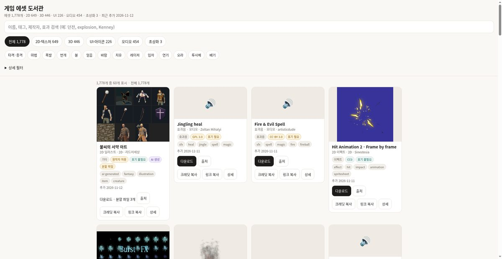

# game-asset-catalog

재사용 가능한 게임 에셋 라이브러리의 중앙 카탈로그입니다.
실제 파일은 유형별 저장소에 두고, 여기에 모든 에셋의 출처·라이선스·작가·장르 태그를 기록합니다.

**총 2,541팩입니다.** (catalog.csv 기준, 아래 저장소 표의 팩 수 합계와 같습니다.)

※ Quaternius 팩: 팩 페이지는 CC0로 표기하지만 Quaternius 사이트의 공통 라이선스(QAL)는 에셋 단독 재배포를 제한합니다. 사용 전 원 사이트(quaternius.com)에서 확인해 주세요.

## 📸 실제 실행 화면

## 구성

이 저장소는 에셋의 **포털(중앙 카탈로그)** 입니다. catalog.csv, 사이트, 문서로 모든 에셋의 출처·라이선스·작가·장르 태그·저장소 위치를 기록합니다.
실제 파일은 아래 **유형별 저장소**에 들어 있습니다. 각 팩 폴더에는 zip, pack.md, 미리보기, LICENSE-SOURCE.txt, 라이선스 전문, CREDITS.txt가 함께 있습니다.

| 저장소 | 내용 | 팩 수 |
| --- | --- | ---: |
| [assets-2d-pixel](https://github.com/sigco3111/assets-2d-pixel) | 2D 픽셀 스프라이트, 타일셋, 이펙트, 텍스처 | 732 |
| [assets-3d-lowpoly](https://github.com/sigco3111/assets-3d-lowpoly) | 3D 로우폴리 모델 (1호, GLB·OBJ) | 508 |
| [assets-3d-lowpoly-2](https://github.com/sigco3111/assets-3d-lowpoly-2) | 3D 로우폴리 모델 (2호) | 293 |
| [assets-3d-polyfork](https://github.com/sigco3111/assets-3d-polyfork) | 3D 모델 (Polyfork 자동 수집) | 132 |
| [assets-ui-icons](https://github.com/sigco3111/assets-ui-icons) | UI 키트, 아이콘 | 261 |
| [assets-audio](https://github.com/sigco3111/assets-audio) | 효과음, 배경음악 (OGG) | 575 |
| [assets-2d-portraits](https://github.com/sigco3111/assets-2d-portraits) | 2D 초상화 | 3 |
| [assets-code](https://github.com/sigco3111/assets-code) | 재사용 코드 모듈 (TypeScript·JavaScript) | 37 |
| **합계** | | **2,514** |

## 사이트와 검색

- 카탈로그 사이트: https://sigco3111.github.io/game-asset-catalog/ (이름·태그·제작자·라이선스로 검색, 미리보기)
- 전체 목록: [catalog.csv](catalog.csv). 장르는 tags 열로 검색합니다.

catalog.csv 열:

| 열 | 내용 |
| --- | --- |
| name | 팩 이름 |
| repo | 팩이 올라간 유형별 저장소 |
| file | 저장소 안의 zip 파일 이름 |
| type | 에셋 종류 (예: 2D 타일셋, 3D 모델, 효과음) |
| tags | 장르·특징 태그 (쉼표로 구분, 검색용) |
| author | 제작자 |
| source_url | 원본 배포 페이지 |
| license | 라이선스 (원본 페이지에서 확인한 표기) |
| attribution | 귀속 표기 문구 |
| added | 카탈로그에 추가한 날짜 |
| notes | 메모 (형식, 원본 License.txt 포함 여부, 주의 문구 등) |
| preview | 미리보기 이미지 주소 |
| sample | 샘플 음원 주소 (오디오 팩) |
| split | 분할 zip 파일 목록 |

사이트 기능, 위키·llms.txt, 자동 갱신과 용량 관리 설명은 [docs/README-DETAILS.md](docs/README-DETAILS.md)에 있습니다.

## 라이선스

### 허용 (기본 수집 대상)

| 라이선스 | 설명 |
| --- | --- |
| CC0 | 저작권을 포기한 공개 자료. 귀속 표기 없이 쓸 수 있지만 카탈로그에는 출처를 기록합니다. |
| CC-BY | 귀속 표기(작가·출처·라이선스)가 필요합니다. catalog.csv attribution 열에 표기 문구를 적습니다. |
| MIT | 저작권·허가 고지를 유지하면 사용할 수 있습니다. 라이선스 전문 파일을 팩에 함께 둡니다. |
| GPL 2.0 / 3.0 | 원본 GPL 라이선스를 그대로 유지합니다. 재배포할 때는 GPL 조건(라이선스 고지, 소스 공개 등)을 따릅니다. |
| OGA-BY | OpenGameArt의 CC-BY 계열 표기 조건으로, 출처와 작가 표기가 필요합니다. |
| Apache-2.0 | 저작권·라이선스 고지와 변경 표기를 유지하면 사용할 수 있습니다. LICENSE·NOTICE 전문을 팩에 함께 둡니다. (2026-11-20 추가) |
| OFL 1.1 | SIL 폰트 라이선스. 폰트 단독 판매는 금지, 수정 폰트는 같은 라이선스로 배포해야 합니다. OFL 전문을 팩에 함께 둡니다. (2026-11-20 추가) |

### 수록하되 사용 주의

소유자 지시(2026-11-20, "라이선스가 없어도 수집해. 사용할 수 없다고 명시하지 않으면 모두 수집해")로 아래 팩도 수록합니다. 위험을 감수하고 수록하는 것이므로 사용 전에 확인하세요.

| 라이선스 | 설명 |
| --- | --- |
| NC | 비영리 한정. 상업적 사용 불가. |
| ND | 변경 금지. 수정·파생물 제작 불가. |
| 불명확 | 출처 페이지에 라이선스 표기가 없거나 모호함. 사용 전 원작자 확인 필요. 불명확 팩은 허용 라이선스로 적지 않습니다. |

NC·ND·불명확 팩은 catalog.csv 라이선스 열에 있는 그대로 표기하고, notes 열에 주의 문구를 적습니다. 2026-11-20 기준 '알 수 없음' 팩 9건이 수록돼 있습니다 (everyday-game 3, 게임 10종 수집 6; catalog.csv 라이선스 열).

### 수록하지 않음

| 대상 | 이유 |
| --- | --- |
| CC-BY-SA 단독 | 허용 목록에 없음 |
| 구매 에셋 (Unity Asset Store, Epic/Fab 등) | 재배포가 금지되는 경우가 많음 |
| 로그인·결제 후 얻는 자료 | 공개 재배포 대상이 아님 |
| 약관이 재배포를 명시적으로 금지한 자료 | 재배포 불가 |

> NC·ND·불명확 라이선스 팩이 포함될 수 있습니다. 라이선스 열을 확인하고, 불명확 팩은 사용 전에 원작자 허락을 확인하세요. 권리자가 삭제를 요청하면 즉시 내립니다. 삭제 요청은 이 저장소의 Issues에 등록해 주세요.

### 설명

- CC-BY·MIT·GPL 팩은 귀속·저작권 표기와 조건을 catalog.csv의 attribution·notes 열에 함께 기록합니다.
- 카피레프트 안내: GPL 에셋은 원본 GPL 라이선스를 그대로 유지합니다. 에셋을 가져다 쓰는 사람이 재배포할 때는 GPL 조건(라이선스 고지, 소스 공개 등)을 따라야 합니다.

### 규칙 변경 기록

- 2026-11-08 (A15): GPL·MIT 허용. 이전에는 CC0·CC-BY만 허용.
- 2026-11-17: OGA-BY 허용.
- 2026-11-17: NC·ND·불명확 수집 허용 (희정님 결정).

## 수집 원칙

- 허용 라이선스는 위 허용 표(CC0, CC-BY, MIT, GPL 2.0/3.0, OGA-BY)입니다. 수록 주의 팩과 수록하지 않는 대상은 라이선스 섹션을 따릅니다.
- 팩 폴더에는 zip, pack.md, 미리보기, LICENSE-SOURCE.txt, 라이선스 전문, CREDITS.txt를 둡니다. AI 생성물은 pack.md에 AI 생성 여부와 도구, 출처 조건을 적습니다.
- 용량: 5MB 초과 zip은 해당 저장소의 Releases에 올립니다. 파일은 25MB 이하, 커밋은 40MB 이하로 합니다. 저장소별 용량은 docs/capacity-report.md를 봅니다.

## 출처 검증 상태

Kenney, KayKit, Quaternius 등의 출처 검증 상태와 추가 확장 기록은 [docs/SOURCE-VERIFICATION.md](docs/SOURCE-VERIFICATION.md)에 있습니다.

## 삭제 요청

저작권자가 자료 삭제를 요청하면 [Issues](https://github.com/sigco3111/game-asset-catalog/issues)에 등록해 주세요. 확인 후 즉시 내립니다.

## 수집 이력

라운드별 상세 기록은 [docs/COLLECTION-HISTORY.md](docs/COLLECTION-HISTORY.md)에 있습니다. 최근 3개 라운드:

- 2026-11-20 KOASSET-2 추가 (11팩, 총 2140팩)
- 2026-11-20 KOASSET 추가 (8팩, 총 2129팩)
- 2026-11-20 AUTO-20261120-14 추가 (3팩, 총 2121팩)
- 2026-11-20 EG-20261120 추가 (3팩, 총 2118팩)

## 문서 관리

- 새 라운드의 상세 기록은 docs/COLLECTION-HISTORY.md 맨 위에 추가하고, README는 총 팩 수와 저장소 표의 팩 수만 갱신합니다.
